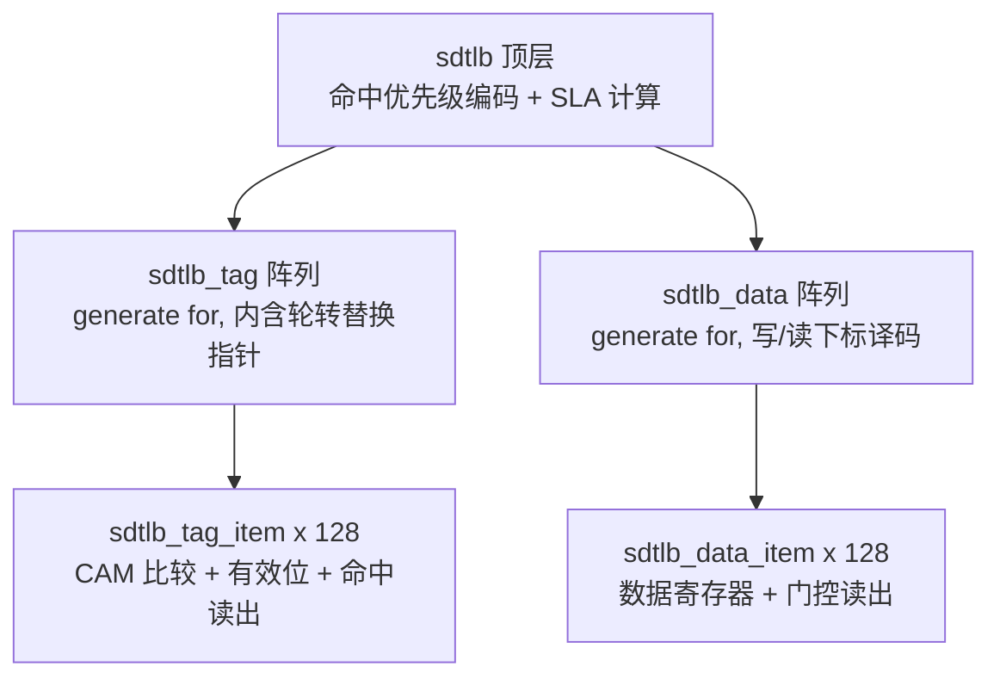

# sdtlb 实现决策与进展

| 项目 | 内容 |
| --- | --- |
| 文档名称 | sdtlb 实现决策与进展 |
| 日期 | 2026-10-06 |
| 范围 | SDTLB (Tag 阵列 + Data 阵列 + SLA 计算) 与其单元自检 |
| 上游 | [SDecoder 设计方案](../../doc/design_plan/SDecoder设计方案/SDecoder设计方案.md), [SDecoder 接口手册](../../doc/design_plan/SDecoder接口手册/SDecoder接口手册.md) |
| 说明 | 本文件只记**决策与理由**以及进展快照. 编码规范 (命名, 大括号风格, `*.svh` 与 import 约束) 见 [CONTRIBUTING.md](../../CONTRIBUTING.md), agent 每次要遵守的约定与检查命令见 [AGENTS.md](../../AGENTS.md), 设计细节与位域见上述设计文档, 这里不复制正文 |

## 模块划分与理由

- **条目 → 阵列 → 顶层三层**, 理由: 后续可能把阵列换成 RAM/SRAM 实现 (待决策项之一), 换的时候只改阵列模块内部, 顶层的端口与连线不动. 为此两个阵列的读写口都取"有效 + 下标 + 数据"的地址形式
- **Tag 与 Data 分属两个阵列模块而非一个合并模块**: 二者的读语义本来就不同 (Tag 是全并行比较, Data 是按下标读), 分开后 Tag 侧仍是 CAM 语义, 将来若改索引式 tag RAM (set-associative 口径) 只需改 `sdtlb_tag` 与它对顶层的接口
- 曾有过一版把两者合在一个 `sdtlb` 里的实现, 已弃用并留档在 [backup/rtl/sdtlb_tag.sv](../../backup/rtl/sdtlb_tag.sv) (`backup/` 不入库)

## 已定决策

| 决策 | 理由 |
| --- | --- |
| 未命中时读出全 0 (`rd_*` / `rd_sla` / `rd_sla_ovf` 都给 0) | 组合读出若不加门控会露出 `req_pa` 的残值;置 0 后上层直接以 `req_hit_vld` 判断有效性 |
| Data 读出由"命中向量逐位 OR"改为"按命中下标 `rd_idx` 译码" | 与 RAM 的地址读形式一致;单命中时两者等价, 多命中时稳定读**下标最小**那条的数据 (与 `req_hit_idx` 口径一致), 不再是把多条数据 OR 成垃圾 |
| 轮转替换指针放在 `sdtlb_tag` 内部, 以 `fill_idx` 输出 | 用户选定;写地址由 Tag 段给出, Data 段按同一下标写入, 保证 Tag/Data 同条目 |
| 无效化只清 Tag 侧 `valid`, Data 段无有效位端口 | 设计方案的无效化只清 `Valid`;数据段的有效性由同下标 Tag 条目代表 |
| 无效化的 `inv_match` **刻意不含** `tag_item.valid` | 若含有效位, 条目当前无效时清位分支不会被选中, 同拍的装填会把覆盖"正在被刷新地址"的映射填进去. 变异测试 (把有效位加回条件) 令该用例 FAIL, 已固定为回归用例 |
| SLA 计算放在顶层 `sdtlb`, 段式与页式共用一条公式 | 设计方案 §代换结果计算;页式的 `pa_base[34:30] == pa_up[34:30]` 使偏移自然为 0. 加法进位作为 `rd_sla_ovf` 给上层报地址非法 |
| 命中下标多命中取最小 | 设计方案 §命中判断;同时让"按命中下标读数据"有确定行为 |
| 断言拆两处: `PA[47]=0` 放 tag 条目, `$onehot0(req_hit)` 放 tag 阵列 | 各自放在"产生该约束的模块"里: 条目是请求地址的入口, 阵列是命中向量的产生者 |

## 断言与头文件机制

- 断言宏 (`assert_clk` / `assert_x_value`) 与总开关 `ASSERT_ON` 放在 [rtl/sdecoder_constants.svh](../../rtl/sdecoder_constants.svh);`ASSERT_ON` 由 [simulation/base/option/compile_define.f](../../simulation/base/option/compile_define.f) 默认打开
- `rtl/sdecoder-undef.svh` 作为 filelist 中该段的**末行**做清理, 把该段用到的 `ifndef` 守卫**全部**清掉, 含 `_SDECODER_PKG_SVH_` (参照 Synopsys 的口径: 段末把宏状态清干净). 常量头守卫必须清, 否则下一段再 `include` 常量头会被守卫跳过而拿不到宏 (实测不补 => `Error-[UM] Undefined macro`)
- **由此定下的硬约束**: 已被前面段处理过的 `*.svh` 不允许在后续段再 `include`. testbench 侧要用包里的名字, 靠 `import sdecoder_pkg::*;` (参见 [sdtlb_if.sv](../../testbench/top/interface/sdtlb_if.sv) 把 import 放在接口头), 不要再写 `` `include "sdecoder_pkg.svh" `` —— 守卫已清, 再 include 就是把 `package` 声明读第二遍, 同一编译单元里重复定义 (实测 => `Error-[SV-PPD] Package previously declared`)
- 代价 (已知并接受): testbench 环境不能再 `include` DUT 段已经处理过的 `*.svh`, 自包含性靠 `import` 维持;这条口径已写入 [CONTRIBUTING.md](../../CONTRIBUTING.md) 的 `*.svh` 小节
- `*.svh` 一律带 `ifndef` 守卫的理由: 同一段内包/常量头会被多个文件 include, 守卫是防重复定义的第一道闸

## 关键坑与结论 (供后来人避雷)

| 现象 | 结论 |
| --- | --- |
| `logic [16:0] x = expr;` 后仿真里 `hit` 全是 X | 变量声明初始化只在 0 时刻赋一次, 不是持续赋值;组合信号要么 `wire x = expr;` 要么 `logic x; assign x = expr;` |
| 断言宏展开后报错落在 `endmodule` | 常量头里两个宏的正文末尾**没有分号**, 调用点必须自己补 `;` (定义处已注明) |
| 接口里 `timeunit` 报 `Error-[SV-MTU] Misplaced timeunit` | `timeunit`/`timeprecision` 必须是接口体里最前面的声明, 放在 `import` 之后即报错 |
| 既用 clocking block 又裸赋值写同一信号 | clocking block 的 `output` 会被该块持续驱动 (内部变量初值 X), 二者混用会出现多驱动/被 X 覆盖;驱动只能走一条路 |
| `make` 退出码为 0 但自检失败 | VCS 即使 `$fatal` 退出码也是 0;判定必须看 `log/simv.log` 里的 `RESULT: PASS\|FAIL` 行 |
| 无守卫的包头被多个文件 include | `Error-[SV-PPD] Package previously declared` |
| 清了包头守卫后又去 `include` 包头 | 同样报 `Error-[SV-PPD]`: `undef` 删的是**宏**, 已声明的 package 不会消失, 所以包里的名字仍可用 (`import`), 但文本不能再来一遍 |

## 自检(testbench)决策

- **单时钟域 → 无 `#NUM`**: 时钟与复位一律由 [testbench/top/crg.sv](../../testbench/top/crg.sv) 生成;同步等时钟块事件 `@(sdtlb_vif.drv)`;驱动与读出之间隔一个事件, 组合逻辑早已稳定, 所以不需要延时
- **接口 + 时钟块**: [testbench/top/interface/sdtlb_if.sv](../../testbench/top/interface/sdtlb_if.sv) 打包信号并给出 `drv` (驱动 + 回读) 与 `mon` (只采样) 两个时钟块;命中/数据/SLA 是同拍组合量, 因此**直接读裸接口信号**, 不走时钟块采样 (时钟块只在沿上取值, 不适合同拍组合量)
- **波形默认出**: Makefile 的 `DUMP_WAVE` 默认 1 (目前 tb 体量小, 不认为会拖慢仿真;要关掉传 `DUMP_WAVE=0`);回归脚本仍显式 `DUMP_WAVE=0`, 排查问题按单测跑并开波形;单元自检的波形文件名与 `tb_top` 共用 `test_pkg` 里的常量

## 进展快照

- RTL: `sdecoder_pkg.svh` / `sdecoder_constants.svh` / `sdecoder-undef.svh` / 两个条目 / 两个阵列 / `sdtlb` 顶层
- 自检: `tb_sdtlb` 28 条 (已改为接口 + `drv` + crg, 无 `#NUM`), `tb_sdtlb_tag_item` 43 条 (仍是裸信号 + `#NUM` 风格)
- 验证结论: `make -C simulation all` 与四个模块各自 elaborate 均 0 error / 0 warning;上述两支自检全部 PASS;SLA 的页式偏移 0、段式偏移入 `SLA[47:30]`、溢出报出、未命中置 0 均有用例覆盖

## 待决策

1. `tb_sdtlb_tag_item` 的 `#NUM` 清理: 需要给它配一个 `sdtlb_tag_item_if`, 用 `mon` 时钟块的**输入偏斜**观测沿前值, 才能无延时地保住 `same-cycle keeps old` 这类检查;中途拉异步复位那条用例要改成"复位释放后确认条目无效"
2. 替换策略: 轮转 (现状) 还是伪随机 (参考 CORE 内 TLB);影响是否要引入命中下标驱动的状态更新
3. 条目用 FF 还是 RAM 实现 (直接决定阵列模块内部怎么写)
4. `req_hit_idx` 是否作为顶层端口保留 (现仅内部用于读数据);`rd_sla_ovf` 的命名与异常上报形式;顶层是否保留 `rd_pa_base` / `rd_pa_up` (现为观测用)
5. `grn` 目前不参与 SLA 计算 (与设计一致), 后续 SMD 组装是否要用

## 尚未开始

未命中队列 + SDPTW Page Walk 状态机 (`tw_*` 主端口);`rsp_*` 响应与 SMD 三元组组装、异常码上报;`cfg_*` 配置与刷新接口 (`cfg_inv_busy`、刷新期间阻塞回填);`PA[47] = 1` 的 IO 空间请求在顶层的异常通路 (目前只有 tag 条目里那条断言守着这个前提).

## 变更记录

| 日期 | 说明 |
| --- | --- |
| 2026-10-06 | 首版: 汇总 SDTLB 已定决策, 关键坑与结论, 自检决策, 进展快照与待决策项 |
| 2026-10-06 | 头文件口径定为 P1: 段末 `*-undef.svh` 连包头守卫一起清 (Synopsys 口径), 后续段不得再 `include` 已处理过的 `*.svh`, 改用 `import`;修正首版里"刻意不清包头守卫"的错误说法, 并写入 CONTRIBUTING.md |
| 2026-10-06 | 波形口径改为**默认出**: Makefile 的 `DUMP_WAVE` 默认 1, 理由是目前 tb 体量小、不认为拖慢仿真;同步修正首版"波形默认关"的说法与两个 tb 里对应的注释 |
