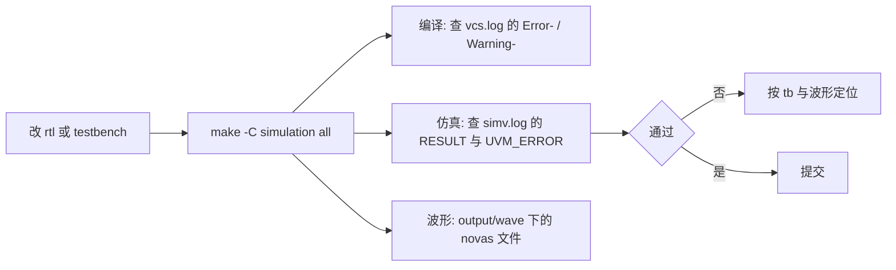

# CONTRIBUTING

| 项目 | 内容 |
| --- | --- |
| 文档名称 | CONTRIBUTING (编码规范) |
| 日期 | 2026-10-06 |
| 范围 | 本仓库的编码规范: SystemVerilog (UVM 使用规范待补) |
| 说明 | 人读的规范. agent 的常驻入口见 [`AGENTS.md`](AGENTS.md): 那里只放每次都要遵守的约定, 细节一律指向本文件 |

## 写 Verilog / SystemVerilog 文件

改动 `rtl/` 后, 在**仓库根目录**跑一遍编译与冒烟:

```bash
make -C simulation all
```

### 代码风格

#### 文件名

- 文件名与 `module/interface/package/class` 名一致
- package 以 `_pkg.svh` 结尾
- interface 以 `_if` 结尾
- module 推荐全小写, 下划线式 (不强制)
- `*.svh` 文件以 `ifndef` 宏保护 (避免多次 `include` 导致的重复定义)
  - rtl 里通常 `*.svh` 使用 `include` 导入
  - testbench 里 `*.svh` 可以 `include` 导入, 也可以在 filelist 里导入, 但**已被前面段处理过的
    `*.svh` 除外** (见下一条)
  - `*-undef.svh` 不使用 `include` 导入, 人工约束 `*-undef.svh` 只能在 filelist 的对应段末尾导入
  - 段末的 `*-undef.svh` 会把该段用到的 `ifndef` 守卫一并清掉 (含 `*_pkg.svh` 的守卫, 参照
    Synopsys 的口径: 段末把宏状态清干净). 因此**已被前面段处理过的 `*.svh` 不允许在后续段再
    `include`**, 后续段用 `import <pkg>::*;` 使用其中的 package —— 再 `include` 会在同一个
    编译单元里重复定义, 报 `Error-[SV-PPD] Package previously declared`

#### 文件内命名

- 类型名 (如类, 结构体, 枚举)：单个大写字母开头
- 变量名：小写字母开头
- 参数与宏: 全大写字母, 下划线式
- 多词命名
  - 类: 大驼峰式 (PascalCase)
  - 对象: 小驼峰式 (camelCase)
  - 结构体/枚举: 大写字母开头, 下划线式
  - 其他: 小写字母开头, 下划线式

#### 缩进与大括号

- `begin` 放在语句同一行的末尾，而不是另起一行
- `else` 另起一行, 与 `if` 对齐

例子

```systemverilog
always_ff @(posedge clk or negedge rst_n) begin
    if (!rst_n) begin
        r <= '0;
    end
    else if (valid) begin
        r <= i;
    end
end
```

#### 其他代码风格要求

- `rtl/` 下的设计代码**禁用 function / task** (不去挑战 EDA 工具)
- `testbench/` 下的验证代码可以不受限使用 Verilog / SystemVerilog 新语法特性
- `virtual interface` 使用 `_vif` 结尾
- 普通 `for` 循环的变量用 `int i/j/k`, `generative for` 的变量用 `genvar_i/j/k`

## 仿真流程

统一入口是 `simulation/Makefile`, 命令都在**仓库根目录**执行.

| 变量 | 默认 | 作用 |
| --- | --- | --- |
| `TB_TOP` | `tb_top` | 仿真的顶层. UVM 冒烟用 `tb_top`;单元自检用 `tb_sdtlb` |
| `TESTNAME` | `TestBase` | UVM 的 `+UVM_TESTNAME`;单元自检用不到, 只参与运行目录命名 |
| `DUMP_WAVE` | `1` | 1 = 出 FSDB 波形 (目前 tb 体量小, 默认出);0 = 不出 |

常用目标: `all` (编译 + 仿真 + 收尾清软链), `vcs` (只编译 / elaborate), `simv_only` (只跑已编译
好的 `simv`), `verdi` (开波形), `clean` (清软链).



- **判定看日志, 不看退出码**: VCS 即使碰到 `$fatal`, 退出码仍是 0. 单元自检看 `log/simv.log` 里的
  `RESULT: PASS|FAIL` 行;UVM 冒烟看 `UVM_ERROR` / `UVM_FATAL` 计数;编译阶段看 `log/vcs.log` 里
  有没有 `Error-[` / `Warning-[`
- **产物与清理**: 运行目录是 `simulation/run_single_testcase/<TB_TOP>.<TESTNAME>/` (回归用
  `run_regress_testcase/`), 已 gitignore, 不入库. `all` / `clean` 只删目录里的软链, **日志与波形
  会留着** —— 换 `DUMP_WAVE` 或换测试重跑前先删运行目录, 否则会看到上一轮的旧波形 / 旧日志
- **波形**: 落在运行目录的 `output/wave/` 下 (`novas.vf` + `novas_000.fsdb`), 用
  `make -C simulation verdi` 打开. 回归由 `script/regression_run.py` 驱动, 那里显式
  `DUMP_WAVE=0` (回归不存波形), 排查问题按单测跑并开波形
- **写 tb 的时序口径**: SDecoder 是单时钟域时序模块, tb 内不出现 `#NUM` 延时 —— 时钟与复位由
  [testbench/top/crg.sv](testbench/top/crg.sv) 生成, 同步等时钟块事件 (如 `@(sdtlb_if.drv)`)
  或时钟沿, 组合量的稳定靠"隔一个事件"而不是延时. 波形 dump 用的 `$fsdbDumpvars(..., "+all")`
  不受此限
