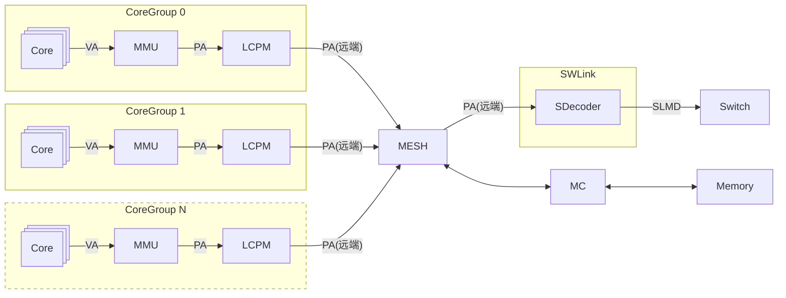
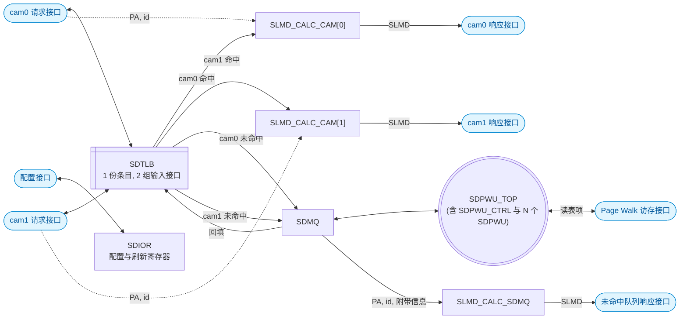
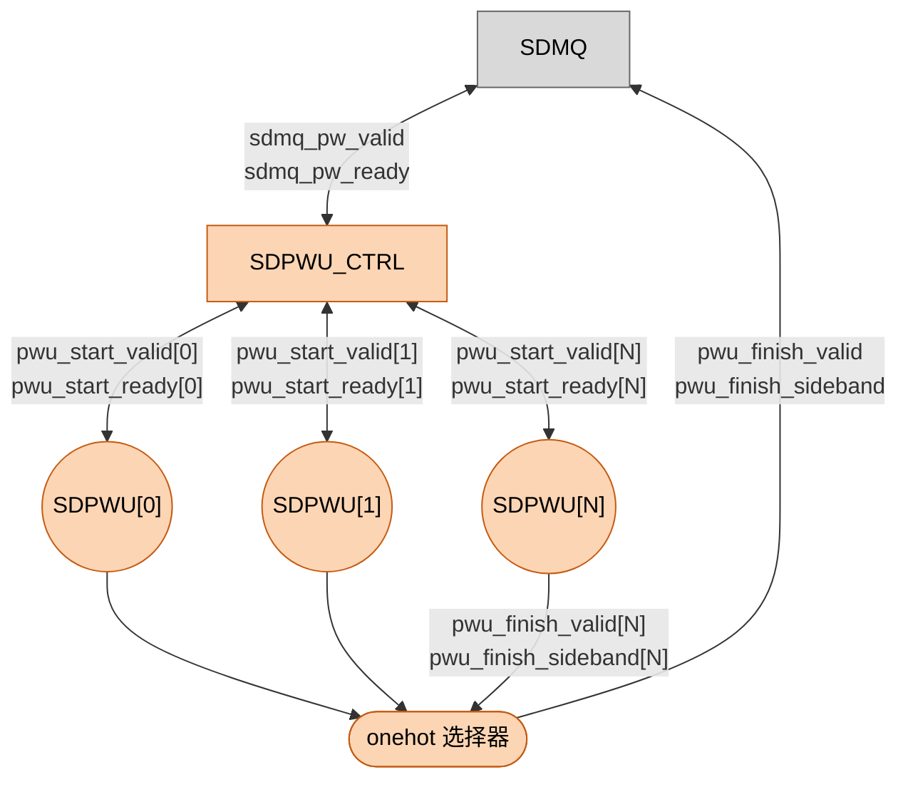
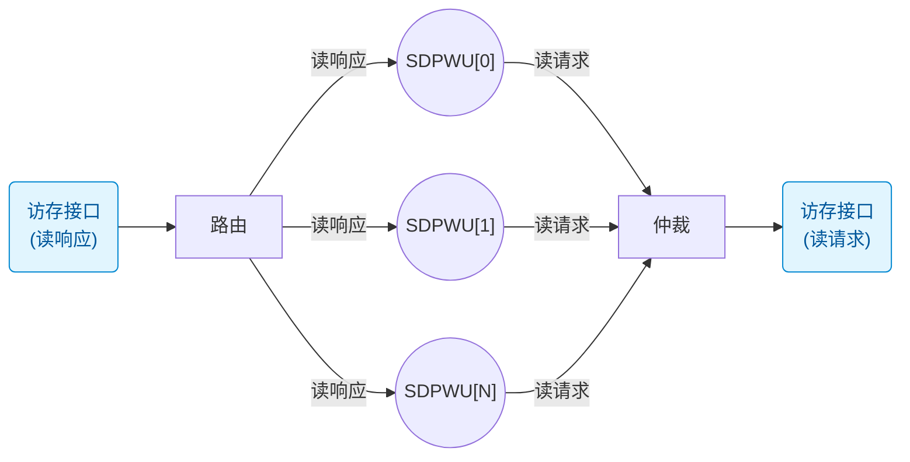
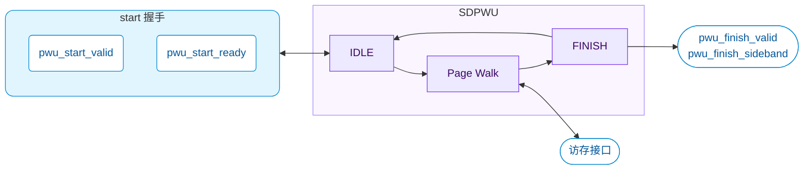
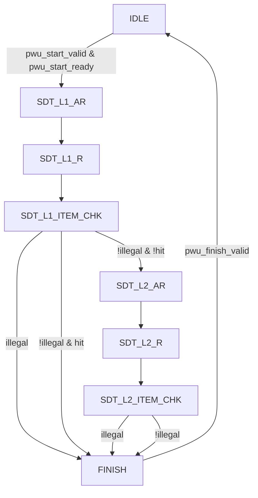
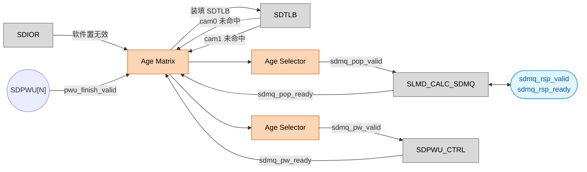
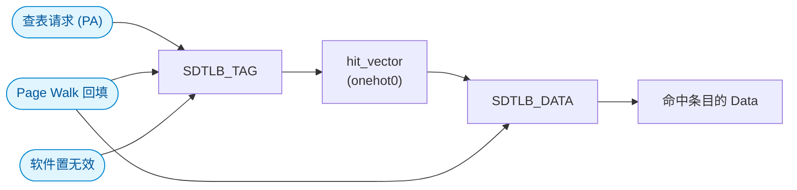

# SDecoder 详细设计方案

## 概述

### 基本功能

SDecoder 的核心功能是 **PA 到 SLMD 的代换**.

SDecoder 位于 User 侧 (内存物理资源的访问方), 挂在 SWLink 内, 它一方面接收从 MESH 网络传来的远端 PA 访问请求, 另一方面将这些请求转为 SLMD 并发送出去



图: SDecoder 在系统中的位置

### 性能要求

1. 2 路请求独立, 并行处理
2. 命中通路流水线处理, 只特殊情况下阻塞流水线
3. 设置 N 个 SDPWU, 但共用 1 组访存接口
4. 乱序响应

### 术语

| 缩写 | 全称 |
| --- | --- |
| CAM | Content Addressable Memory |
| EID | Entity Identifier |
| IOR | IO Register |
| MC | Memory Controller |
| MMU | Memory Management Unit |
| MQ | Miss Queue |
| VA | Virtual Address |
| PA | Physical Address |
| PFN | Page Frame Number |
| PTBR | Page Table Base Register |
| PTE | Page Table Entry |
| PW | Page Walk |
| PWU | Page Walk Unit |
| RSVD | Reserved |
| SDecoder | SWLink Decoder |
| SDIOR | SDecoder IO Register |
| SDMQ | SDecoder Miss Queue |
| SDPWU | SDecoder Page Walk Unit |
| SDPWU_CTRL | SDPWU Control |
| SDPWU_TOP | SDPWU Top Level |
| SDT | SDecoder Table |
| TLB | Translation Lookaside Buffer |
| SDTLB | SDecoder TLB |
| SEG | Segment |
| SLA | SWLink Address |
| SLMD | SWLink Memory Descriptor |
| TokenID | Token Identifier |
| W1C | Write 1 to Clear |

### 参数

| 参数 | 默认值 |
| --- | --- |
| `PA_WIDTH` | 48 |
| `PA_MEM_WIDTH` | 47 |
| `SLA_WIDTH` | 53 |
| `EID_WIDTH` | 11 |
| `TOKEN_ID_WIDTH` | 11 |
| `TOKEN_VALUE_WIDTH` | 10 |
| `REQ_ID_WIDTH` | 8 |
| `SDTLB_ENTRIES` | 128 |
| `SDMQ_DEPTH` | 8 |
| `SDIOR_DATA_WIDTH` | 64 |
| `IOR_ADDR_WIDTH` | 2 |
| `SDPWU_NUM` | 4 |
| `PW_ID_WIDTH` | `$clog2(SDPWU_NUM)` |
| `PW_RDATA_WIDTH` | 128 |
| `PW_RDATA_ERR_WIDTH` | 3 |
| `SDMQ_RSP_ERR_WIDTH` | 5 |
| `CAM_RSP_ERR_WIDTH` | 1 |

注: 暂定 4 个 SDPWU, 即 SDPWU_NUM 的数量为 4

## SDecoder 微结构

### SDecoder 内部结构



2 路独立的输入请求进入同一个 SDTLB 做 CAM 查表: 命中时由对应的 SLMD_CALC_CAM 计算出 SLMD, 从该路的响应接口返回 (命中通路); 未命中时写入 SDMQ, 交由 SDPWU_TOP 做 Page Walk, Page Walk 得到的合法表项由 SDMQ 回填 SDTLB, 同时经 SLMD_CALC_SDMQ 计算出 SLMD, 并从未命中队列响应接口返回 (未命中通路)

各模块的职责如下:

- **SDTLB**: 快表存储模块, 全相联 CAM, 共 `SDTLB_ENTRIES` 个条目, 对外暴露 2 组输入接口 (CAM0/CAM1), 两组输入接口可以并行查表; 如果命中 SDTLB, 则走命中通路, 命中结果按来源从对应的响应接口返回; SDTLB 可被 SDMQ 回填; SDTLB 可被 SDIOR 置无效

- **SDMQ**: 共 `SDMQ_DEPTH` 个条目的未命中缓冲队列, 条目里主要存放 SDTLB 未命中的 PA 和请求源的 ID, 且会额外附带一些其他标识位; SDMQ 最多可以同拍接收 2 个 SDTLB 未命中请求; SDMQ 由年龄矩阵管理, 按年龄关系和标识位信息, 把 SDMQ 的条目从老到年轻输出给 SDPWU_TOP 做 Page Walk; SDMQ 可以用 Page Walk 返回的合法的表项回填 SDTLB; SDMQ 可以被 SDIOR 置无效; SDMQ 允许所有命中 PTE 的条目提前响应

- **SDPWU_TOP**: Page Walk 访存单元, 内含 SDPWU_CTRL 和 N 个 SDPWU (子状态机); 从 SDMQ 取最老的未命中请求, 在访存接口上发起 Page Walk 访存, 最多可以做两级 Page Walk; 每个 SDPWU 一次处理一个未命中请求; N 个 SDPWU 受 SDPWU_CTRL 控制, 分时复用 SDPWU_TOP 的访存接口和 SDMQ 的条目接口 (同一时刻每组接口最多只被 1 个 SDPWU 占用). SDPWU 在内部判定表项的合法性, 把表项连同合法性判定结果交给 SDMQ, 并由 SDMQ 回填 SDTLB; SLMD_CALC_SDMQ 负责拼装 SLMD 或返回异常响应

- **SLMD_CALC**: 计算 SLMD 的模块, 分为 3 个实例, 分别对应 cam0 命中, cam1 命中, 未命中队列响应 (SDMQ 条目弹出); 3 个实例相互独立, 每个实例只驱动对应的响应接口

- **SDIOR**: 配置 SDecoder 内部寄存器, 用于输出其他模块使用的可配置参数, 发起刷新命令, 统计异常信息等

注: SDecoder 内部结构图上只画了 SDIOR 的配置接口, SDIOR 输出的置无效 (刷新) 命令同时作用于 SDTLB 与 SDMQ, SDIOR 统计的异常信息从 SDecoder 顶层输出, 详细内容见后续章节

### 接口分组

| 接口信号 | 定位 | 方向 | 说明 |
| --- | --- | --- | --- |
| `cam0_req_*` | Slave | 输入 | 上游 master 发起的请求 |
| `cam0_rsp_*` | Slave | 输出 | cam0 命中时返回 SLMD |
| `cam1_req_*` | Slave | 输入 | 上游 master 发起的请求 |
| `cam1_rsp_*` | Slave | 输出 | cam1 命中时返回 SLMD |
| `sdmq_rsp_*` | Slave | 输出 | 未命中队列的响应, 条目从 SDMQ 弹出后返回的 SLMD 或错误 |
| `pw_mem_raddr*` | Master | 输出 | Page Walk 访存请求, 读地址通道, N 个 SDPWU 共用 |
| `pw_mem_rdata*` | Master | 输入 | Page Walk 访存响应, 读数据通道, N 个 SDPWU 共用 |
| `ior_*` | Slave | 输入 / 输出 | 配置内部的寄存器 |

各接口逐信号的定义见 "接口信号" 一节; 另有 `clk` / `rst_n`, 整个 SDecoder 工作在单时钟域下

除寄存器配置接口外, 其余接口均采用 valid-ready 握手, 信号名为 `*valid` / `*ready` 风格. valid-ready 握手完成于 `valid` 与 `ready` 同时为高的上升沿, 要求 `valid` 不得组合依赖 `ready`, 且 `valid` 拉高后到握手完成前荷载保持不变

由于响应**不**保序, 为了使请求和响应能够匹配, 请求和响应接口都需要带 id 号, **且同一时刻在途的 id 必须唯一**, 上游只能按 id 进行匹配, 不能依赖响应顺序进行匹配

注: 乱序响应示例: 先到的请求未命中 SDTLB, 经过长时间 Page Walk 后才能响应, 但后到的请求如果命中 SDTLB, 则会先返回这个后到的命中 SDTLB 的响应

### 命中通路

1. 接收: cam0 和 cam1 两组接口独立握手, 两路可以同拍并行接收请求
2. 命中: 两路 cam 请求对 SDTLB 进行条目查询, 命中后将 data 输出
3. 计算: 将 data, PA, id 送到对应的 SLMD_CALC 模块, 计算出 SLMD

注: CAM 命中到响应输出的通路不设 FIFO, `SLMD_CALC_CAM[n]` 接收 data, PA, id 后, 拼装成 SLMD 输出到响应接口上

注: 由于不设 FIFO, 所以上级模块应尽快从响应接口取走数据, 取走不及时会反压该路的请求接口 (请求端 ready 拉低); 如果上游有能力做到无条件接收响应, 则可以在例化 SDecoder 时将响应端的 ready 信号置为常 1

注: 命中通路通常情况下无阻塞, 会阻塞请求源请求的情况有 3 种:

1. 响应接口数据无法被取走 (ready 为 0)
2. SDMQ 将满, 避免队列溢出
3. 装填 SDTLB 的当拍 (SDTLB 采用 Latch, 不支持同拍读写)

### 未命中通路

1. 接收: cam0 和 cam1 两组接口独立握手, 两路可以同拍并行接收请求
2. 未命中: cam0 和 cam1 的未命中都写入同一个 SDMQ, 支持同拍写入 2 个请求, 只要 SDMQ 还有足够的空间就可以接收请求
   1. 由于 2 路共用 SDMQ, 且 2 路 cam 请求机会均等, 所以 SDMQ 将满时同时反压 2 路 cam 请求
3. Page Walk: SDPWU_TOP 从 SDMQ 取请求, 并分发给空闲的 SDPWU 做 Page Walk
   1. SDMQ 按年龄从老到年轻取请求, 仲裁到空闲的 SDPWU 后, 把该条目标记为 page_walk_start
   2. 每个 SDPWU 一次只能处理一个未命中请求, 最多通过 2 次访存获取到 PTE
   3. SDPWU 完成 Page Walk 后, 在 SDPWU 内部判定表项合法性, 并将 PTE 连同合法性判定结果交给 SDMQ
4. SDMQ 接收 PTE
   1. 所有 SDPWU 复用一套访存接口, 所以断言 SDMQ 一拍最多接收 1 个 PTE
   2. 接收 PTE 时 CAM 所有 SDMQ 条目, 将命中条目都标记 pte_hit, 且附带用于拼装 SLMD 的信息
   3. 接收 PTE 时, 按 sideband 中的 SDMQ 条目号, 置起对应条目的 page_walk_finish
5. 装填 SDTLB
   1. SDMQ 接收 PTE 时, 如果 PTE 对应的标记为 page_walk_start 的条目被标记为 pte_hit (说明该 PTE 覆盖它的 PA), 则用该 PTE 装填 SDTLB; 否则不装填
6. 响应 SLMD
   1. SLMD_CALC_SDMQ 通过 `sdmq_pop_valid` / `sdmq_pop_ready` 从 SDMQ 取走可响应的最老条目, 握手后 SDMQ 在下一拍把该条目的 valid 置为 0
   2. SLMD_CALC_SDMQ 在握手当拍拼装 SLMD, 用 FF 寄存后, 再在响应接口上完成 valid / ready 握手

## 模块详细设计

### SDPWU_TOP

#### 地址划分

从 Core 的角度看, 虚地址 VA 为 53 位, 物理地址 PA 为 48 位. PA[47] 用于区分地址空间:

- PA[47] = 0: Mem 空间, 共 128 TB
- PA[47] = 1: IO 空间, 共 128 TB

SDecoder 只处理 Mem 空间, 因此断言 PA[47] 恒为 0, 实际有用的是 PA[46:0]; 不过虽然 PA[47] 恒为 0, 但现在 Page Table 中仍然保留该位:

1. 一级表的基地址 IOR.SDecoder_PTBR.SDT_L1_BASE[47]
2. 二级表的基地址 PTE.SDT_L2_BASE[47]

所以对于一个 PA 请求, 其位域划分如下:

| 名称 | 位域 | 说明 |
| --- | --- | --- |
| 地址空间标识 | [47] | 0: Mem 空间, 1: IO 空间 |
| 一级表索引 | [46:35] | 一级表条目**最大**覆盖 32GB |
| 二级表索引 | [34:30] | 二级表条目**固定**覆盖 1GB |
| 页内偏移 | [29:0] | 原样透传到 SLA[29:0], 不参与查表 |

软件约束:

1. 代换表必须存放在本芯片的本地 HBM / DDR 上, 不允许存放在远端池化内存中. 否则读表本身就会变成一次远端访问, 会经过一次 SWLink 环回
2. 代换表在内存中的基地址对界 (要求): 硬件只使用基地址的高位, 不对对界做检查
   1. IOR.SDecoder_PTBR.SDT_L1_BASE 按 16B 对界 (一级条目大小为 16B)
   2. PTE.SDT_L2_BASE 按 8B 对界 (二级条目大小为 8B)
3. PA 查表的索引是"基地址 + 索引 × 条目宽度", 一级表本身基地址 IOR.SDecoder_PTBR.SDT_L1_BASE 由软件填写 IO 寄存器, 二级表基地址 PTE.SDT_L2_BASE 由一级表条目提供

#### 一级表条目

| 位域 | 位宽 | 名称 | 说明 |
| --- | --- | --- | --- |
| [127:112] | 16 | RSVD | 保留 |
| [111:67] | 45 | PTE.SDT_L2_BASE[47:3] | 二级表基地址字段 |
| [66:56] | 11 | EID[10:0] | SLMD 的组成部分 |
| [55:45] | 11 | TokenID[10:0] | SLMD 的组成部分 |
| [44:35] | 10 | TokenValue[9:0] | SLMD 的组成部分 |
| [34:12] | 23 | S_PFN[52:30] | 段式代换的 SLA 基址, 以 1GB 对界 |
| [11:7] | 5 | SEG_LEN[34:30] | 段长度, 以 1GB 对界 |
| [6:2] | 5 | SEG_BASE[34:30] | 段基址, 以 1GB 对界 |
| [1] | 1 | Type | 1: 该 32GB 区间存在 1 个段式映射; 0: 该 32GB 区间均为页表 |
| [0] | 1 | Valid | 条目有效位 |

注: 一级表的条目宽度为 16B (128 bit)
注: SEG_LEN 实际上是段表偏移, 其含义类似 AXI 的 AxLEN, 实际段的长度为 (SEG_LEN + 1) * 1GB
注: 段表下界为 SEG_BASE, 上界为 SEG_BASE + SEG_LEN
注: 一级表是 "段页混合" 式的表. 每个 Type 为 1 的 32GB 区间内段式映射有且仅有 1 个, 但在二级表内同时还可以有 0/1/N 个页式映射; Type 为 0 时区间全部为页式映射
注: 优先查段式映射, 不命中再去查二级表

- 一级表条目地址
  - 按条目大小对界 (16B), 因此断言 IOR.SDecoder_PTBR.SDT_L1_BASE[3:0] 为 4'h0, 硬件取 {IOR.SDecoder_PTBR.SDT_L1_BASE[47:4], 4'h0}, 低 4 位忽略
  - 一级表条目地址 = {IOR.SDecoder_PTBR.SDT_L1_BASE[47:4], 4'h0} + PA[46:35] * 16

<br>

- 一级表命中条件
  - 一级表条目 Valid 位为 1
  - 一级表条目 Type 位为 1
  - SEG_BASE[34:30] <= PA[34:30] <= SEG_BASE[34:30] + SEG_LEN[34:30]

<br>

- 一级表命中计算 SLA
  - SLA[52:30] = S_PFN[52:30] + (PA[34:30] - SEG_BASE[34:30])
  - SLA[29:0] = PA[29:0]

<br>

- 软件约束, 不能写非法的一级表条目
  - SEG_BASE + SEG_LEN > 31
  - S_PFN[52:30] + (PA[34:30] - SEG_BASE[34:30]) 溢出

#### 二级表条目

| 位域 | 位宽 | 名称 | 说明 |
| --- | --- | --- | --- |
| [63:56] | 8 | RSVD | 保留 |
| [55:45] | 11 | EID[10:0] | SLMD 的组成部分 |
| [44:34] | 11 | TokenID[10:0] | SLMD 的组成部分 |
| [33:24] | 10 | TokenValue[9:0] | SLMD 的组成部分 |
| [23:1] | 23 | S_PFN[52:30] | 页式代换的 SLA 基址, 以 1GB 对界 |
| [0] | 1 | Valid | 二级条目有效位 |

注: 二级表条目宽度 8B (64 bit)

- 二级表条目地址
  - 按条目大小对界 (8B), 因此断言 PTE.SDT_L2_BASE[2:0] 为 3'h0, 硬件取 {PTE.SDT_L2_BASE[47:3], 3'h0}, 低 3 位忽略
  - L2 条目地址 = {PTE.SDT_L2_BASE[47:3], 3'h0} + PA[34:30] * 8

<br>

- 二级表命中条件
  - 一级表条目位域 Valid = 1
  - 一级表未命中段式映射 (Type = 0, 或 PA 不在段范围内)
  - 二级表条目位域 Valid = 1

<br>

- 二级表命中计算 SLA
  - SLA[52:30] = S_PFN[52:30]
  - SLA[29:0] = PA[29:0]

#### SDPWU_CTRL

SDPWU_CTRL 是 SDPWU_TOP 的控制单元, 负责控制 N 个 SDPWU 的启动

当 SDMQ 中存在可以 Page Walk 的最老条目, 且存在空闲的 SDPWU 时, SDPWU_CTRL 从空闲的 SDPWU 中仲裁出 1 个空闲的状态机 (轮转仲裁), 把待做 Page Walk 的条目分配给该 SDPWU, 同时把该条目的 SDMQ 条目号一并交给 SDPWU, 并在 SDMQ 中把该条目标记为 `page_walk_start`, 随后启动该 SDPWU 做 Page Walk



图: SDPWU_CTRL 的连接关系


所有 SDPWU 复用一套访存接口, 所以断言 SDMQ 一拍最多接收 1 个 PTE. 所以用一个 onehot 选择器将 N 个 SDPWU 在 Page Walk 完成的输出合并为 1 个.



图: SDPWU 复用一套访存接口示意图

#### SDPWU

每个 SDPWU 是一个独立的 Page Walk 子状态机, 由 SDPWU 模块实现, 每个 SDPWU 一次只能处理一个未命中请求, 最多通过 2 次访存获取到 PTE



图: SDPWU 的接口

上图 SDPWU 内的 "IDLE, Page Walk, FINISH" 是 SDPWU 内部状态机的示意. 其中, IDLE 和 FINISH 是 SDPWU 内实际存在的状态机, Page Walk 是多级访存多个状态机的示意

SDPWU 的开始采用 valid+ready 握手, 结束为单拍有效信号, 不需要握手

- pwu_start_valid 是 SDPWU 的输出, pwu_start_ready 是 SDPWU 的输入
- pwu_finish_valid 和 pwu_finish_sideband 是 SDPWU 的输出, 均为单拍有效信号; sideband 中含 SDMQ 条目号与 PTE 结果的非法标志 `illegal`



图: SDPWU 状态机

`illegal` 是 PTE 结果的统一非法标志, 下表描述了可能出现的非法情况, 这些情况都会作为独立的 sideband 信号在 Page Walk 完成时一并输出

表: PTE illegal 说明表

| 非法情况 | 说明 |
| --- | --- |
| pw_ctrl_err | page walk 发生控制错 |
| pw_data_ecc_err | page walk 发生数据 ECC 多错 (multi-ecc error) |
| pw_oob_access | page walk out-of-bounds access, 页表地址越界 |
| pw_pte_malformed | page walk 返回的 PTE 字段取值非法 |
| pw_pte_page_fault | 缺页异常, PTE 未建立 (Valid = 0) |

注: 目前 `SDT_L1_ITEM_CHK` 判断 `pw_pte_malformed` 的情况是段的 1GB 上界超出一级表表项的 32GB 区间, 即 `SEG_BASE + SEG_LEN > 31`

注: `SDT_L2_ITEM_CHK` 不判断 `pw_pte_malformed` 的情况

状态说明:

- `IDLE`: 空闲, 拉高 `pwu_start_valid` 向 SDPWU_CTRL 申请新的未命中请求; 在 SDPWU_CTRL 拉高 `pwu_start_ready` 完成握手后, 进入 Page Walk
- `SDT_L1_AR`/`SDT_L1_R`: 访问一级表, 读一级表表项
- `SDT_L1_ITEM_CHK`: 根据一级表表项判定 `illegal` 与段式命中 (详细状态转移关系见后面的状态转移表)
- `SDT_L2_AR`/`SDT_L2_R`: 访问二级表, 读二级表表项
- `SDT_L2_ITEM_CHK`: 根据二级表表项判定 `illegal` 与页式命中 (详细状态转移关系见后面的状态转移表)
- `FINISH`: Page Walk 结束, 单拍拉高 `pwu_finish_valid` 并附带 `pwu_finish_sideband`; 随后回到 `IDLE`

`SDT_L1_ITEM_CHK` 状态转移表

| illegal | Type | hit | 行为 |
| --- | --- | --- | --- |
| 1 | X | X | 非法 PTE 结果, Page Walk 结束 |
| 0 | X | 0 | 该 32GB 区间不存在段式映射或段式映射未命中, 前往访问二级表 |
| 0 | 1 | 1 | 段式映射命中, Page Walk 结束 |

`SDT_L2_ITEM_CHK` 状态转移表

| illegal | 行为 |
| --- | --- |
| 1 | 非法 PTE 结果, Page Walk 结束 |
| 0 | 二级表 (页表) 命中, Page Walk 结束 |

### SDMQ

#### 微结构



图: SDMQ 的内部结构

注: SDMQ 使用年龄矩阵进行管理
注: 两路 CAM 未命中的请求可以同拍装填 SDMQ 条目, `age_matrix` 随之更新年龄关系
注: 按年龄挑出最老的需要 Page Walk 的条目, 送给 SDPWU_TOP 做 Page Walk
注: 按年龄挑出最老的可以响应输出的条目, 送给 SLMD_CALC_MQ 做 SLMD 拼装或返回异常响应

#### 条目内容

SDMQ 是一个深度为 `SDMQ_DEPTH` 的队列, 每个条目主要存储 SDTLB 未命中的 PA 以及附属的一些相关信息

表: SDMQ 条目的字段 (控制类):

| 字段 | 位宽 | 说明 |
| --- | --- | --- |
| valid | 1 | 条目有效位 |
| flushed | 1 | 条目被软件置无效位 (刷新) |
| page_walk_start | 1 | 该条目已分配给 SDPWU 开始过 Page Walk |
| page_walk_finish | 1 | 该条目的 Page Walk 已结束 |
| page_walk_err | `SDMQ_RSP_ERR_WIDTH` | Page Walk 异常时带回的错误位, 位域同 `sdmq_rsp_err` |
| pte_hit | 1 | PTE 结果是否被当前条目命中 |

表: SDMQ 条目的字段 (数据类):

| 字段 | 位宽 | 说明 |
| --- | --- | --- |
| req_pa[46:0] | 47 | 未命中请求的 PA |
| req_id | `REQ_ID_WIDTH` | 未命中请求的 req_id |
| pte_hit_pa_base | 18 | 用于拼装 SLMD |
| pte_hit_eid | 11 | 用于拼装 SLMD |
| pte_hit_token_id | 11 | 用于拼装 SLMD |
| pte_hit_token_value | 10 | 用于拼装 SLMD |
| pte_hit_s_pfn | 23 | 用于拼装 SLMD |

#### 年龄矩阵

年龄矩阵的大小为 `SDMQ_DEPTH × SDMQ_DEPTH`, 记录 SDMQ 中每个条目的年龄关系, `age_matrix[i][j] = 1` 表示 SDMQ 中第 i 个条目比第 j 个条目更老

装填 SDMQ 条目时, 按照写入条目的顺序, 设置各个条目的年龄关系, 先写入的条目比后写入的条目更老

注: SDMQ 乱序弹出其中的条目 (后写入的条目可能先被弹出), 所以不能使用传统队列的读写指针控制 MISS 请求的输出, 所以这里用年龄矩阵来记录 SDMQ 中每个条目的年龄关系, 较老的条目优先输出, 即使后写入的条目先被弹出后又被装填, 该条目也是最年轻的

注: 如果 2 个 Miss 请求同拍装填 SDMQ 条目, 那么装填到条目号比较大的那个请求更年轻

#### 装填条目 (SDMQ)

当 SDTLB 未命中时, 向 SDMQ 装填条目:

1. 将 SDMQ 条目的 valid 置为 1
2. 将 SDMQ 条目非 valid 的控制类字段均置为 0
3. 将该请求的 PA[46:0] 和 req_id 也一并写入 SDMQ

装填在本拍写入, 下一拍生效; 可断言装填当拍该条目仍处于无效状态

SDMQ 可以悬挂多个请求, 但这些 Miss 请求**不做**装填条目时的相关性判断. "同一时刻在途的 id 必须唯一, 响应按 id 乱序返回, 上游按 id 匹配", 所以即使 PA[46:30] 完全相同, 它们的 id 也必然不同. 因此**不能把多个请求合并成同一个 SDMQ 条目**

SDMQ 将满时同时拉低两路请求接口的 ready 信号, 不再接受任何新的请求; 因此断言装填有效时, 一定存在空闲的 SDMQ 条目

由于 SDTLB 有 2 个 CAM 接口, SDMQ 可以同拍接收 2 条请求的条目装填, 所以 "SDMQ 将满" 指的是 SDMQ 里还剩 0 或 1 个空闲条目; 也就是说 SDMQ 的有效深度是 `SDMQ_DEPTH-1`

空闲条目数量与反压上游示例:

- 当 SDMQ 还剩 2 个空闲条目, 此时 2 个 CAM 请求接口的 ready 信号还是处于高电平. 若此时 2 个请求同时装填 SDMQ, 则 SDMQ 会被写满, 即还剩 0 个空闲条目. 2 个 CAM 请求接口的 ready 信号此时应该拉低反压上游请求, 直到 SDMQ 弹出 2 个条目后才恢复 ready 高电平
- 当 SDMQ 还剩 2 个空闲条目, 此时 2 个 CAM 请求接口的 ready 信号还是处于高电平. 若此时 1 个 CAM 请求接口装填 SDMQ, 则 SDMQ 还能剩下 1 个空闲条目. 为避免之后 2 个请求同时装填 SDMQ 而导致 SDMQ 溢出, 2 个 CAM 请求接口的 ready 信号此时**提前**拉低反压上游请求, 直到 SDMQ 弹出 1 个条目后才恢复 ready 高电平

注: 与 Core 内 DTB 不同, Core 内 DTBMQ (DTB_MISS_QUEUE) 如果只有 1 个空闲条目, 则将空闲条目分配给流水线 A 上的请求, 流水线 B 上的请求做 "DTBMQ 满" 的冲突处理; SDecoder 的 2 个 CAM 请求接口是机会均等的, 应该不会出现优先把空闲条目分配给某一路请求的情况, 所以 SDMQ 将满但未满时提前拉低 ready

#### 置无效条目

在置无效请求的当拍, 对 SDMQ 的条目进行置无效. 置无效不修改 SDMQ 条目的 valid 字段, 而是修改 SDMQ 条目的 flushed 字段

置无效操作的优先级: 装填 > 弹出 > 置无效

1. "装填" 只作用于无效条目, 装填不受同拍置无效影响. 装填条目的下一拍, 该条目的 valid 置为 1, 被装填条目的其余控制类字段均置为 0
2. "弹出" 只作用于有效条目, 弹出不受同拍置无效影响. 弹出当拍 SDMQ 送出的条目仍为有效条目, 下一拍 SDMQ 把该条目的 valid 置为 0
3. "置无效" 只把已存在的有效条目标记为 flushed

注: 事实上 "装填" 和 "弹出" 断言不会同拍有效, 因为断言装填只作用于无效条目, 断言弹出只作用于有效条目, 所以断言对同一条目, 不存在同拍同时进行装填和弹出的情况, 但代码里保留 "装填 > 弹出" 的优先级关系

注: SDMQ 条目只有 PA 信息, 没有段的概念, 而 `SDecoder_IS` 的置无效粒度是段, 两者存在语义上的分歧. 目前按 `PA[47:30]` 完全一致来实现, 即同一个 1GB 页内的所有 SDMQ 条目会一起被置无效 (待确认)

#### 弹出条目

从 SDMQ 中挑选最老的条目弹出, 候选条目需同时满足:

- `valid = 1`
- `page_walk_busy = 0`, 即该条目没有在途的 Page Walk
- 满足以下任一
  - `pte_hit = 1` (已命中 PTE)
  - `flushed = 1` (被软件置无效)
  - `page_walk_finish = 1` (Page Walk 已结束)

等价表达式: `valid & !page_walk_busy & (pte_hit | flushed | page_walk_finish)`

注: `page_walk_busy = page_walk_start & !page_walk_finish`, 当 `page_walk_busy` 为 1 时, 即使 `pte_hit` 或 `flushed` 也不参与弹出

注: 可能因为 Page Walk 出错的原因, 条目内容是 pte_hit = 0, flushed = 0, page_walk_finish = 1

弹出指 SDMQ 与 SLMD_CALC_SDMQ 之间的 `sdmq_pop_valid` / `sdmq_pop_ready` 握手

SDMQ 与 SLMD_CALC_SDMQ 握手当拍, SLMD_CALC_SDMQ 用 SDMQ 送出的条目组合拼装出 SLMD, 并用 FF 寄存该 SLMD; 这样响应接口上 valid 为 1 期间荷载可以保持不变

弹出条目的响应形式:

1. `pte_hit = 1`: 返回正常的 SLMD
2. `page_walk_finish = 1 且 pte_hit = 0`: 返回异常响应, `sdmq_rsp_err` 取该条目的 `page_walk_err`
3. `flushed = 1`: 返回无效响应, 置起 `sdmq_rsp_flushed`; 此时不需要 `sdmq_rsp_err`
4. 一条条目同时满足多个条件时, 优先级为 `pte_hit` > `flushed` > `page_walk_finish`

#### 发起 Page Walk


#### Page Walk 结束

SDMQ 收到 `pwu_finish_valid` 后:

1. 用 `pwu_finish_sideband` 中的 SDMQ 条目号找到发起本次 Page Walk 的条目, 置起它的 `page_walk_finish`
2. 如果 PTE 合法: 用 PTE 覆盖的映射范围与 SDMQ 中剩余条目做 CAM 比较, 命中的条目标记 `pte_hit`, 并写入拼装 SLMD 需要的数据 (`pte_hit_pa_base` / `pte_hit_eid` / `pte_hit_token_id` / `pte_hit_token_value` / `pte_hit_s_pfn`); 发起本次 Page Walk 的条目自身也必然命中
3. 如果 PTE 非法: 不标记 `pte_hit`, 把 `pwu_finish_sideband` 中的错误位写进发起条目的 `page_walk_err`

注: 一次 Page Walk 得到的 PTE 可以服务多个 SDMQ 条目, 一次 Page Walk 可能把多个 SDMQ 条目标记为 `pte_hit`

#### 装填 SDTLB

<!-- 避免重复装填 -->

### SDTLB

#### 微结构

SDTLB 的主要功能是缓存 PA 到 SLMD 的映射, 命中时输出对应 TLB 条目的 Data



图: SDTLB 的内部结构

| 功能 | 说明 |
| --- | --- |
| 条目数 | 128 |
| 映射覆盖范围 | 1GB 到 32GB |
| 组织结构 | 全相联 (CAM + FF + Latch) |
| 查表 | 2 个 CAM 并行读端口 |
| 写入 | 只允许硬件装填 |
| 清除 | 由刷新接口置无效 |

注: SDTLB 条目除 `Valid` 用 FF 外, 其余字段都用 Latch. Latch 被同拍读写时行为未知, 因此装填与查表不能同拍进行: 装填当拍写入 Latch, 该拍由 SDTLB 拉低所有请求端 ready 信号, 反压所有查表请求.

注: 置无效与装填同拍发生时, 置无效优先, 本次装填丢弃 (`Valid` 不被置起)

注: 虽然 Page Table 是 "一级表段式代换 (范围 1GB 到 32GB), 二级表页式代换 (固定 1GB)", 但是 SDTLB 段式和页式统一按 "段" 处理, 把 1GB 页看作长度为 1 的段, 页和段都用 `PA_Base` / `PA_Up` 的范围表示, 不设额外的粒度位

#### 条目内容

| 字段组 | 字段 | 位宽 | 存储 | 说明 |
| --- | --- | --- | --- | --- |
| Tag | `PA_Base[47:30]` | 18 | Latch | 段/页基址, 1GB 对界 |
| Tag | `PA_Up[34:30]` | 5 | Latch | 段/页上界 (含), 1GB 对界 |
| Tag | `Valid` | 1 | FF | 条目有效位 |
| Data | `EID[10:0]` | 11 | Latch | Entity 标识 |
| Data | `TokenID[10:0]` | 11 | Latch | 查找上下文使用 |
| Data | `TokenValue[9:0]` | 10 | Latch | 凭据校验使用 |
| Data | `S_PFN[52:30]` | 23 | Latch | SLA 基址, 1GB 对界 |

注: 页式条目 `SDTLB.Tag.PA_Up[34:30] = SDTLB.Tag.PA_Base[34:30]`
注: 段式条目 `SDTLB.Tag.PA_Up[34:30] = PTE.L1.SEG_BASE[34:30] + PTE.L1.SEG_LEN[34:30]`

#### 访问条目

命中条件:

1. `Valid = 1`
2. `PA[47:35] == PA_Base[47:35]`
3. `PA_Base[34:30] <= PA[34:30] <= PA_Up`

128 个 Tag 并行比较, 得到 onehot0 的 `hit_vector`; 正常情况下最多命中一个 SDTLB 条目, 多命中时数据未定义 

注: 目前考虑响应带上 "多命中异常" 标志, 并登记异常寄存器

SDTLB 的 Tag 类使用组合逻辑进行 CAM 寻找命中条目; `hit_vector` 打 1 拍后再用; 请求拍 T 时刻的命中结果固定在 T+1 时刻有效; SDTLB 的 Data 类字段用 `hit_vector` 选出命中的条目后输出

装填当拍写入 Latch, 这一拍禁止读访问条目, 即拉低请求接口的 ready 信号, 两路查表请求均被反压 (断言 fill 时请求接口不能握手)

命中后的 SLA 计算:

```text
SLA[52:30] = S_PFN[52:30] + (PA[34:30] - PA_Base[34:30])
SLA[29:0]  = PA[29:0]
```

#### 装填条目 (SDTLB)

SDTLB 只允许硬件回填, 软件不可写入

- 如果 Page Walk 命中段式映射 (一级表条目有效且落在段内), 则回填到 SDTLB 条目的 Tag 字段为
  - `PA_Base = {PA[47:35], SEG_BASE[34:30]}`
  - `PA_Up = SEG_BASE + SEG_LEN`
- 如果 Page Walk 命中页式映射 (二级表条目有效), 则回填到 SDTLB 条目的 Tag 字段为
  - `PA_Base = PA[47:30]`
  - `PA_Up = PA[34:30]`
- 装填 SDTLB 条目时, SDTLB 条目的其他字段直接取 PTE 的对应字段
  - `EID / TokenID / TokenValue / S_PFN`

只有无异常的 PTE 才会回填 SDTLB

同一拍对同一条目同时进行置无效和装填时, **置无效优先, 本次装填丢弃**

装填指针:

1. 当 SDTLB 有空闲条目时, 则优先装填数据到 SDTLB 的空闲条目中; 若有多条空闲条目, 则优先装填最低位的空闲条目
2. 当 SDTLB 没有空闲条目时, 将装填数据填入到**伪随机**选择的 SDTLB 条目中, SDTLB 不设多级结构, 被淘汰的条目将被完全丢弃, 如果后续存在条目需要用到这条条目, 则只能通过 Page Walk 重新装填

## 接口信号

缺典型时序图: wavedrom_render, 不贴在 markdown 正文里, 生成 svg 转 visio-vsdx 后粘贴到 word 里

### 请求接口 (CAM)

| 信号 | 方向 | 位宽 | 说明 |
| --- | --- | --- | --- |
| `camN_req_valid` | I | 1 | / |
| `camN_req_ready` | O | 1 | / |
| `camN_req_pa` | I | `PA_WIDTH` | / |
| `camN_req_id` | I | `REQ_ID_WIDTH` | / |

注 1: 共有 2 组请求接口 (CAM), N 可取 [0, 1], 分别对应 SDTLB 的两组输入接口 (cam0 / cam1)

### 响应接口 (CAM)

| 信号 | 方向 | 位宽 | 说明 |
| --- | --- | --- | --- |
| `camN_rsp_valid` | O | 1 | / |
| `camN_rsp_ready` | I | 1 | / |
| `camN_rsp_id` | O | `REQ_ID_WIDTH` | / |
| `camN_rsp_eid` | O | `EID_WIDTH` | / |
| `camN_rsp_token_id` | O | `TOKEN_ID_WIDTH` | / |
| `camN_rsp_token_value` | O | `TOKEN_VALUE_WIDTH` | / |
| `camN_rsp_sla` | O | `SLA_WIDTH` | / |
| `camN_rsp_err` | O | `CAM_RSP_ERR_WIDTH` | / |

注 1: 共有 2 组响应接口 (CAM), N 可取 [0, 1], 分别对应 SDTLB 两组输入接口 (cam0 / cam1) 的响应

`camN_rsp_err` 位域含义:

| 名称 | 位域 | 说明 |
| --- | --- | --- |
| `tlb_multi_hit` | [0] | CAM 命中多条 SDTLB 条目 |

注: 当软件修改了 Page Table 但未对 SDTLB 做刷新, 可能会出现 SDTLB 中存在多个条目命中同一个 PA 的情况, 即 CAM 命中 SDTLB 的条目不唯一

### 响应接口 (SDMQ)

| 信号 | 方向 | 位宽 | 说明 |
| --- | --- | --- | --- |
| `sdmq_rsp_valid` | O | 1 | / |
| `sdmq_rsp_ready` | I | 1 | / |
| `sdmq_rsp_id` | O | `REQ_ID_WIDTH` | / |
| `sdmq_rsp_eid` | O | `EID_WIDTH` | / |
| `sdmq_rsp_token_id` | O | `TOKEN_ID_WIDTH` | / |
| `sdmq_rsp_token_value` | O | `TOKEN_VALUE_WIDTH` | / |
| `sdmq_rsp_sla` | O | `SLA_WIDTH` | / |
| `sdmq_rsp_err` | O | `SDMQ_RSP_ERR_WIDTH` | / |
| `sdmq_rsp_flushed` | O | 1 | 条目被软件置无效 (刷新), 本次返回无效响应 |

`sdmq_rsp_err` 位域含义:

| 名称 | 位域 | 说明 |
| --- | --- | --- |
| `pw_ctrl_err` | [4] | page walk 发生控制错 |
| `pw_data_ecc_err` | [3] | page walk 发生数据 ECC 多错 (multi-ecc error) |
| `pw_oob_access` | [2] | page walk out-of-bounds access, 页表地址越界 |
| `pw_pte_malformed` | [1] | page walk 返回的 PTE 字段取值非法 |
| `pw_pte_page_fault` | [0] | 缺页异常, PTE 未建立 (Valid = 0) |

注: pw_oob_access 包含了 "1 级表地址越界" 和 "2 级表地址越界"

注: `pw_pte_page_fault` 指缺页异常, 即 PTE 未建立 (Valid = 0); `pw_pte_malformed` 指 PTE 字段取值非法

### 访存接口 (Page Walk)

访存接口的 "读地址通道" 和 "读数据通道分离"

读地址通道:

| 信号 | 方向 | 位宽 | 说明 |
| --- | --- | --- | --- |
| `pw_mem_raddr_id` | O | `PW_ID_WIDTH` | / |
| `pw_mem_raddr` | O | `PA_WIDTH` | / |
| `pw_mem_raddr_valid` | O | 1 | / |
| `pw_mem_raddr_ready` | I | 1 | / |

读数据通道:

| 信号 | 方向 | 位宽 | 说明 |
| --- | --- | --- | --- |
| `pw_mem_rdata` | I | `PW_RDATA_WIDTH` | / |
| `pw_mem_rdata_id` | I | `PW_ID_WIDTH` | / |
| `pw_mem_rdata_valid` | I | 1 | / |
| `pw_mem_rdata_ready` | O | 1 | / |
| `pw_mem_rdata_err` | I | `PW_RDATA_ERR_WIDTH` | / |

`pw_mem_rdata_err` 位域含义:

| 名称 | 位域 | 说明 |
| --- | --- | --- |
| `pw_ctrl_err` | [2] | page walk 发生控制错 |
| `pw_data_ecc_err` | [1] | page walk 发生数据 ECC 多错 (multi-ecc error) |
| `pw_oob_access` | [0] | page walk out-of-bounds access, 页表地址越界 |

### 寄存器配置接口

| 信号 | 方向 | 位宽 | 说明 |
| --- | --- | --- | --- |
| `ior_wen` | I | 1 | 写使能 |
| `ior_waddr` | I | `IOR_ADDR_WIDTH` | 写地址 |
| `ior_wdata` | I | `SDIOR_DATA_WIDTH` | 写数据 |
| `ior_raddr` | I | `IOR_ADDR_WIDTH` | 读地址 |
| `ior_rdata` | O | `SDIOR_DATA_WIDTH` | 读数据 |

### 异常统计接口

异常统计信号不是寄存器配置接口的一部分, 但异常统计寄存器位于 SDIOR 内, 异常发生的下一拍, SDIOR 的异常统计寄存器对应位被置 1, 并直通到 SDecoder 顶层输出

| 信号 | 方向 | 位宽 | 说明 |
| --- | --- | --- | --- |
| `pw_ctrl_err` | O | 1 | page walk 发生控制错 |
| `pw_data_ecc_err` | O | 1 | page walk 发生数据 ECC 多错 (multi-ecc error) |
| `pw_oob_access` | O | 1 | page walk out-of-bounds access, 页表地址越界 |
| `pw_pte_malformed` | O | 1 | page walk 返回的 PTE 字段取值非法 |
| `pw_pte_page_fault` | O | 1 | 缺页异常, PTE 未建立 (Valid = 0) |
| `tlb_multi_hit` | O | 1 | CAM 命中 SDTLB 的条目不唯一 |

异常寄存器为 `SDecoder_ES`, 可以通过软件读出, 也可以由软件清除 (W1C)

## 可配置的寄存器

### 寄存器列表

| 序号 | 名字 | 说明 |
| --- | --- | --- |
| 0 | `SDecoder_IA` | Invalid All, 软件刷新, 置无效所有 SDTLB 条目 |
| 1 | `SDecoder_IS` | Invalid Selected, 软件刷新, 置无效指定的 SDTLB 条目 |
| 2 | `SDecoder_PTBR` | Page Table Base Register, 一级表基地址 |
| 3 | `SDecoder_ES` | Exception Summary, 异常统计寄存器 |
| 4 | `SDecoder_Perf_CTL` | Performance Control, 性能统计控制寄存器 |
| 5 | `SDecoder_SDTLB_AccessCnt` | SDTLB Access Count, SDTLB 访问计数寄存器 |
| 6 | `SDecoder_SDTLB_HitCnt` | SDTLB Hit Count, SDTLB 命中计数寄存器 |
| 7 | `SDecoder_SDT_L1_AccessCnt` | SDTLB Level 1 Access Count, 一级表访问计数寄存器 |
| 8 | `SDecoder_SDT_L2_AccessCnt` | SDTLB Level 2 Access Count, 二级表访问计数寄存器 |
