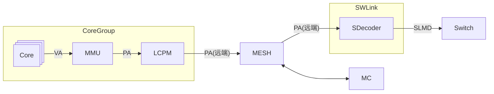
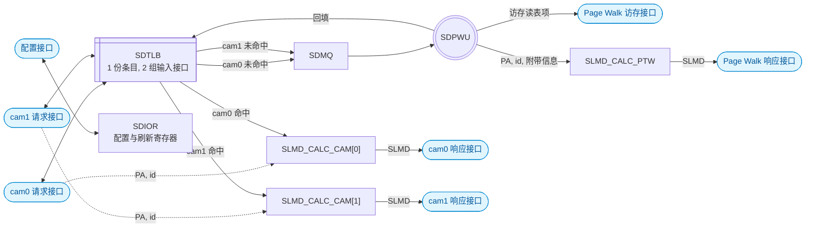
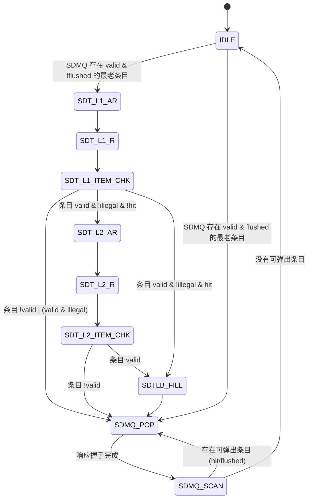
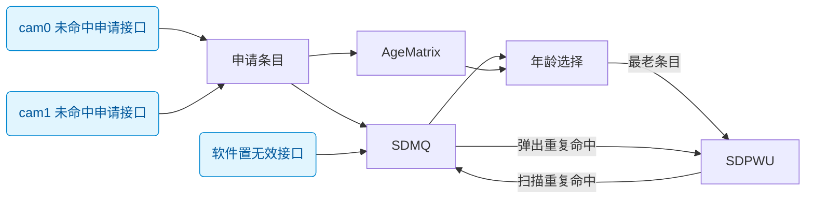
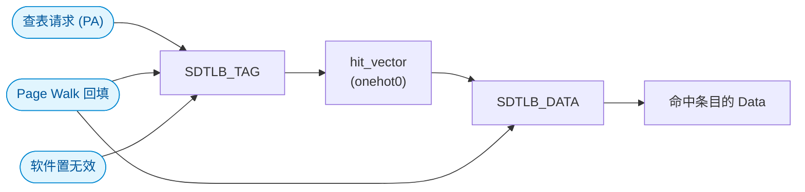

# SDecoder 详细设计方案

## 概述

### 基本功能

SDecoder 的核心功能是 **PA 到 SLMD 的代换**.

SDecoder 位于 User 侧 (内存物理资源的访问方), 挂在 SWLink 内, 它一方面接收从 MESH 网络传来的远端 PA 访问请求, 另一方面将这些请求转为 SLMD 并发送出去



图: SDecoder 在系统中的位置

### 性能要求

1. SDTLB 采用全相联结构, 双 CAM 接口, 每拍最多可并行进行 2 次查表请求
2. SDTLB 命中通路采用顺序流水线. 接收方可以无阻塞接收命中通路的响应时, 该流水线本身是无阻塞的; 但 SDMQ 将满时, 拉低请求通路的 ready 信号, 阻塞命中通路流水线, 请求接口不再接受新的请求
3. SDTLB 未命中通路在 SDecoder 内部缓存, 并做 Page Walk 访存, 最终返回 SLMD 响应. SDecoder 只设 1 组访存接口, 一次只做一条请求的 Page Walk
4. 响应不保序: hit 可以绕过 miss, 为了使请求和响应能够正确匹配, 请求和响应都带 id 号, 且要求 id 号在途唯一

### 术语

| 缩写 | 全称 |
| --- | --- |
| CAM | Content Addressable Memory |
| EID | Entity Identifier |
| IOR | IO Register |
| MC | Memory Controller |
| MMU | Memory Management Unit |
| MQ | Miss Queue |
| VA | Virtual Address |
| PA | Physical Address |
| PFN | Page Frame Number |
| PTBR | Page Table Base Register |
| PTE | Page Table Entry |
| PTW | Page Table Walker |
| PW | Page Walk |
| RSVD | Reserved |
| SDecoder | SWLink Decoder |
| SDIOR | SDecoder IO Register |
| SDMQ | SDecoder Miss Queue |
| SDPWU | SDecoder Page Walk Unit |
| SDT | SDecoder Table |
| TLB | Translation Lookaside Buffer |
| SDTLB | SDecoder TLB |
| SEG | Segment |
| SLA | SWLink Address |
| SLMD | SWLink Memory Descriptor |
| TokenID | Token Identifier |
| W1C | Write 1 to Clear |

### 参数

| 参数 | 默认值 |
| --- | --- |
| `PA_WIDTH` | 48 |
| `PA_MEM_WIDTH` | 47 |
| `SLA_WIDTH` | 53 |
| `EID_WIDTH` | 11 |
| `TOKEN_ID_WIDTH` | 10 |
| `TOKEN_VALUE_WIDTH` | 10 |
| `REQ_ID_WIDTH` | 8 |
| `SDTLB_ENTRIES` | 128 |
| `SDMQ_DEPTH` | 8 |
| `SDIOR_DATA_WIDTH` | 64 |
| `CFG_ADDR_WIDTH` | 2 |
| `PW_RDATA_WIDTH` | 128 |
| `PW_RSP_ERR_WIDTH` | 6 |
| `CAM_RSP_ERR_WIDTH` | 1 |

注: `SDIOR_DATA_WIDTH` 目前是 64 bit, 但建议用 32 bit 以匹配 APB

## SDecoder 微结构

### SDecoder 内部结构



图: SDecoder 的内部结构

SDTLB 的物理实现只有 1 份, 但有 2 组独立的输入接口 (CAM), 分别接上游的 2 个请求, 两路 CAM 请求接口可以并行查表

两路 CAM 请求未命中 SDTLB 都进入同一个 SDMQ, 由一套串行的 SDPWU 做 Page Walk, Page Walk 完成后将合法表项回填 SDTLB

响应侧有 3 个相互独立的 SLMD_CALC 模块, 分别归属 cam0 命中, cam1 命中, Page Walk 结果, 每个 SLMD_CALC 模块互不阻塞, 独自响应, 只驱动自己那条响应通道

图上只画了 SDIOR 的配置接口, SDIOR 输出的置无效 (刷新) 命令作用于 SDTLB 与 SDMQ, 统计的异常信息从 SDecoder 顶层输出, 寄存器编码见 "可配置的寄存器" 一节

### 接口分组

| 接口信号 | 定位 | 方向 | 说明 |
| --- | --- | --- | --- |
| `cam0_req_*` | Slave | 输入 | 上游 master 发起的请求 |
| `cam0_rsp_*` | Slave | 输出 | cam0 命中时返回 SLMD |
| `cam1_req_*` | Slave | 输入 | 上游 master 发起的请求 |
| `cam1_rsp_*` | Slave | 输出 | cam1 命中时返回 SLMD |
| `pw_rsp_*` | Slave | 输出 | SDTLB 未命中, Page Walk 完成后返回的 SLMD 或错误 |
| `pw_mem_ar*` | Master | 输出 | Page Walk 访存请求, 读地址通道 |
| `pw_mem_r*` | Master | 输入 | Page Walk 访存请求, 读数据通道 |
| `cfg_*` | Slave | 输入 / 输出 | 配置内部的寄存器 |

各接口逐信号的定义见 "接口信号" 一节; 另有 `clk` / `rst_n`, 整个 SDecoder 工作在单时钟域下

除寄存器配置接口外, 其余接口均采用 valid-ready 握手, 信号名为 `*valid` / `*ready` 风格. valid-ready 握手完成于 `valid` 与 `ready` 同时为高的上升沿, 要求 `valid` 不得组合依赖 `ready`, 且 `valid` 拉高后到握手完成前荷载保持不变

由于响应**不**保序, 为了使请求和响应能够匹配, 请求和响应接口都需要带 id 号, **且同一时刻在途的 id 必须唯一**, 上游只能按 id 进行匹配, 不能依赖响应顺序进行匹配

注: 例如先到的请求未命中 SDTLB, 经过长时间 Page Walk 后才能响应, 但后到的请求如果命中 SDTLB, 则会先返回这个后到的命中 SDTLB 的响应

### 模块划分

**SDTLB**: 快表存储模块, 全相联 CAM, 共 `SDTLB_ENTRIES` 个条目, 对外暴露 2 组输入接口 CAM0/1, 两路可以并行查表; 如果命中 SDTLB, 则走命中通路, 命中结果按来源从对应的响应接口返回; 可被 SDPWU 回填; 可被 SDIOR 置无效

**SDMQ**: 共 `SDMQ_DEPTH` 个条目的未命中缓冲队列, 条目里主要存放 SDTLB 未命中的 PA 和请求源的 ID, 会附带一些其他标识位; 最多可以同拍接收 2 个 SDTLB 未命中请求; SDMQ 由年龄矩阵管理, 按年龄从老到年轻输出给 SDPWU; 可被 SDIOR 置无效

**SDPWU**: 串行 Page Table Walker 访存单元, 从 SDMQ 取未命中请求, 在访存接口上发起读请求, 做最多两级 Page Walk. SDPWU 在内部判定表项的合法性: 合法结果回填 SDTLB, 并连同请求的 PA 和 id 送到 SLMD_CALC_PTW; SLMD_CALC_PTW 拼装 SLMD 或返回异常响应

**SLMD_CALC**: 计算 SLMD 的模块, 分为 3 个实例, 分别对应 cam0 命中, cam1 命中, Page Walk 完成; 3 个实例相互独立, 每个实例只驱动对应的响应接口

**SDIOR**: 配置 SDecoder 内部寄存器, 输出其他模块使用的可配置参数, 发起刷新命令, 统计异常信息

### 命中通路

1. 接收: cam0 和 cam1 两组接口独立握手, 两路可以同拍并行接收请求
2. 命中: 两路 cam 请求对 SDTLB 进行条目查询, 命中后将 data 输出
3. 计算: 将 data, PA, id 送到对应的 SLMD_CALC 模块, 计算出 SLMD

注: CAM 命中到响应输出的通路不设 FIFO, `SLMD_CALC_CAM[n]` 接收 data, PA, id 后, 拼装成 SLMD 输出到响应接口上

注: 由于不设 FIFO, 所以上级模块应尽快从响应接口取走数据, 取走不及时会反压该路的请求接口 (请求端 ready 拉低); 如果上游有能力做到无条件接收响应, 则可以在例化 SDecoder 时将响应端的 ready 信号置为常 1

### 未命中通路

1. 接收: cam0 和 cam1 两组接口独立握手, 两路可以同拍并行接收请求
2. 未命中: cam0 和 cam1 的未命中都写入同一个 SDMQ, 支持同拍写入 2 个请求, 只要 SDMQ 还有足够的空间就可以接收请求; SDMQ 将满时同时拉低两路请求接口的 ready, 不再接受新的请求
3. Page Walk: SDPWU 从 SDMQ 取请求, 并能通过最多 2 次访存获取到 PTE. SDPWU 判定表项合法性, SLMD_CALC_PTW 拼装 SLMD 并检查 SLA 溢出
   1. 表项合法: SDPWU 回填 SDTLB, 并将表项, PA, id 交给 SLMD_CALC_PTW 拼装 SLMD
   2. 表项合法: SDMQ 中 "命中同段/页" 或 "被软件置无效 (刷新)" 的条目可以被提前弹出, 并继续交由 SLMD_CALC_PTW 做 SLMD 拼装或返回异常响应
   3. 表项非法: 本次 Page Walk 结果不回填 SDTLB, 不扫描 SDMQ "命中同段/页" 的重复条目; 仍扫描 SDMQ 的 flushed 条目, 最后由 SLMD_CALC_PTW 返回异常响应

注: SDPWU 是串行的, 一次只能处理一个请求, SDMQ 按年龄从老到年轻取请求; 响应整体不保序, 上游按 ID 匹配

注: 由于两路共用 SDMQ, 且 2 路 cam 请求机会均等, 所以 SDMQ 将满时同时反压 2 路 cam 请求

## 模块详细设计

### SDPWU

#### 地址划分

从 Core 的角度看, 虚地址 VA 为 53 位, 物理地址 PA 为 48 位. PA[47] 用于区分地址空间:

- PA[47] = 0: Mem 空间, 共 128 TB
- PA[47] = 1: IO 空间, 共 128 TB

SDecoder 只处理 Mem 空间, 因此断言 PA[47] 恒为 0, 实际有用的是 PA[46:0]

虽然 PA[47] 恒为 0, 但现在 Page Table 中仍然保留该位:

1. 一级表的基地址 SDecoder_PTBR_L1[47]
2. 二级表的基地址 SDecoder_PTBR_L2[47]

所以对于一个 PA 请求, 其位域划分如下:

| 名称 | 位域 | 说明 |
| --- | --- | --- |
| 地址空间标识 | [47] | 0: Mem 空间, 1: IO 空间 |
| 一级表索引 | [46:35] | 一级表条目**最大**覆盖 32GB |
| 二级表索引 | [34:30] | 二级表条目**固定**覆盖 1GB |
| 页内偏移 | [29:0] | 原样透传到 SLA[29:0], 不参与查表 |

软件约束:

1. 代换表必须存放在本芯片的本地 HBM / DDR 上, 不允许存放在远端池化内存中. 否则读表本身就会变成一次远端访问, 会经过一次 SWLink 环回
2. 代换表在内存中的基地址对界 (要求): 硬件只使用基地址的高位, 不对对界做检查
   1. SDecoder_PTBR_L1 按 16B 对界 (一级条目大小为 16B)
   2. SDecoder_PTBR_L2 按 8B 对界 (二级条目大小为 8B)
3. PA 查表的索引是"基地址 + 索引 × 条目宽度", 一级表本身基地址 SDecoder_PTBR_L1 由软件填写 IO 寄存器, 二级表基地址 SDecoder_PTBR_L2 由一级表条目提供

#### 一级表条目

一级表的条目宽度为 16B (128 bit)

| 位域 | 位宽 | 名称 | 说明 |
| --- | --- | --- | --- |
| [127:111] | 17 | RSVD | 保留 |
| [110:66] | 45 | SDecoder_PTBR_L2[47:3] | 二级表基地址字段 |
| [65:55] | 11 | EID[10:0] | SLMD 的组成部分 |
| [54:45] | 10 | TokenID[9:0] | SLMD 的组成部分 |
| [44:35] | 10 | TokenValue[9:0] | SLMD 的组成部分 |
| [34:12] | 23 | S_PFN[52:30] | 段式代换的 SLA 基址, 以 1GB 对界 |
| [11:7] | 5 | SEG_LEN[34:30] | 段长度, 以 1GB 对界 |
| [6:2] | 5 | SEG_BASE[34:30] | 段基址, 以 1GB 对界 |
| [1] | 1 | Type | 1: 该 32GB 区间存在 1 个段式映射; 0: 该 32GB 区间均为页表 |
| [0] | 1 | Valid | 条目有效位 |

注 1: SEG_LEN 实际上是段表偏移, 其含义类似 AXI 的 AxLEN, 实际段的长度为 (SEG_LEN + 1) * 1GB
注 2: 段表下界为 SEG_BASE, 上界为 SEG_BASE + SEG_LEN
注 3: 一级表是 "段页混合" 式的表. 每个 Type 为 1 的 32GB 区间内段式映射有且仅有 1 个, 但在二级表内同时还可以有 0/1/N 个页式映射; Type 为 0 时区间全部为页式映射
注 4: 优先查段式映射, 不命中再去查二级表

一级表条目地址:

1. 按条目大小对界 (16B), 因此断言 SDecoder_PTBR_L1[3:0] 为 4'h0, 硬件取 {SDecoder_PTBR_L1[47:4], 4'h0}, 低 4 位忽略
2. L1 条目地址 = {SDecoder_PTBR_L1[47:4], 4'h0} + PA[46:35] * 16

一级表命中条件:

1. 一级表条目 Valid 位为 1
2. 一级表条目 Type 位为 1
3. SEG_BASE[34:30] <= PA[34:30] <= SEG_BASE[34:30] + SEG_LEN[34:30]

一级表命中计算 SLA:

1. SLA[52:30] = S_PFN[52:30] + (PA[34:30] - SEG_BASE[34:30])
2. SLA[29:0] = PA[29:0]

软件约束, 不能写非法的一级表条目:

1. SEG_BASE + SEG_LEN > 31
2. S_PFN[52:30] + (PA[34:30] - SEG_BASE[34:30]) 溢出

#### 二级表条目

二级表条目宽度 8B (64 bit)

| 位域 | 位宽 | 名称 | 说明 |
| --- | --- | --- | --- |
| [63:55] | 9 | RSVD | 保留 |
| [54:44] | 11 | EID[10:0] | SLMD 的组成部分 |
| [43:34] | 10 | TokenID[9:0] | SLMD 的组成部分 |
| [33:24] | 10 | TokenValue[9:0] | SLMD 的组成部分 |
| [23:1] | 23 | S_PFN[52:30] | 页式代换的 SLA 基址, 以 1GB 对界 |
| [0] | 1 | Valid | 二级条目有效位 |

二级表条目地址:

1. 按条目大小对界 (8B), 因此断言 SDecoder_PTBR_L2[2:0] 为 3'h0, 硬件取 {SDecoder_PTBR_L2[47:3], 3'h0}, 低 3 位忽略
2. L2 条目地址 = {SDecoder_PTBR_L2[47:3], 3'h0} + PA[34:30] * 8

二级表命中条件:

1. 一级表条目位域 Valid = 1
2. 一级表未命中段式映射 (Type = 0, 或 PA 不在段范围内)
3. 二级表条目位域 Valid = 1

二级表命中计算 SLA:

1. SLA[52:30] = S_PFN[52:30]
2. SLA[29:0] = PA[29:0]

#### 状态机



图: SDPWU 的状态机

注: flushed 即软件通过 IOR 对 SDecoder 进行置无效 (刷新) 操作
注: 状态机图里的「条目」有两种含义, 注意区分: 一种是 SDMQ 条目, 另一种是 PTE
注: 目前 `SDT_L1_ITEM_CHK` 判为非法的情况是段的 1GB 上界超出本条目的 32GB 区间, 即 `SEG_BASE + SEG_LEN > 31`, 软件保证二级表基地址不越界
注: `SDT_L2_ITEM_CHK` 不判断二级表 PTE 合法性

状态说明:

- `IDLE`: 空闲, 取最老的 valid 条目. 若该条目未标识为 flushed, 则进入 Page Walk 阶段; 若该条目是 flushed 条目, 则直接弹出该条目, 不做 Page Walk
- `SDT_L1_AR`/`SDT_L1_R`: 访问一级表, 读一级表条目
- `SDT_L1_ITEM_CHK`: 根据一级表条目判定命中状态, 详细状态转移关系见后面的状态转移表
- `SDT_L2_AR`/`SDT_L2_R`: 访问二级表, 读二级表条目
- `SDT_L2_ITEM_CHK`: 根据二级表条目判定命中状态, 二级表 valid 则认为命中, 否则认为未命中
- `SDTLB_FILL`: Page Walk 完成, 将合法条目回填 SDTLB
- `SDMQ_POP`: 弹出当前待响应的 SDMQ 条目, 交给 SLMD_CALC_PTW 拼装 SLMD 或返回异常响应
- `SDMQ_SCAN`: 扫描 SDMQ 中的条目, 每次选出年龄最老的可弹出条目 (命中同段/页或被软件置无效), 交给 SLMD_CALC_PTW 做 SLMD 拼装或返回异常响应


`SDT_L1_ITEM_CHK` 状态转移表

| valid | Type | illegal | hit | 行为 |
| --- | --- | --- | --- | --- |
| 0 | X | X | X | 缺页异常, 不装填 SDTLB |
| 1 | 0 | 0 | 0 | 该 32GB 区间不存在段式映射, 前往访问二级表 |
| 1 | 1 | 0 | 0 | 段式映射未命中, 前往访问二级表 |
| 1 | 1 | 0 | 1 | 段式映射命中, Page Walk 结束, 装填 SDTLB |
| 1 | X | 1 | X | 非法异常, PTE 非法, 不装填 SDTLB |

### SDMQ

#### 微结构



图: SDMQ 的内部结构

注: 两路 CAM 未命中的请求可以同拍申请 SDMQ 条目, `AgeMatrix` 随之更新年龄关系
注: 按年龄挑出最老的条目, 送给 SDPWU 做 Page Walk
注: Page Walk 完成后, 用合法的 PTE 扫描 SDMQ 中重复命中的条目 (当前条目已弹出, 不参与), 并把它们弹出送给 SDPWU, 最终移交 SLMD_CALC_PTW 做 SLMD 拼装或返回异常响应

#### 条目内容

SDMQ 是一个深度为 `SDMQ_DEPTH` 的队列, 每个条目主要存储 SDTLB 未命中的 PA 以及附属的一些相关信息

SDMQ 条目的字段:

| 字段 | 位宽 | 说明 |
| --- | --- | --- |
| Valid | 1 | 条目有效位 |
| Flushed | 1 | 条目被软件置无效位 (刷新) |
| PA[46:0] | 47 | 未命中请求的 PA |
| req_id | `REQ_ID_WIDTH` | 未命中请求的 req_id |

#### 申请条目

当 SDTLB 未命中时, 向 SDMQ 申请条目, 将该请求的 PA[46:0] 和 req_id 写入 SDMQ. 如果 SDMQ 将满, 则同时拉低两路请求接口的 ready, 不再接受任何新的请求

由于 SDTLB 有 2 个 CAM 接口, SDMQ 可以同拍接收 2 条请求的条目申请, 所以 "SDMQ 将满" 指的是 SDMQ 里还剩 0 或 1 个空闲条目; 也就是说 SDMQ 的有效深度是 `SDMQ_DEPTH-1`

SDMQ 可以悬挂多个请求, 但这些 Miss 请求**不做**申请条目时的相关性判断. "同一时刻在途的 id 必须唯一, 响应按 id 乱序返回, 上游按 id 匹配", 所以即使 PA[46:30] 完全相同, 它们的 id 也必然不同. 因此**不能把多个请求合并成同一个 SDMQ 条目**; 但一次 Page Walk 得到的 PTE 可以服务多个 SDMQ 条目, 一次 Page Walk 可能导致多个 SDMQ 条目被弹出

注: 当 SDMQ 还剩 2 个空闲条目, 此时 2 个 CAM 请求接口的 ready 信号还是处于高电平. 若此时 2 个请求同时申请 SDMQ, 则 SDMQ 会被写满, 即还剩 0 个空闲条目. 2 个 CAM 请求接口的 ready 信号此时应该拉低反压上游请求, 直到 SDMQ 弹出 2 个条目后才恢复 ready 高电平

注: 当 SDMQ 还剩 2 个空闲条目, 此时 2 个 CAM 请求接口的 ready 信号还是处于高电平. 若此时 1 个 CAM 请求接口申请 SDMQ, 则 SDMQ 还能剩下 1 个空闲条目. 为避免之后 2 个请求同时申请 SDMQ 而导致 SDMQ 溢出, 2 个 CAM 请求接口的 ready 信号此时**提前**拉低反压上游请求, 直到 SDMQ 弹出 1 个条目后才恢复 ready 高电平

注: 与 Core 内 DTB 不同, Core 内 DTBMQ (DTB_MISS_QUEUE) 如果只有 1 个空闲条目, 则将空闲条目分配给流水线 A 上的请求, 流水线 B 上的请求做 "DTBMQ 满" 的冲突处理; SDecoder 的 2 个 CAM 请求接口是机会均等的, 应该不会出现优先把空闲条目分配给某一路请求的情况, 所以 SDMQ 将满但未满时提前拉低 ready

#### 删除条目

Page Walk 完成后, 用本次 PTE 覆盖的映射范围与 SDMQ 中剩余条目做 CAM 比较; 如果条目 "命中同段/页" 或 "被软件置无效 (刷新)", 则把这些条目按年龄从老到年轻的顺序依次弹出 SDMQ, 之后经 SDPWU 交给 SLMD_CALC_PTW 做 SLMD 拼装或返回异常响应

#### 年龄矩阵

年龄矩阵的大小为 `SDMQ_DEPTH × SDMQ_DEPTH`, 记录 SDMQ 中每个条目的年龄关系, `AgeMatrix[i][j] = 1` 表示 SDMQ 中第 i 个条目比第 j 个条目更老

申请 SDMQ 条目时, 按照请求写入条目的顺序, 设置各个条目的年龄关系, 先写入的条目比后写入的条目更老

注: 因为 SDMQ 是乱序删除其中的条目的 (后写入的条目可能先被删除), 所以不能使用传统队列的读写指针控制 MISS 请求的输出, 所以这里用年龄矩阵来记录 SDMQ 中每个条目的年龄关系, 年老的条目优先输出, 即使后写入的条目先被删除后又被申请, 该条目也是最年轻的

注: 如果 2 个 Miss 请求同拍申请 SDMQ 条目, 那么申请到条目号比较大的那个请求更年轻

### SDTLB

#### 微结构

SDTLB 的主要功能是缓存 PA 到 SLMD 的映射, 命中时输出对应 TLB 条目的 Data



图: SDTLB 的内部结构

| 功能 | 说明 |
| --- | --- |
| 条目数 | 128 |
| 映射覆盖范围 | 1GB 到 32GB |
| 组织结构 | 全相联 (CAM + FF + Latch) |
| 查表 | 2 个 CAM 并行读端口 |
| 写入 | 只允许硬件装填 |
| 清除 | 由刷新接口置无效 |

段式和页式统一按 "段" 处理, 把 1GB 页看作长度为 1 的段, 页和段都用 `PA_Base` / `PA_Up` 表示, 不设额外的粒度位.

#### 条目内容

| 字段组 | 字段 | 位宽 | 存储 | 说明 |
| --- | --- | --- | --- | --- |
| Tag | `PA_Base[47:30]` | 18 | Latch | 段/页基址, 1GB 对界 |
| Tag | `PA_Up[34:30]` | 5 | Latch | 段/页上界 (含), 1GB 对界 |
| Tag | `Valid` | 1 | FF | 条目有效位 |
| Data | `EID[10:0]` | 11 | Latch | Entity 标识 |
| Data | `TokenID[9:0]` | 10 | Latch | 查找上下文使用 |
| Data | `TokenValue[9:0]` | 10 | Latch | 凭据校验使用 |
| Data | `S_PFN[52:30]` | 23 | Latch | SLA 基址, 1GB 对界 |

注: 页式条目 `PA_Base[34:30] = PA_Up`
注: 段式条目 `PA_Up = SEG_BASE + SEG_LEN`

#### 访问条目

命中条件:

1. `Valid = 1`.
2. `PA[47:35] == PA_Base[47:35]`.
3. `PA_Base[34:30] <= PA[34:30] <= PA_Up`.

- 128 个 Tag 并行比较, 得到 onehot0 的 `hit_vector`; 正常配置下最多命中一个 SDTLB 条目; 多命中时数据未定义, 但响应带多命中异常标志
- Tag CAM 比较是组合逻辑; `hit_vector` 打 1 拍后再用; 请求拍 T 时刻的命中结果固定在 T+1 时刻有效
- SDTLB 的 Data 用 `hit_vector` 选出命中的条目并输出
- 装填 SDTLB 在时钟上升沿完成, 同拍 CAM 读请求看到的是装填前的条目

命中后的 SLA 计算:

```text
SLA[52:30] = S_PFN[52:30] + (PA[34:30] - PA_Base[34:30])
SLA[29:0]  = PA[29:0]
```

#### 装填条目

SDTLB 只允许硬件回填, 软件不可写入

- 如果 Page Walk 命中段式映射 (一级表条目有效且落在段内), 则回填到 SDTLB 条目的 Tag 字段为
  - `PA_Base = {PA[47:35], SEG_BASE[34:30]}`
  - `PA_Up = SEG_BASE + SEG_LEN`
- 如果 Page Walk 命中页式映射 (二级表条目有效), 则回填到 SDTLB 条目的 Tag 字段为
  - `PA_Base = PA[47:30]`
  - `PA_Up = PA[34:30]`
- 装填 SDTLB 条目时, SDTLB 条目的其他字段直接取 PTE 的对应字段
  - `EID / TokenID / TokenValue / S_PFN`

只有无异常的 Page Walk 结果才会回填 SDTLB

当 SDTLB 有空闲条目时, 将装填数据填入到空闲的 SDTLB 条目中, 若有多条空闲条目, 则优先装填低位的空闲条目

当 SDTLB 没有空闲条目时, 将装填数据填入到**伪随机**选择的 SDTLB 条目中, SDTLB 不设多级结构, 被淘汰的条目将被完全丢弃, 只能通过 Page Walk 重新装填

同一拍对同一条目同时进行置无效和装填时, 置无效优先, 本次装填丢弃

## 接口信号

### 请求接口 (CAM)

| 信号 | 方向 | 位宽 | 说明 |
| --- | --- | --- | --- |
| `camN_req_valid` | I | 1 | / |
| `camN_req_ready` | O | 1 | / |
| `camN_req_pa` | I | `PA_WIDTH` | / |
| `camN_req_id` | I | `REQ_ID_WIDTH` | / |

注 1: 共有 2 组请求接口 (CAM), N 可取 [0, 1], 分别对应 SDTLB 的两组输入接口 (cam0 / cam1)

典型时序图: wavedrom_render, 不贴在 markdown 正文里, 生成 svg 转 visio-vsdx 后粘贴到 word 里

### 响应接口 (CAM)

| 信号 | 方向 | 位宽 | 说明 |
| --- | --- | --- | --- |
| `camN_rsp_valid` | O | 1 | / |
| `camN_rsp_ready` | I | 1 | / |
| `camN_rsp_id` | O | `REQ_ID_WIDTH` | / |
| `camN_rsp_eid` | O | `EID_WIDTH` | / |
| `camN_rsp_token_id` | O | `TOKEN_ID_WIDTH` | / |
| `camN_rsp_token_value` | O | `TOKEN_VALUE_WIDTH` | / |
| `camN_rsp_sla` | O | `SLA_WIDTH` | / |
| `camN_rsp_err` | O | `CAM_RSP_ERR_WIDTH` | / |

注 1: 共有 2 组响应接口 (CAM), N 可取 [0, 1], 分别对应 SDTLB 两组输入接口 (cam0 / cam1) 的响应

`camN_rsp_err` 位域含义:

| 名称 | 位域 | 说明 |
| --- | --- | --- |
| `camN_rsp_hit_onehot0_fail` | [0] | CAM 命中 SDTLB 的条目不唯一 |

注: 当软件修改了 Page Table 但未对 SDTLB 做刷新, 可能会出现 SDTLB 中存在多个条目命中同一个 PA 的情况, 即 CAM 命中 SDTLB 的条目不唯一

典型时序图: wavedrom_render, 不贴在 markdown 正文里, 生成 svg 转 visio-vsdx 后粘贴到 word 里

### 响应接口 (Page Walk)

| 信号 | 方向 | 位宽 | 说明 |
| --- | --- | --- | --- |
| `pw_rsp_valid` | O | 1 | / |
| `pw_rsp_ready` | I | 1 | / |
| `pw_rsp_id` | O | `REQ_ID_WIDTH` | / |
| `pw_rsp_eid` | O | `EID_WIDTH` | / |
| `pw_rsp_token_id` | O | `TOKEN_ID_WIDTH` | / |
| `pw_rsp_token_value` | O | `TOKEN_VALUE_WIDTH` | / |
| `pw_rsp_sla` | O | `SLA_WIDTH` | / |
| `pw_rsp_err` | O | `PW_RSP_ERR_WIDTH` | / |

`pw_rsp_err` 位域含义:

| 名称 | 位域 | 说明 |
| --- | --- | --- |
| `pw_ctrl_err` | [5] | Page Walk 发生控制错 |
| `pw_ecc_err` | [4] | Page Walk 发生 ECC 错 |
| `pw_page_fault` | [3] | 缺页异常 |
| `pw_illegal_pte` | [2] | PTE 非法 |
| `pw_illegal_ptbr_l2` | [1] | 二级表基地址非法 |
| `pw_illegal_ptbr_l1` | [0] | 一级表基地址非法 |

典型时序图: wavedrom_render, 不贴在 markdown 正文里, 生成 svg 转 visio-vsdx 后粘贴到 word 里

### 访存接口 (Page Walk)

| 信号 | 方向 | 位宽 | 说明 |
| --- | --- | --- | --- |
| `pw_mem_araddr` | O | `PA_WIDTH` | / |
| `pw_mem_arvalid` | O | 1 | / |
| `pw_mem_arready` | I | 1 | / |
| `pw_mem_rdata` | I | `PW_RDATA_WIDTH` | / |
| `pw_mem_rvalid` | I | 1 | / |
| `pw_mem_rready` | O | 1 | / |

典型时序图: wavedrom_render, 不贴在 markdown 正文里, 生成 svg 转 visio-vsdx 后粘贴到 word 里

### 寄存器配置接口

| 信号 | 方向 | 位宽 | 说明 |
| --- | --- | --- | --- |
| `cfg_wr_en` | I | 1 | 写使能 |
| `cfg_wr_addr` | I | `CFG_ADDR_WIDTH` | 写地址 |
| `cfg_wr_data` | I | `SDIOR_DATA_WIDTH` | 写数据 |
| `cfg_rd_addr` | I | `CFG_ADDR_WIDTH` | 读地址 |
| `cfg_rd_data` | O | `SDIOR_DATA_WIDTH` | 读数据 |

典型时序图: wavedrom_render, 不贴在 markdown 正文里, 生成 svg 转 visio-vsdx 后粘贴到 word 里

### 异常统计接口

异常统计信号不是寄存器配置接口的一部分, 但异常统计寄存器位于 SDIOR 内, 异常发生的下一拍, SDIOR 的异常统计寄存器对应位被置 1, 并直通到 SDecoder 顶层输出

| 信号 | 方向 | 位宽 | 说明 |
| --- | --- | --- | --- |
| `invalid_item` | O | 1 | 条目无效 |
| `illegal_ptbr` | O | 1 | 页表地址非法 (越界) |
| `data_ecc_err` | O | 1 | Page Walk 数据 ECC 错 |
| `ctrl_err` | O | 1 | Page Walk 控制错 |
| `other_err` | O | 1 | 其他错 |

异常寄存器为 `SDecoder_ES`, 可以通过软件读出, 也可以由软件清除 (W1C)

每个异常统计信号都是某一类异常出现过的汇总位

| 异常统计信号 | 统计类型 |
| --- | --- |
| `invalid_item` | 缺页异常 |
| `invalid_item` | PTE 非法 |
| `illegal_ptbr` | 一级表/二级表基地址非法 |
| `data_ecc_err` | Page Walk 数据 ECC 错 |
| `ctrl_err` | Page Walk 控制错 |
| `other_err` | SDTLB 多命中 |

典型时序图: wavedrom_render, 不贴在 markdown 正文里, 生成 svg 转 visio-vsdx 后粘贴到 word 里

## 可配置的寄存器

### 寄存器列表

| 序号 | 名字 | 说明 |
| --- | --- | --- |
| 0 | `SDecoder_IA` | Invalid All, 软件刷新, 置无效所有 SDTLB 条目 |
| 1 | `SDecoder_IS` | Invalid Selected, 软件刷新, 置无效指定的 SDTLB 条目 |
| 2 | `SDecoder_PTBR_L1` | Page Table Base Register (Level 1), 一级表基地址 |
| 3 | `SDecoder_ES` | Exception Summary, 异常统计寄存器 |
| 4 | `SDecoder_Perf_CTL` | Performance Control, 性能统计控制寄存器 |
| 5 | `SDecoder_SDTLB_AccessCnt` | SDTLB Access Count, SDTLB 访问计数寄存器 |
| 6 | `SDecoder_SDTLB_HitCnt` | SDTLB Hit Count, SDTLB 命中计数寄存器 |
| 7 | `SDecoder_SDT_L1_AccessCnt` | SDTLB Level 1 Access Count, 一级表访问计数寄存器 |
| 8 | `SDecoder_SDT_L2_AccessCnt` | SDTLB Level 2 Access Count, 二级表访问计数寄存器 |

### 寄存器详细说明

#### SDecoder_IA

#### SDecoder_IS

#### SDecoder_PTBR_L1

#### SDecoder_ES

#### SDecoder_Perf_CTL

#### SDecoder_SDTLB_AccessCnt

#### SDecoder_SDTLB_HitCnt

#### SDecoder_SDT_L1_AccessCnt

#### SDecoder_SDT_L2_AccessCnt


