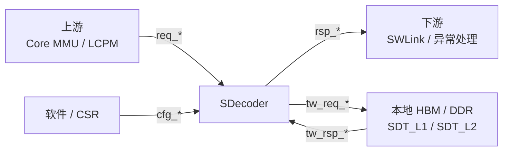
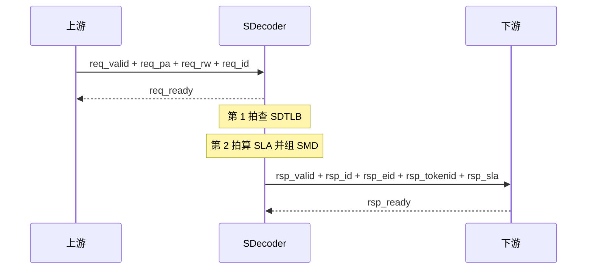
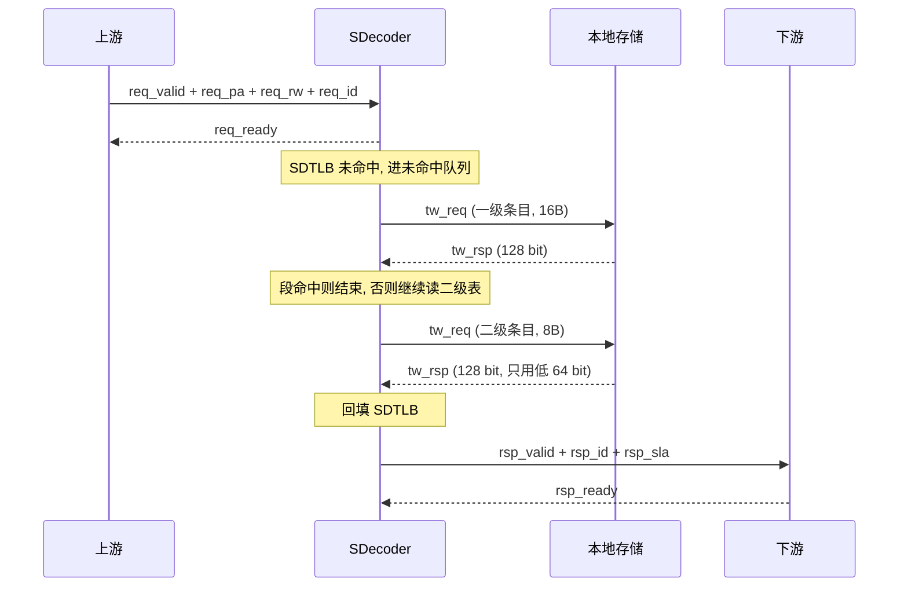

# SDecoder 接口手册

| 项目 | 内容 |
| --- | --- |
| 文档名称 | SDecoder 接口手册 |
| 版本 | v0.2 |
| 状态 | 初稿, 待确认问题已评审关闭 |
| 日期 | 2026-09-30 |
| 适用 IP | SDecoder (native 接口版本) |
| 配套文档 | [SDecoder 设计方案](../SDecoder设计方案/SDecoder设计方案.md) |

## 概述

### 本手册的作用

本手册定义 SDecoder IP 的对外接口: 端口清单, 位宽, 握手时序, 寄存器与异常码.

接口目前按 **native** (自定义同步接口) 设计, 不引入 AMBA 协议. 后续如果要交付成标准总线形态, 只需在 IP 外面加一层薄 wrapper, 见文末附录.

### 命名约定

| 约定 | 说明 |
| --- | --- |
| 方向 | 端口名不带方向后缀, 由信号表中的 I / O 标注 |
| 低有效 | 信号名以 `_n` 结尾, 例如 `rst_n` |
| 分组 | 按功能前缀分组: `req_`, `rsp_`, `tw_`, `cfg_`, 以及 `clk` / `rst_n` |
| 位宽 | 信号位宽尽量参数化, 默认值见参数表 |

### 与设计方案的关系

模块内部结构, SDTLB 与 SDPTW 的工作过程, 以及待确认问题, 见 [SDecoder 设计方案](../SDecoder设计方案/SDecoder设计方案.md). 本手册只描述 IP 边界上的行为.

## 缩写与术语

| 缩写 | 说明 |
| --- | --- |
| SDecoder | 本 IP, 完成 User 侧 PA 到 SMD 的代换 |
| SMD | 内存描述符, 即 (EID, TokenID, SLA) 三元组 |
| EID | Entity 标识, 用于 SWLink 路由 |
| TokenID | 逻辑池标识, 用于索引上下文 |
| SLA | 网络侧虚地址 |
| PA | 物理地址 |
| SDT_L1 / SDT_L2 | SDecoder 一级 / 二级代换表 |
| SDTLB / SDPTW | 本 IP 内的代换快表 / Page Walk 模块 |
| PW | 遍历代换表得到代换结果的行为, 本方案中由 SDPTW 完成 |
| IOR | IO 寄存器 |
| W1P | 写 1 触发, 硬件自清 |
| RO / RW | 只读 / 可读可写 |
| MCHK | 机器检查异常 |
| AMBA | Advanced Microcontroller Bus Architecture |

完整缩写表见 [SDecoder 设计方案](../SDecoder设计方案/SDecoder设计方案.md).

## 参数

| 参数 | 默认值 | 说明 |
| --- | --- | --- |
| PA_WIDTH | 48 | 物理地址位宽 |
| SLA_WIDTH | 48 | 网络侧虚地址位宽 |
| EID_WIDTH | 11 | Entity 标识位宽 |
| TOKENID_WIDTH | 10 | 逻辑池标识位宽 |
| REQ_ID_WIDTH | 8 | 事务标识位宽 |
| WALK_ID_WIDTH | 3 | Page Walk 访存标识位宽 |
| SDTLB_ENTRIES | 128 | SDTLB 条目数, 全相联 |
| MISS_FIFO_DEPTH | 4 | 未命中队列深度 |
| SDT_L1_ENTRY_BYTES | 16 | 一级条目字节数 |
| SDT_L2_ENTRY_BYTES | 8 | 二级条目字节数 |

## 接口总览

| 接口组 | 前缀 | 方向 | 说明 |
| --- | --- | --- | --- |
| 时钟与复位 | `clk` / `rst_n` | 输入 | IP 唯一时钟域 |
| 代换请求 | `req_` | 输入 | 上游 (核心 MMU 下游 / LCPM) 发起代换 |
| 代换响应 | `rsp_` | 输出 | 返回 SMD 或异常 |
| Page Walk 访存 | `tw_` | 主端口 | SDPTW 读本地存储中的代换表 |
| 配置与刷新 | `cfg_` | 输入 | 软件配置基地址, 置无效快表条目 |

图 1: SDecoder 接口边界. 左侧请求, 右侧响应与 Page Walk 访存, 下方为配置与刷新通路.

## 时钟与复位

| 信号 | 方向 | 位宽 | 说明 |
| --- | --- | --- | --- |
| clk | I | 1 | 主时钟, 所有信号同步于 clk 上升沿 |
| rst_n | I | 1 | 复位, 低有效, 建议异步复位同步释放 |

复位后的输出状态:

| 信号 | 复位值 | 说明 |
| --- | --- | --- |
| req_ready | 0 | 复位期间不接收请求 |
| rsp_valid | 0 | 不返回响应 |
| tw_req_valid | 0 | 不发 Page Walk 访存 |
| tw_rsp_ready | 0 | 不接收 Page Walk 数据 |
| cfg_inv_busy | 0 | 空闲 |

本 IP 只有一个时钟域, 不需要跨时钟处理. `cfg_*` 若来自慢速 CSR 时钟, 需要在 IP 外部先做同步.

## 代换请求接口

| 信号 | 方向 | 位宽 | 说明 |
| --- | --- | --- | --- |
| req_valid | I | 1 | 请求有效 |
| req_ready | O | 1 | 本 IP 可接收请求 |
| req_pa | I | PA_WIDTH | User 侧物理地址 PA[47:0] |
| req_rw | I | 1 | 0 表示读, 1 表示写; 本 IP 不做权限检查, 该信号仅用于异常登记 |
| req_id | I | REQ_ID_WIDTH | 事务标识, 原样出现在对应的响应上 |

约定:

1. `req_valid` 与 `req_ready` 同时为高的时钟上升沿完成一次请求接收.
2. `req_valid` 拉高后必须一直保持, 直到握手完成; 保持期间 `req_pa` / `req_rw` / `req_id` 不得变化.
3. `req_ready` 只由未命中队列的占用情况和 `cfg_enable` 决定, 不组合依赖 `req_valid`.
4. 本 IP 只处理 Mem 空间, 要求 `req_pa[47] = 0`. 若上游误发 `req_pa[47] = 1`, 首版按地址非法处理.
5. 本 IP 不区分请求来源 (C1/A3 核的 Load / Store, iDMA 引擎), 代换逻辑完全相同. 多来源如何汇聚到本接口, 由集成方决定.

## 代换响应接口

| 信号 | 方向 | 位宽 | 说明 |
| --- | --- | --- | --- |
| rsp_valid | O | 1 | 响应有效 |
| rsp_ready | I | 1 | 下游可接收响应 |
| rsp_id | O | REQ_ID_WIDTH | 对应请求的 `req_id` |
| rsp_fault | O | 1 | 0 表示本次返回 SMD, 1 表示本次为异常 |
| rsp_eid | O | EID_WIDTH | 仅 `rsp_fault = 0` 时有效 |
| rsp_tokenid | O | TOKENID_WIDTH | 仅 `rsp_fault = 0` 时有效 |
| rsp_sla | O | SLA_WIDTH | 仅 `rsp_fault = 0` 时有效 |
| rsp_fcode | O | 3 | 异常码, 仅 `rsp_fault = 1` 时有效 |

约定:

1. 每个被接收的请求恰好产生一个响应, 不会丢也不会多.
2. 首版按请求顺序返回响应 (先进先出). 接口保留 `rsp_id`, 方便后续支持乱序返回.
3. 下游需要按 `rsp_fault` 分流: `rsp_fault = 0` 的 SMD 送往 SWLink, `rsp_fault = 1` 的送异常处理.
4. `rsp_fault = 1` 时 `rsp_eid` / `rsp_tokenid` / `rsp_sla` 无意义, 下游不得使用.

## Page Walk 访存接口

SDPTW 通过本接口读取本地存储中的代换表, 是主端口 (master) 形态.

| 信号 | 方向 | 位宽 | 说明 |
| --- | --- | --- | --- |
| tw_req_valid | O | 1 | 读请求有效 |
| tw_req_ready | I | 1 | 本地存储可接收请求 |
| tw_req_addr | O | PA_WIDTH | 条目字节地址 |
| tw_req_size | O | 1 | 0 表示读 8B (二级条目), 1 表示读 16B (一级条目) |
| tw_req_id | O | WALK_ID_WIDTH | Page Walk 访存标识 |
| tw_rsp_valid | I | 1 | 读数据有效 |
| tw_rsp_ready | O | 1 | 本 IP 可接收读数据 |
| tw_rsp_data | I | 128 | 读回数据; `tw_req_size = 0` 时只用 [63:0] |
| tw_rsp_id | I | WALK_ID_WIDTH | 与对应 `tw_req_id` 相同 |
| tw_rsp_err | I | 2 | 读错误指示 |

约定:

1. 本 IP 只读不写, 不会发出写请求, 也不会回写 ACCESSED 之类的软件位.
2. `tw_req_addr` 落在发起访问的物理地址空间, 由本地互连决定是否可达.
3. 首版同一时刻只有一个未完成的 Page Walk 访存请求, 因此 `tw_req_id` 在本次 Page Walk 期间保持不变, 取值为该请求在未命中队列中的下标. 保留该信号是为了后续支持多个并行 Page Walk.
4. 若 `tw_req_size = 0`, 硬件只解析 `tw_rsp_data[63:0]`; 其余位忽略.
5. 本接口是延迟敏感主端口: 带宽需求很低 (只有 SDTLB 未命中时才读 1 到 2 个条目), 但一次 Page Walk 的往返时间会直接叠加到上游访存的延迟上. 集成方需保证该端口优先响应, 不被长时间饿死; 本 IP 不实现 QOS 或优先级寄存器.

## 配置与刷新接口

| 信号 | 方向 | 位宽 | 说明 |
| --- | --- | --- | --- |
| cfg_enable | I | 1 | 代换使能, 为 0 时 `req_ready` 保持低 |
| cfg_sdt_l1_base | I | PA_WIDTH | 一级表基地址, 只有 [47:4] 有效, [3:0] 被忽略 |
| cfg_inv_all | I | 1 | 单拍脉冲, 置无效全部 SDTLB 条目 |
| cfg_inv_addr_valid | I | 1 | 单拍脉冲, 置无效覆盖 `cfg_inv_addr` 的全部条目 |
| cfg_inv_addr | I | 17 | 待置无效的地址 PA[46:30] |
| cfg_inv_busy | O | 1 | 刷新进行中 |

约定:

1. 两个刷新脉冲都是单拍脉冲, 必须与 `cfg_inv_busy = 0` 的时钟沿对齐.
2. `cfg_enable = 0` 时, 已在途的请求正常处理完, 新的请求不再接收.
3. 修改 `cfg_sdt_l1_base` 后, 软件必须做一次全部置无效, 否则会残留按旧基地址算出的条目.
4. 对界: 硬件只使用 `cfg_sdt_l1_base` 的高位, 不对对界做检查. 软件约定 `cfg_sdt_l1_base` 按 64KB 对界 (一级表大小), 二级表基地址按 256B 对界.

## 时序要求

### 通用握手规则

所有 valid / ready 接口遵循同一套规则:

1. 一次传输在 `valid = 1` 且 `ready = 1` 的时钟上升沿完成.
2. `valid` 不允许组合依赖 `ready`, 否则会形成组合环.
3. `valid` 拉高后到握手完成前, 载荷必须保持不变.
4. `ready` 可以随时变化, 但一旦拉高又拉低, 不影响已经完成的传输.
5. 复位期间 `valid` 一律为 0.

### 命中时序

图 2: SDTLB 命中时的时序. 请求握手后 2 拍出响应, 响应与请求用 `rsp_id` 关联.

### 未命中时序

图 3: SDTLB 未命中时的时序. 响应延迟为 2 拍查表加 Page Walk 访存时间.

### 背压

| 场景 | 表现 |
| --- | --- |
| 未命中队列满 | `req_ready` 拉低, 上游需要保持请求直到被接收 |
| 下游不接收响应 | `rsp_valid` 保持拉高; 结果寄存器被占满后, 上游请求也会被反压, `req_ready` 拉低 |
| 刷新进行中 | `cfg_inv_busy = 1`, 期间 Page Walk 回填被阻塞 |

## 寄存器列表

下表是软件可见的 IOR. 首版不实现 APB 从口, 这些寄存器由 `cfg_*` 端口直接体现; 后续封装时一一对应.

| 偏移 | 名称 | 属性 | 位域 | 说明 |
| --- | --- | --- | --- | --- |
| 0x000 | SDEC_CTRL | RW | [0] ENABLE | 代换使能, 复位值 0 |
| 0x008 | SDEC_PTBR | RW | [47:4] SDT_L1_BASE | 一级表基地址, 复位值 0 |
| 0x010 | SDEC_IA | W1P | - | 写 1 置无效全部 SDTLB 条目 |
| 0x018 | SDEC_IS | W1P | [16:0] PA[46:30] | 写 1 置无效覆盖该地址的全部条目 |
| 0x020 | SDEC_STATUS | RO | [0] INV_BUSY | 刷新进行中, 1 表示忙 |
| 0x028 | SDEC_ERRINFO | RO | 见下表 | 最近一次异常信息 |

SDEC_ERRINFO 位域:

| 位域 | 名称 | 说明 |
| --- | --- | --- |
| [2:0] | FCODE | 异常码, 与 `rsp_fcode` 一致; 0 表示尚未记录异常 |
| [3] | RW | 发生异常的访问类型, 0 读, 1 写 |
| [51:4] | FPA[47:0] | 发生异常的请求地址 |
| [63:52] | RSVD | 保留 |

## 异常码

`rsp_fcode` 与 `SDEC_ERRINFO.FCODE` 使用同一套编码.

| 编码 | 名称 | 触发条件 | 上报类型 |
| --- | --- | --- | --- |
| 3'b000 | 无异常 | - | 正常返回 SMD |
| 3'b001 | 地址非法 | 条目无效, 段越界, SLA 溢出, PA[47] = 1 | 报地址非法异常 |
| 3'b010 | 不可纠错错误 | `tw_rsp_err = 2'b10` | 报 MCHK |
| 3'b011 | Page Walk 控制错 | Page Walk 过程出现非法状态 | 报 MCHK |
| 其他 | 保留 | - | - |

本 IP 只识别并回报本地产生的异常, 回报对象是发起访问的上游 (User 侧). 远端 (Home 侧 SMMU 或访存通路) 发现的异常由 SWLink 与 SMMU 的异常回传机制处理, 不在本 IP 范围内.

本 IP 不产生中断输出: 异常只通过 `rsp_fault` 与 `SDEC_ERRINFO` 两个出口暴露, 是否产生中断, 如何聚合由集成方决定.

## 软件使用流程

1. 写 SDEC_PTBR, 配置一级表基地址 SDT_L1_BASE.
2. 在本地存储里建立 SDT_L1 与 SDT_L2. 表项格式以 [SDecoder 设计方案](../SDecoder设计方案/SDecoder设计方案.md) 为准, 软件保证填写内容与格式一致, 且表存放在本芯片存储中.
3. 写 SDEC_CTRL.ENABLE = 1, 开始接受代换请求.
4. 映射关系变化时, 先改表项, 再刷新快表:
   - 大范围变化: 写 SDEC_IA 置无效全部条目.
   - 局部变化: 写 SDEC_IS, 置无效覆盖该地址的全部条目.
5. 每次刷新后查询 SDEC_STATUS.INV_BUSY, 等到归 0 再继续后续操作.
6. 若怀疑出现异常, 读 SDEC_ERRINFO 获取最近一次异常的编码与地址.

## 附录: 后续 AMBA 封装

native 接口在 IP 内部保持不变, 后续交付标准形态时, 在同一份 RTL 外面加一层薄 wrapper 完成协议转换: 配置与刷新通路挂成 APB 从口 (承载 SDEC_* 寄存器), Page Walk 访存通路挂成 AXI 主口 (读通道, 128 bit 数据宽度), 代换请求与响应通路按系统需要接成 AXI Stream 或直接接入 SWLink 内部通路. wrapper 只做时序与协议适配, 不改变本手册定义的字段语义与异常码.

## 修订记录

| 版本 | 日期 | 修订人 | 说明 |
| --- | --- | --- | --- |
| v0.1 | 2026-09-30 | - | 首版, 定义 native 接口 |
| v0.2 | 2026-09-30 | - | 评审关闭 Q1 到 Q12; 补集成约束 (访存通路优先级, 对界约定, 异常上报对象, 不产生中断, 不区分来源) |
