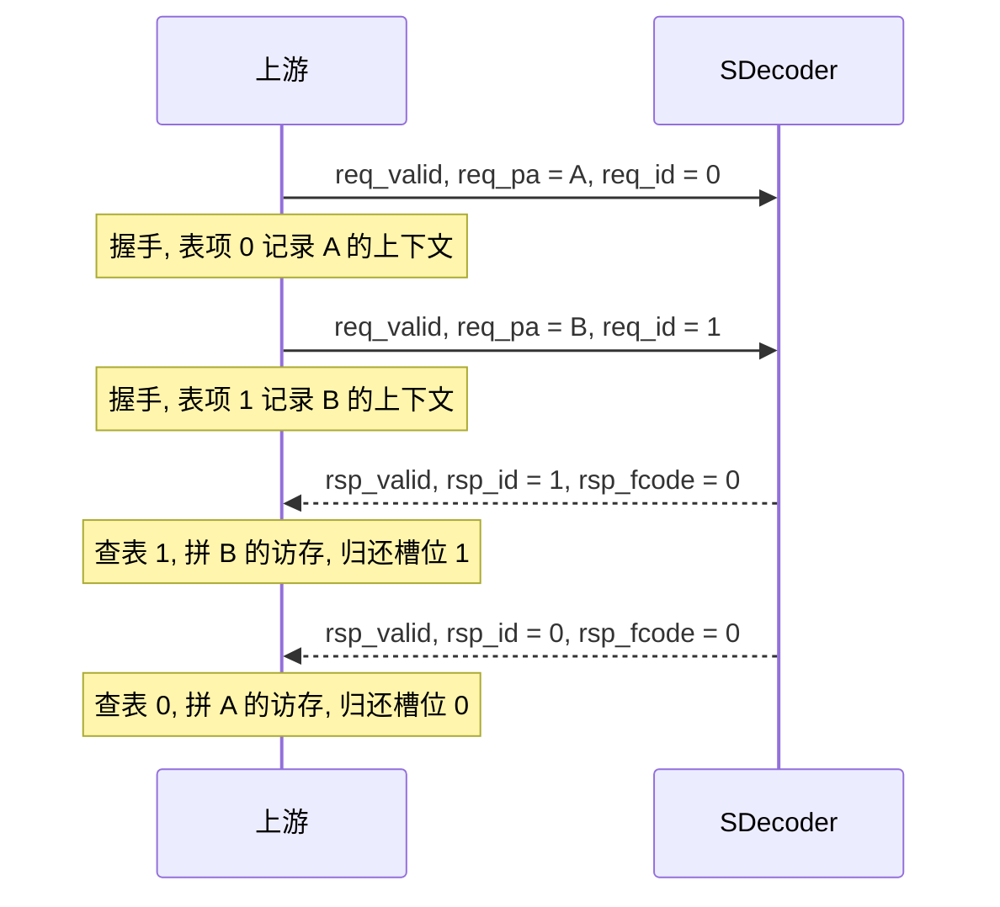

# 上游 req 与 rsp 使用约定

状态: 初稿. 适用范围: SDecoder 的 native 代换请求 / 响应接口, 不涉及 AXI / APB wrapper. 端口定义见 [SDecoder 设计方案](<../SDecoder设计方案/SDecoder 设计方案.md>) 的接口章节.

## 摘要

1. `req_id` 由上游分配, 语义是 **outstanding 槽位号**: 从请求握手到对应响应握手之间, 该值不得被其他在途请求复用.
2. 每个被接收的请求恰好一个响应; 响应可以乱序, 上游用 `rsp_id` 直接索引自己的 outstanding 表匹配, 不需要 CAM, 也不按地址匹配.
3. 分配用 free-list, 或直接复用已有的 ROB / MSHR 表项号; **握手成功才占用, 响应握手后才归还**.
4. 请求被 `req_ready` 卡住时, `req_valid` / `req_pa` / `req_id` 保持不变; 没有空槽时上游不要发请求.
5. SDecoder 不保证响应顺序, 也不看 `req_id` 做任何排序; 若上游需要按接收顺序提交, 自己按 ID 重排.
6. 如果以后把代换接口也包成 AXI, 槽位号可以直接当 `ARID` / `AWID` 用: 因为在途唯一, 同 ID 保序规则不会被触发.

命名说明: 本文按当前接口写 `req_id` / `rsp_id`; 它们的语义是槽位号而不是 AXI 的事务标识. 若后续改名 (例如 `req_slot`), 约定不变, 只替换名字.

## 术语

| 术语 | 含义 |
| --- | --- |
| outstanding | 已经握手接收, 但响应还没握手的请求 |
| 槽位号 | 本文对 `req_id` / `rsp_id` 的称呼: 上游 outstanding 表的下标 |
| 在途唯一 | 任意时刻, 所有 outstanding 请求的 `req_id` 互不相同 |
| 归还 | 响应握手后, 把槽位号放回 free-list, 允许再次分配 |

## 责任划分

| 事项 | 上游 | SDecoder |
| --- | --- | --- |
| 分配槽位号 | 负责 | - |
| 保证在途唯一 | 负责 | 不检查 |
| 响应匹配 | 按 `rsp_id` 查表 | 把 `req_id` 回显到 `rsp_id` |
| 响应顺序 | 需要保序时自己重排 | 不保证, 可能乱序 |
| 反压 | 遵守 `req_ready` | 在缓存将满时拉低 `req_ready` |
| 每个请求一个响应 | 依赖 SDecoder 的保证 | 保证, 不丢不多 |

## `req_id` 的语义

- 它不是 AXI 的 `AxID`: AXI ID 用来划分保序组, 同 ID 的响应必须按请求顺序返回; 这里的槽位号不带任何排序语义, 只负责把响应匹配回请求.
- SDecoder 只保存并在响应时原样回显, 不检查唯一性, 也不按它做任何排序; 在途唯一完全靠上游保证.
- 位宽 `REQ_ID_WIDTH = 8`, 上游实际可用数量 N 自定 (N ≤ 256), 编码不要求连续, 也不要求从 0 开始.

## 分配

### free-list

复位时把所有可用槽位号压进一个 FIFO (free-list), 请求握手时弹出一个, 响应握手时把 `rsp_id` 压回.

```verilog
// 示意, 非可综合代码
assign req_valid = want_send && slot_free;   // 没有空闲槽位就不发请求
assign req_id    = free_head;                // 组合选队头, 握手前保持不变

always_ff @(posedge clk or negedge rst_n) begin
    if (!rst_n) begin
        // free-list 复位为全部空闲
    end else begin
        if (req_valid && req_ready) begin
            table[free_head] <= {rw, size, attr, ...};   // 只在握手拍写表并弹出
        end
        if (rsp_valid && rsp_ready) begin
            push_free(rsp_id);                           // 响应被消费后才归还
        end
    end
end
```

要点:

- `free_head` 只在握手拍变化, 所以请求被反压期间 `req_id` 天然保持, 不需要额外的保持寄存器;
- 表项在请求握手拍写入, 不要提前写, 否则被反压的请求会覆盖别人的表项;
- 没有空闲槽位时 `req_valid` 必须为 0; 上层若还有队列, 由上层再挡一层.

### 位图分配

用一个 N bit 的 `busy` 位图, 请求时找第一个空位, 响应时清对应位:

- 占用和释放都是随机访问, 不需要 FIFO;
- 代价是每拍要做优先编码, 且 `busy` 位图随 N 增长;
- 槽位号同样要求在途唯一, 只是分配策略不同.

### 复用已有表项号

如果上游本身就有 ROB / MSHR / load-store 队列表项, 直接把表项号当 `req_id` 用, 不需要额外分配器:

- 零成本, 也天然在途唯一 (同一表项不会同时承载两笔在途请求);
- 前提是表项号位宽不超过 `REQ_ID_WIDTH`, 且表项从分配到释放的窗口覆盖整个请求生命周期.

三种做法对比:

| 做法 | 结构 | 优点 | 代价 |
| --- | --- | --- | --- |
| free-list | FIFO 深度 N | 分配释放 O(1), 时序简单 | 多一个 FIFO |
| 位图 | N bit + 优先编码 | 不需要 FIFO | 组合路径随 N 变长 |
| 复用表项号 | 无 | 零成本, 与上游 ROB 天然对齐 | 复用现有编号, 需要位宽匹配 |

## 表项存什么

`req_id` 只是索引, 响应本身不携带请求上下文, 所以表项里要存下游拼访存所需的一切:

| 字段 | 用途 |
| --- | --- |
| `valid` | 该槽位在用 |
| `rw` | 读 / 写. SDecoder 请求接口不含 `rw`, 由上游自己保存 |
| size / 属性 | 访存宽度、cache 属性、安全属性等 |
| 原始地址 | 需要回填或异常上报时使用 |
| 目的信息 | 回包路由, 例如 core_group 编号 |
| 其他 | 上游自己的跟踪位, 例如是否已提交 |

## 匹配

响应握手 (`rsp_valid && rsp_ready`) 那拍, 用 `rsp_id` 直接读表:

```verilog
// 示意, 非可综合代码
if (rsp_valid && rsp_ready) begin
    entry = table[rsp_id];
    issue_downstream(entry, rsp_fcode, rsp_sla, ...);   // 拼出真正的访存或异常
    push_free(rsp_id);                                  // 归还槽位
end
```

规则:

1. 直接索引, 不用 CAM, 也不用比较地址; 在途唯一保证一个 `rsp_id` 只对应一笔请求.
2. 归还发生在响应握手之后; 不能看到 `rsp_valid` 就提前归还, 否则表项可能被新请求覆盖, 而响应还没被消费.
3. `rsp_fcode != 3'b000` 的响应同样是一次响应, 同样占用并归还槽位; 此时 `rsp_eid` / `rsp_token_id` / `rsp_sla` 不得使用.
4. 响应乱序是正常行为: 命中可以越过在途未命中先返回; 上游的表项按 `rsp_id` 索引, 谁先回谁先处理.
5. 若上层要求按请求接收顺序提交, 由上游按 `rsp_id` 做重排 (ROB 或重排窗口), SDecoder 不提供保序.

## 反压与容量

- 上游可用槽位数 N 可以大于 SDecoder 能同时接收的数量: SDecoder 在 MISS_FIFO 满或响应 FIFO 将满时拉低 `req_ready`, 多出来的槽位只是暂时用不上.
- `req_ready` 可以在任意时刻拉低; 上游一旦拉高 `req_valid`, 在被接收之前不得撤销, 期间 `req_pa` / `req_id` 不得变化.
- 反压时 free-list 的弹出和表项写入都不能生效, 见到握手才提交.
- 复位期间 `req_ready` 为 0; 上游在复位释放后才可以发请求, 并把 free-list 恢复成全部空闲.
- 响应侧也是标准 valid / ready: `rsp_valid` 保持到 `rsp_ready`; 上游可以在任意时刻拉低 `rsp_ready`, 响应不会丢, 只是槽位归还延后.

## 与 AXI wrapper 的衔接

当前设计里的 wrapper 只把配置挂 APB 从口, 把 Page Walk 访存挂 AXI 主口, 代换请求 / 响应仍然是 native. 万一以后也把代换接口包成 AXI:

- 槽位号可以按 1:1 映射成 `ARID` / `AWID`, 响应侧的 `RID` / `BID` 就是槽位号; 因为在途唯一, 每笔请求的 AXI ID 都不同, AXI 要求的同 ID 响应保序不会被触发, 乱序响应合法.
- 如果反过来希望用 AXI ID 表达 "同一组请求要保序", 就和 "槽位号在途唯一" 冲突: 这种分组保序需要 wrapper 自己记录并按 ID 缓冲重排, 不能把同一个 ID 复用到并发的两笔请求上.
- AXI5 的 `AxIDUNQ` 语义和槽位号一致: 在途唯一时, 下游不需要再为它排序.

## 常见错误

1. **按地址匹配响应**: 响应不带地址, 且不同地址的响应可以乱序, 只能按 `rsp_id` 匹配.
2. **提前归还槽位**: 看到 `rsp_valid` 就归还, 而 `rsp_ready` 还没握手, 表项会被覆盖.
3. **复用未归还的槽位**: 违反在途唯一, 两个在途请求共用一个 `rsp_id`, 响应无法区分.
4. **反压期间改字段**: `req_valid` 已拉高但未握手时改 `req_pa` / `req_id`, 会被 SDecoder 采到错误请求.
5. **把 `req_id` 当 AXI ID 用**: 指望 SDecoder 为同 ID 请求保序; SDecoder 不做任何按 ID 的排序.
6. **忽略异常响应**: `rsp_fcode != 0` 时仍去用 `rsp_sla`, 或该响应不归还槽位, 导致槽位泄漏.
7. **用 `rsp_ready` 反压请求**: 请求侧只看 `req_ready`, 它已经包含响应 FIFO 将满的信息; 再拿 `rsp_ready` 去挡 `req_valid` 不会出错, 但会白掉吞吐.

## 时序示例

两笔 outstanding: 请求 A (未命中, 槽位 0) 先进, 请求 B (命中, 槽位 1) 后进, B 的响应先返回.



图 1: 两笔 outstanding 的乱序响应. 命中 B 越过未命中的 A 先返回, 上游按 `rsp_id` 查表即可匹配.

## 参考

- [SDecoder 设计方案](<../SDecoder设计方案/SDecoder 设计方案.md>): 接口定义与参数.
- [未命中队列与响应保序](../SDecoder设计方案/未命中队列与响应保序.md): 为什么允许乱序, 以及 `req_id` / `rsp_id` 的由来.
