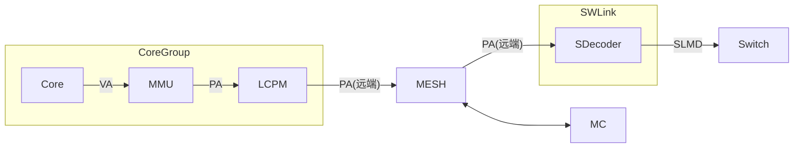
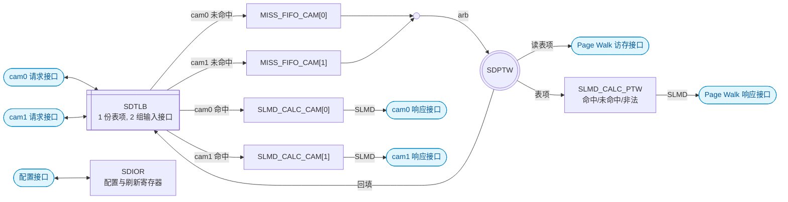
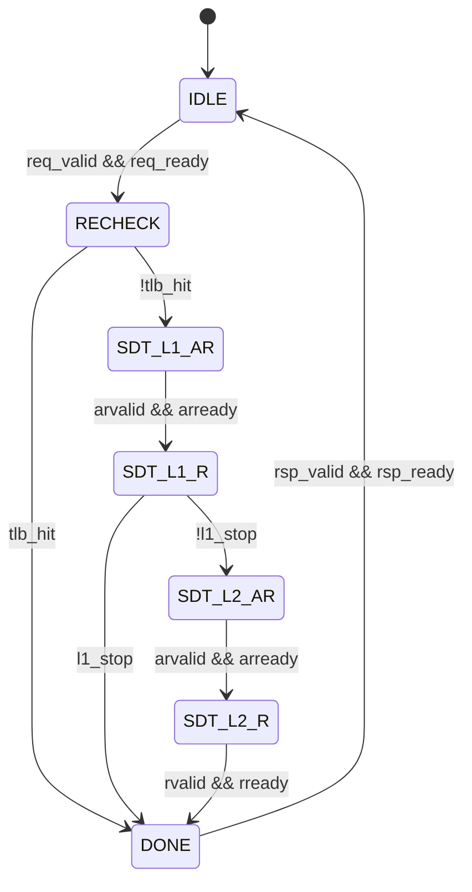

# SDecoder 设计方案

## 概述

### 总体描述

SDecoder 的核心功能做的是 **PA 到 SLMD 的代换**.

SDecoder 位于 User 侧 (内存物理资源的访问方), 挂在 SWLink 内, 它一方面接收从 MESH 网络传来的远端 PA 访问请求, 另一方面将这些请求转为 SLMD 并发送出去

图: SDecoder 在系统中的位置

### 缩写表

| 缩写 | 全称 |
| --- | --- |
| SDecoder | SWLink Decoder |
| SDTLB | SDecoder TLB |
| SDPTW | SDecoder Page Table Walker |
| MISS_FIFO | Miss FIFO |
| SLMD | SWLink Memory Descriptor |
| EID | Entity Identifier |
| TokenID | Token Identifier |
| SLA | SWLink Address |
| VA | Virtual Address |
| PA | Physical Address |
| TLB | Translation Lookaside Buffer |
| CAM | Content Addressable Memory |
| RSVD | Reserved |
| PW | Page Walk |
| PTW | Page Table Walker |
| IOR | IO Register |
| W1P | Write 1 to Pulse |

<!-- [TODO] 其他缩写表内容后续待补充 -->

### 参数表

| 参数 | 默认值 |
| --- | --- |
| `PA_WIDTH` | 48 |
| `PA_MEM_WIDTH` | 47 |
| `SLA_WIDTH` | 53 |
| `EID_WIDTH` | 11 |
| `TOKEN_ID_WIDTH` | 10 |
| `TOKEN_VALUE_WIDTH` | 10 |
| `REQ_ID_WIDTH` | 8 |
| `SDTLB_ENTRIES` | 128 |
| `MISS_FIFO_DEPTH` | 8 |
| `SDIOR_DATA_WIDTH` | 64 |
| `RSP_ERR_WIDTH` | 4 |

注: `SDIOR_DATA_WIDTH` 目前是 64 bit, 但建议用 32 bit 以匹配 APB

## 架构

### SDecoder (AI generated)

#### 接口分组

| 接口信号 | 定位 | 方向 | 说明 |
| --- | --- | --- | --- |
| `cam0_req_*` | Slave | 输入 | 上游 master 发起请求 |
| `cam0_rsp_*` | Slave | 输出 | cam0 命中时返回 SLMD |
| `cam1_req_*` | Slave | 输入 | 上游 master 发起请求 |
| `cam1_rsp_*` | Slave | 输出 | cam1 命中时返回 SLMD |
| `pw_rsp_*` | Slave | 输出 | 未命中 Page Walk 完成后返回 SLMD 或错误 |
| `pw_ar*` | Master | 输出 | 发起读表项地址, 读本地 SDT_L1 / SDT_L2 |
| `pw_r*` | Master | 输入 | 接收读回的表项数据 |
| `cfg_*` | Slave | 输入 / 输出 | 配置基地址, 置无效 SDTLB |

各接口逐信号的定义见 "接口信号" 一节; 另有 `clk` / `rst_n`, 单时钟域.

除配置接口外, 其余接口都采用 valid-ready 握手, 信号名为 `*valid` / `*ready` 风格: 握手完成于 `valid` 与 `ready` 同时为高的上升沿; `valid` 不得组合依赖 `ready`, 拉高后到握手完成前载荷保持不变.

注: valid-ready 握手的优点是: 收发双方不需要约定固定延迟, 各自按自己的节奏工作; 接收方随时可以拉低 `ready` 反压, 发送方只要保持 `valid` 和载荷即可; 中间插入缓冲或流水级也不改变协议, 数据通路的组合路径可以打拍切断, 减轻时序压力; 代价是 `ready` 方向形成组合反压链, 长链上仍需寄存化处理.

#### 内部结构

图: SDecoder 内部结构. 1 个 SDTLB 有 2 组输入接口, 未命中按来源接口进入各自的 MISS_FIFO, 经仲裁后共用单套 SDPTW; 3 个 SLMD_CALC 分别服务 cam0 命中 / cam1 命中 / Page Walk 结果 (命中 / 未命中 / 非法), 各自驱动对应的响应接口.

SDecoder 采用 "单 TLB + 双 CAM 接口 + 单 walker" 的结构: SDTLB 的物理实现只有 1 份, 但有 2 组独立的输入接口, 分别接上游的 2 个请求端口, 因此两路可以并行查表; 未命中按来源接口分别进入 MISS_FIFO_CAM[0] / MISS_FIFO_CAM[1], 经仲裁后由一套串行的 SDPTW 做 Page Walk, 完成后由 Page Walk 的 SLMD_CALC 拼装并从 `pw_rsp_*` 返回, 同时回填 SDTLB. 响应侧有 3 个相互独立的 `SLMD_CALC` 实例, 分别归属 cam0 命中, cam1 命中, Page Walk 结果, 每个实例只驱动自己那条响应通道, 三条通道互不阻塞.

图上只画了 SDIOR 与配置接口的连接; 它输出的置无效命令作用于 SDTLB, 寄存器编码见 "可配置的寄存器" 一节.

#### 模块划分

1. `SDTLB`: 全相联 CAM, 共 `SDTLB_ENTRIES` (128) 条表项, 只有 1 份表项存储; 对外是 2 组输入接口 cam0 / cam1. 两组接口共享同一份表项, 两路可以并行查表; 命中结果按来源从对应的 `camN_rsp_*` 返回. 回填和置无效都只作用于这一份 TLB 表项.
2. `MISS_FIFO_CAM[0]` / `MISS_FIFO_CAM[1]`: 分别属于 CAM0 和 CAM1, 各深 `MISS_FIFO_DEPTH` (8), 存放本路未命中的 PA 和 `req_id`. 两个队列独立, 不互相借深度.
3. `ARB`: 仲裁, 把 MISS_FIFO_CAM[0] / MISS_FIFO_CAM[1] 的请求合流后送给 SDPTW; 两个队列之间按轮询取, 同一时刻只送出一个请求.
4. `SDPTW`: 单 walker, 从 ARB 取请求做两级 Page Walk, 只读 SDT_L1 / SDT_L2. Page Walk 完成后把表项和 `req_id` 交给 `SLMD_CALC_PTW`, 由它拼装 SLMD 并从 `pw_rsp_*` 返回; 检查通过的结果回填 SDTLB.
5. `SLMD_CALC_CAM[0]` / `SLMD_CALC_CAM[1]` / `SLMD_CALC_PTW`: 3 个实例相互独立. `SLMD_CALC_CAM[0]` / `SLMD_CALC_CAM[1]` 用 TLB 命中表项和请求 PA 算出 SLA 并拼出 SLMD; `SLMD_CALC_PTW` 用 SDPTW 的 Page Walk 结果判定命中 / 未命中 / 非法, 拼出 SLMD 或错误. 每个实例只驱动对应的响应接口, 实例之间不共享流水级, 一条通道反压不影响另外两条.
6. `SDIOR`: 配置与刷新寄存器, 输出 `SDT_L1_BASE` 和置无效命令, 置无效作用于 SDTLB.

#### 命中与未命中流程

1. 接收: cam0 和 cam1 两组接口独立握手, 两路可以同拍接收请求.
2. 命中: 两路查的是同一份 TLB 表项. 命中表项按来源接口送给对应的 `SLMD_CALC` (cam0 命中去 `SLMD_CALC_CAM[0]`, cam1 命中去 `SLMD_CALC_CAM[1]`), 由它算 SLA 并拼 SLMD, 从该接口的 `camN_rsp_*` 返回, 带 `req_id`.
3. 未命中: cam0 的未命中写入 MISS_FIFO_CAM[0], cam1 的写入 MISS_FIFO_CAM[1]; 命中路径不等待未命中 (hit-under-miss).
4. Page Walk: `ARB` 从两个 MISS_FIFO 取请求交给 SDPTW; SDPTW 读 SDT_L1, 段命中则直接给出段式结果, 否则再读 SDT_L2; Page Walk 结果交给 `SLMD_CALC_PTW`, 由它判定命中 / 未命中 / 非法, 拼装后从 `pw_rsp_*` 返回, 合法结果同时回填 SDTLB.
5. 反压: 本路 MISS_FIFOn 满或本路响应通道反压时拉低 `camN_req_ready`; 两个队列和 3 个 `SLMD_CALC` 都独立, 一路积压不影响另一路.

注: CAM 命中的响应不设 FIFO, 命中表项由 `SLMD_CALC_CAM[n]` 直接驱动 `camN_rsp_*`. 上级模块应尽快从 `camN_rsp_*` 取走数据, 取走不及时会反压该路的请求接口 (`camN_req_ready` 拉低); 理想情况下, 例化 SDecoder 时可以把 `camN_rsp_ready` 常置为 1.

注: SDPTW 是单 walker, `ARB` 在两个 MISS_FIFO 之间按轮询取; 两条未命中通路之间不保证与接收顺序一致, 但响应本来就按 `req_id` 乱序匹配, 不影响正确性.

三条路径输出的 SLMD 字段语义一致, 都由各自的 `SLMD_CALC` 组装. 响应可以乱序, 命中与未命中走不同的响应通道, 同一时刻在途的 `req_id` 必须唯一, 上游按 ID 匹配.

### SDPTW

#### Page Table 结构

##### 地址划分

核心视角的虚地址 VA 为 53 位, 物理地址 PA 为 48 位. PA[47] 用于区分地址空间:

- PA[47] = 0: Mem 空间, 共 128 TB
- PA[47] = 1: IO 空间, 共 128 TB

因为 SDecoder 只处理 Mem 空间, 所以断言 PA[47] 恒为 0, 实际有用的是 PA[46:0]

虽然 PA[47] 恒为 0, 但现在 Page Table 中仍然保留该位:

1. 一级表的基地址 SDT_L1_BASE[47]
2. 二级表的基地址 SDT_L2_BASE[47]

所以对于一个 PA 请求, 其位域划分如下:

| 名称 | 位域 | 说明 |
| --- | --- | --- |
| 地址空间标识 | [47] | 0: Mem 空间, 1: IO 空间 |
| 一级表索引 | [46:35] | 一级表表项**最大**覆盖 32GB |
| 二级表索引 | [34:30] | 二级表表项**固定**覆盖 1GB |
| 页内偏移 | [29:0] | 原样透传到 SLA[29:0], 不参与查表 |

##### 段页混合的两级代换表

SDecoder 采用 "段页混合" 的两级代换表: 一级表表项描述一个段 (最大 32GB), 二级表表项描述一个 1GB 页

| 表 | 表项数 | 表项宽度 | 覆盖范围 | 存储开销 |
| --- | --- | --- | --- | --- |
| 一级表 | 4096 | 16B | 128TB | 64KB |
| 二级表 (单表) | 32 | 8B | 32GB | 256B |

注 1: 一级表在内存中只有 1 张, 二级表在内存中有 4096 张
注 2: 一级表的覆盖范围 = 32GB × 4096 = 128TB
注 3: 一级表的存储开销 = 16B × 4096 = 64KB
注 4: 二级表 (单表) 的覆盖范围 = 1GB × 32 = 32GB
注 5: 二级表 (单表) 的存储开销 = 8B × 32 = 256B
注 6: 二级表 (合计) 总存储开销 = 256B × 4096 = 1MB

软件约束:

1. 两级代换表必须存放在本芯片的本地 HBM / DDR 上, 不允许存放在远端池化内存中. 否则读表本身就会变成一次远端访问, 会经过一次 SWLink 环回
2. 两级代换表在内存中的基地址对界: 硬件只使用基地址的高位, 不对对界做检查
   1. SDT_L1_BASE 按 16B 对界 (一级表项大小为 16B)
   2. SDT_L2_BASE 按 8B 对界 (二级表项大小为 8B)
3. PA 查表的索引是"基地址 + 索引 × 表项宽度", 一级表本身基地址 SDT_L1_BASE 由软件填写 IO 寄存器, 二级表基地址 SDT_L2_BASE 由一级表表项提供

##### 一级表表项

一级表的表项宽度为 16B (128 bit)

| 位域 | 位宽 | 名称 | 说明 |
| --- | --- | --- | --- |
| [127:110] | 18 | RSVD | 保留 |
| [109:65] | 45 | SDT_L2_BASE[47:3] | 二级表基地址 |
| [64:54] | 11 | EID[10:0] | SLMD 的组成部分 |
| [53:44] | 10 | TokenID[9:0] | SLMD 的组成部分 |
| [43:34] | 10 | TokenValue[9:0] | SLMD 的组成部分 |
| [33:11] | 23 | S_PFN[52:30] | 段式代换的 SLA 基址, 以 1GB 对界 |
| [10:6] | 5 | SEG_LEN[34:30] | 段长度, 以 1GB 对界 |
| [5:1] | 5 | SEG_BASE[34:30] | 段基址, 以 1GB 对界 |
| [0] | 1 | Valid | 表项有效位 |

注 1: SEG_LEN 实际上是段表偏移, 其含义类似 AXI 的 AxLEN, 实际段的长度为 (SEG_LEN + 1) * 1GB
注 2: 段表下界为 SEG_BASE, 上界为 SEG_BASE + SEG_LEN
注 3: 这是 "段页混合" 式的表, 且段表有且仅有 1 个. 优先在一级表查是否命中段表, 不命中的话再去二级表查是否命中页表

一级表表项地址:

1. 按表项大小对界 (16B), 因此断言 SDT_L1_BASE[3:0] 为 4'h0, 硬件取 {SDT_L1_BASE[47:4], 4'h0}, 低 4 位忽略
2. L1 表项地址 = {SDT_L1_BASE[47:4], 4'h0} + PA[47:35] * 16

一级表命中条件:

1. 一级表表项位域 Valid = 1
2. SEG_BASE[34:30] <= PA[34:30] <= SEG_BASE[34:30] + SEG_LEN[34:30]

一级表命中计算 SLA:

1. SLA[52:30] = S_PFN[52:30] + (PA[34:30] - SEG_BASE[34:30])
2. SLA[29:0] = PA[29:0]

软件约束, 不能写非法的一级表表项:

1. SEG_BASE + SEG_LEN > 31
2. S_PFN[52:30] + (PA[34:30] - SEG_BASE[34:30]) 溢出

##### 二级表表项

二级表表项宽度 8B (64 bit)

| 位域 | 位宽 | 名称 | 说明 |
| --- | --- | --- | --- |
| [63:55] | 9 | RSVD | 保留 |
| [54:44] | 11 | EID[10:0] | SLMD 的组成部分 |
| [43:34] | 10 | TokenID[9:0] | SLMD 的组成部分 |
| [33:24] | 10 | TokenValue[9:0] | SLMD 的组成部分 |
| [23:1] | 23 | S_PFN[52:30] | 页式代换的 SLA 基址, 以 1GB 对界 |
| [0] | 1 | Valid | 二级表项有效位 |

二级表表项地址:

1. 按表项大小对界 (8B), 因此断言 SDT_L2_BASE[2:0] 为 3'h0, 硬件取 {SDT_L2_BASE[47:3], 3'h0}, 低 3 位忽略
2. L2 表项地址 = {SDT_L2_BASE[47:3], 3'h0} + PA[34:30] * 8

二级表命中条件:

1. 一级表表项位域 Valid = 1
2. 一级表未命中, 即 PA[34:30] 不在段范围内
3. 二级表表项位域 Valid = 1

二级表命中计算 SLA:

1. SLA[47:30] = S_PFN[47:30]
2. SLA[29:0] = PA[29:0]

#### 状态机

图: SDPTW 状态机

注: `l1_stop = !l1.valid || (SEG_BASE <= PA[34:30] <= SEG_BASE + SEG_LEN)`

状态说明:

- `IDLE`: 空闲, 等待 Page Walk 请求, 收到 Page Walk 请求后, 锁存 PA 和 req_id
- `RECHECK`: Page Walk 开始前重查 SDTLB (借用 CAM0/CAM1 的查表口, 见 "重查 SDTLB" 一节); 命中则直接进入 `DONE`, 用命中的表项组装 SLMD, 不访存也不回填 SDTLB; 未命中才实际执行 Page Walk
- `SDT_L1_AR`: Page Walk, 写一级表表项地址, 等 `arready`
- `SDT_L1_R`: Page Walk, 读一级表表项数据, 如果段命中或一级无效则直接进入 `DONE` 状态, 否则跳转到二级表访问
- `SDT_L2_AR`: Page Walk, 写二级表表项地址, 等 `arready`
- `SDT_L2_R`: Page Walk, 读二级表表项数据, 转 `DONE` 状态
- `DONE`:
  - 把 Page Walk 结果交给 SLMD_CALC_PTW, 由它校验表项数据合法性并拼装 SLMD
  - 如果 Page Walk 结果合法, 回填 SDTLB, 否则不回填

#### 重查 SDTLB

##### 开始前重查 SDTLB

在 Page Walk **开始前**需要额外先重新查一下 SDTLB (减少不必要的访存)

重查发生在 SDPTW 从 ARB 取到请求之后, 发起第一次 SDT_L1 访存之前; 命中则跳过 Page Walk, 直接把该表项交给 SLMD_CALC_PTW 组装并从 pw_rsp_* 返回, 且不回填

1. 假设 MISS FIFO 里有 2 个 FIFO 条目恰好属于 32GB 的同一个段 (其 PA[46:35] 相同, 但 PA[34:30] 不同). 可是我们无法在前一条请求的 Page Walk 还没完成时就知道它们属于同一个段, 这就导致了不必要的访存
2. 访问到 Page Table 的同一个段表项的 2 个请求不一定是连续挨着, 甚至可能其中一个在 CAM0 的 MISS FIFO 的第一项里, 另一个在 CAM1 的 MISS FIFO 的最后一项里
3. 当然可以在 SDPTW 里做一个小的 DFF 缓存, 用来缓存前面几个访存的结果, 不过看起来有相当的复杂度

所以 TLB 除了标准输入端的 CAM0/CAM1 查表外, 还需要让 Page Walk 也有 CAM 接口来查 TLB 表项, 但是为 Page Walk 这种小概率事件设计一个额外的 CAM 查表接口是不值得的, 所以 Page Walk CAM 复用 CAM0/CAM1 的查表逻辑

复用 CAM0/CAM1 的查表逻辑的方案是:

1. 当 CAM0/CAM1 一个忙, 另一个空闲时, 让空闲的 CAM 口去查 Page Walk 的请求
2. 当 CAM0/CAM1 都忙或都空闲, 轮转抢占其中一个 CAM 口, 让该 CAM 口的 camN_req_ready 拉低一拍
   1. 都空闲时复用轮转指针, 简化设计

##### 结束后重查 SDTLB

在 Page Walk **结束后**需要额外先重新查一下 SDTLB (减少不必要的回填)

**由于该项只适用于 2 个完全独立的 PTW 模块, 但 TLB 依然只有 1 个的情况, 初版不涉及该功能**

如果 2 个独立的 PTW 模块同时收到了 "同一个段, 但 PA[34:30] 不同" 的 2 个请求, 由于事先 TLB 都没有命中, 于是 2 个 PTW 同时在做 Page Walk, 所以很可能 2 个 PTW 都想回填同一个段的表项, 这就会导致 TLB 很可能就有 2 条内容完全一致的表项 (从而导致命中向量不再是独热码, 影响后续读 TLB 的数据或影响置无效的逻辑)

### SDTLB

## 参数

## 接口信号

### 请求接口 (CAM)

| 信号 | 方向 | 位宽 | 说明 |
| --- | --- | --- | --- |
| `camN_req_valid` | I | 1 | / |
| `camN_req_ready` | O | 1 | / |
| `camN_req_pa` | I | `PA_WIDTH` | / |
| `camN_req_id` | I | `REQ_ID_WIDTH` | / |

注 1: 共有 2 组请求接口 (CAM), N 可取 [0, 1], 分别对应 TLB 的两组输入接口 (cam0 / cam1)

### 响应接口 (CAM)

| 信号 | 方向 | 位宽 | 说明 |
| --- | --- | --- | --- |
| `camN_rsp_valid` | O | 1 | / |
| `camN_rsp_ready` | I | 1 | / |
| `camN_rsp_id` | O | `REQ_ID_WIDTH` | / |
| `camN_rsp_eid` | O | `EID_WIDTH` | / |
| `camN_rsp_token_id` | O | `TOKEN_ID_WIDTH` | / |
| `camN_rsp_token_value` | O | `TOKEN_VALUE_WIDTH` | / |
| `camN_rsp_sla` | O | `SLA_WIDTH` | / |

注 1: 共有 2 组响应接口 (CAM), N 可取 [0, 1], 分别对应 TLB 两组输入接口 (cam0 / cam1) 的响应

<!-- [TODO] `camN_rsp_err` 编码:-->

### 响应接口 (Page Walk)

| 信号 | 方向 | 位宽 | 说明 |
| --- | --- | --- | --- |
| `pw_rsp_valid` | O | 1 | / |
| `pw_rsp_ready` | I | 1 | / |
| `pw_rsp_id` | O | `REQ_ID_WIDTH` | / |
| `pw_rsp_err` | O | `RSP_ERR_WIDTH` | 应该就 page walk 有 err 吧 |
| `pw_rsp_eid` | O | `EID_WIDTH` | / |
| `pw_rsp_token_id` | O | `TOKEN_ID_WIDTH` | / |
| `pw_rsp_token_value` | O | `TOKEN_VALUE_WIDTH` | / |
| `pw_rsp_sla` | O | `SLA_WIDTH` | / |

### 访存接口 (Page Walk)

| 信号 | 方向 | 位宽 | 说明 |
| --- | --- | --- | --- |
| `pw_araddr` | O | `PA_WIDTH` | / |
| `pw_arvalid` | O | 1 | / |
| `pw_arready` | I | 1 | / |
| `pw_rdata` | I | 128 | / |
| `pw_rvalid` | I | 1 | / |
| `pw_rready` | O | 1 | / |

### 寄存器配置接口

| 信号 | 方向 | 位宽 | 说明 |
| --- | --- | --- | --- |
| `cfg_wr` | I | 1 | 写使能, 1 拍脉冲 |
| `cfg_rd` | I | 1 | 读使能, 1 拍脉冲 |
| `cfg_addr` | I | 2 | 寄存器索引 |
| `cfg_wdata` | I | `SDIOR_DATA_WIDTH` | 写数据 |
| `cfg_rdata` | O | `SDIOR_DATA_WIDTH` | 读数据 |

## 可配置的寄存器

| `cfg_addr` | 寄存器 | 属性 | 说明 |
| --- | --- | --- | --- |
| 0 | `SDecoder_IA` | W1P | 写 bit0 = 1, 置无效全部 SDTLB 表项 |
| 1 | `SDecoder_IS` | W1P | 写 bit63 = 1, 置无效覆盖 `PA[47:30]` 的表项; 低 48 位为 PA |
| 2 | `SDT_L1_BASE` | RW | 一级表基地址 `PA[47:0]`, 16B 对界 |

## 异常处理

可能会有由于 valid-ready 握手导致的死锁/活锁问题

有些异常是没法处理的, 尤其是当软件修改了 Page Table 的内容, 但忘记了去刷新 SDecoder 的 SDTLB 的情况
