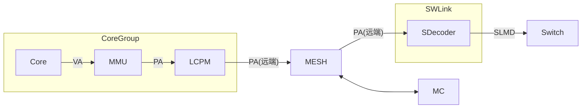
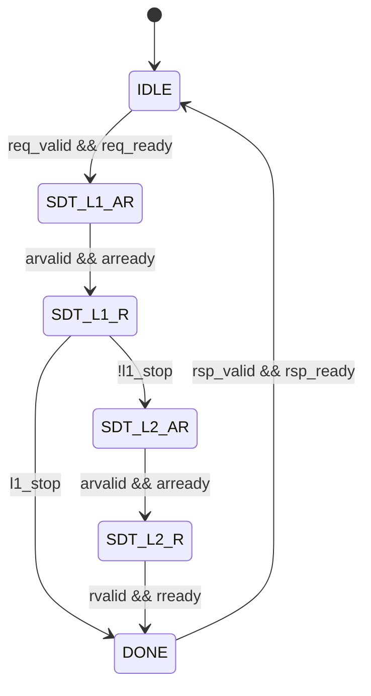

# SDecoder 设计方案

## 概述

### 总体描述

SDecoder 的核心功能做的是 **PA 到 SLMD 的代换**.

SDecoder 位于 User 侧 (内存物理资源的访问方), 挂在 SWLink 内, 它一方面接收从 MESH 网络传来的远端 PA 访问请求, 另一方面将这些请求转为 SLMD 并发送出去

图: SDecoder 在系统中的位置

### 缩写表

| 缩写 | 全称 |
| --- | --- |
| SDecoder | SWLink Decoder |
| SDTLB | SDecoder TLB |
| SDPTW | SDecoder Page Table Walker |
| MISS_FIFO | Miss FIFO |
| SLMD | SWLink Memory Descriptor |
| EID | Entity Identifier |
| TokenID | Token Identifier |
| SLA | SWLink Address |
| VA | Virtual Address |
| PA | Physical Address |
| TLB | Translation Lookaside Buffer |
| CAM | Content Addressable Memory |
| RSVD | Reserved |
| PW | Page Walk |
| PTW | Page Table Walker |
| IOR | IO Register |
| W1P | Write 1 to Pulse |

<!-- [TODO] 其他缩写表内容后续待补充 -->

### 参数表

| 参数 | 默认值 |
| --- | --- |
| `PA_WIDTH` | 48 |
| `PA_MEM_WIDTH` | 47 |
| `SLA_WIDTH` | 53 |
| `EID_WIDTH` | 11 |
| `TOKEN_ID_WIDTH` | 10 |
| `TOKEN_VALUE_WIDTH` | 10 |
| `REQ_ID_WIDTH` | 8 |
| `SDTLB_ENTRIES` | 128 |
| `MISS_FIFO_DEPTH` | 8 |
| `SDIOR_DATA_WIDTH` | 64 |
| `RSP_ERR_WIDTH` | 4 |

注: `SDIOR_DATA_WIDTH` 目前是 64 bit, 但建议用 32 bit 以匹配 APB

## 架构

### SDecoder

### SDPTW

#### 地址划分

核心视角的虚地址 VA 为 53 位, 物理地址 PA 为 48 位. PA[47] 用于区分地址空间:

- PA[47] = 0: Mem 空间, 共 128 TB
- PA[47] = 1: IO 空间, 共 128 TB

因为 SDecoder 只处理 Mem 空间, 所以断言 PA[47] 恒为 0, 实际有用的是 PA[46:0]

虽然 PA[47] 恒为 0, 但现在 Page Table 中仍然保留该位:

1. 一级表的基地址 SDT_L1_BASE[47]
2. 二级表的基地址 SDT_L2_BASE[47]

所以对于一个 PA 请求, 其位域划分如下:

| 名称 | 位域 | 说明 |
| --- | --- | --- |
| 地址空间标识 | [47] | 0: Mem 空间, 1: IO 空间 |
| 一级表索引 | [46:35] | 一级表表项**最大**覆盖 32GB |
| 二级表索引 | [34:30] | 二级表表项**固定**覆盖 1GB |
| 页内偏移 | [29:0] | 原样透传到 SLA[29:0], 不参与查表 |

#### 代换表结构

SDecoder 采用 "段页混合" 的两级代换表: 一级表表项描述一个段 (最大 32GB), 二级表表项描述一个 1GB 页

| 表 | 表项数 | 表项宽度 | 覆盖范围 | 存储开销 |
| --- | --- | --- | --- | --- |
| 一级表 | 4096 | 16B | 128TB | 64KB |
| 二级表 (单表) | 32 | 8B | 32GB | 256B |

注 1: 一级表在内存中只有 1 张, 二级表在内存中有 4096 张
注 2: 一级表的覆盖范围 = 32GB × 4096 = 128TB
注 3: 一级表的存储开销 = 16B × 4096 = 64KB
注 4: 二级表 (单表) 的覆盖范围 = 1GB × 32 = 32GB
注 5: 二级表 (单表) 的存储开销 = 8B × 32 = 256B
注 6: 二级表 (合计) 总存储开销 = 256B × 4096 = 1MB

软件约束:

1. 两级代换表必须存放在本芯片的本地 HBM / DDR 上, 不允许存放在远端池化内存中. 否则读表本身就会变成一次远端访问, 会经过一次 SWLink 环回
2. 两级代换表在内存中的基地址对界: 硬件只使用基地址的高位, 不对对界做检查
   1. SDT_L1_BASE 按 16B 对界 (一级表项大小为 16B)
   2. SDT_L2_BASE 按 8B 对界 (二级表项大小为 8B)
3. PA 查表的索引是"基地址 + 索引 × 表项宽度", 一级表本身基地址 SDT_L1_BASE 由软件填写 IO 寄存器, 二级表基地址 SDT_L2_BASE 由一级表表项提供

##### 一级表代换表表项

一级表的表项宽度为 16B (128 bit)

| 位域 | 位宽 | 名称 | 说明 |
| --- | --- | --- | --- |
| [127:110] | 18 | RSVD | 保留 |
| [109:65] | 45 | SDT_L2_BASE[47:3] | 二级表基地址 |
| [64:54] | 11 | EID[10:0] | SLMD 的组成部分 |
| [53:44] | 10 | TokenID[9:0] | SLMD 的组成部分 |
| [43:34] | 10 | TokenValue[9:0] | SLMD 的组成部分 |
| [33:11] | 23 | S_PFN[52:30] | 段式代换的 SLA 基址, 以 1GB 对界 |
| [10:6] | 5 | SEG_LEN[34:30] | 段长度, 以 1GB 对界 |
| [5:1] | 5 | SEG_BASE[34:30] | 段基址, 以 1GB 对界 |
| [0] | 1 | Valid | 表项有效位 |

注 1: SEG_LEN 实际上是段表偏移, 其含义类似 AXI 的 AxLEN, 实际段的长度为 (SEG_LEN + 1) * 1GB
注 2: 段表下界为 SEG_BASE, 上界为 SEG_BASE + SEG_LEN
注 3: 这是 "段页混合" 式的表, 且段表有且仅有 1 个. 优先在一级表查是否命中段表, 不命中的话再去二级表查是否命中页表

一级表表项地址:

1. 按表项大小对界 (16B), 因此断言 SDT_L1_BASE[3:0] 为 4'h0, 硬件取 {SDT_L1_BASE[47:4], 4'h0}, 低 4 位忽略
2. L1 条目地址 = {SDT_L1_BASE[47:4], 4'h0} + PA[47:35] * 16

一级表命中条件:

1. 一级表表项位域 Valid = 1
2. SEG_BASE[34:30] <= PA[34:30] <= SEG_BASE[34:30] + SEG_LEN[34:30]

一级表命中计算 SLA:

1. SLA[52:30] = S_PFN[52:30] + (PA[34:30] - SEG_BASE[34:30])
2. SLA[29:0] = PA[29:0]

软件约束, 不能写非法的一级表表项:

1. SEG_BASE + SEG_LEN > 31
2. S_PFN[52:30] + (PA[34:30] - SEG_BASE[34:30]) 溢出

##### 二级表代换表表项

二级表表项宽度 8B (64 bit)

| 位域 | 位宽 | 名称 | 说明 |
| --- | --- | --- | --- |
| [63:55] | 9 | RSVD | 保留 |
| [54:44] | 11 | EID[10:0] | SLMD 的组成部分 |
| [43:34] | 10 | TokenID[9:0] | SLMD 的组成部分 |
| [33:24] | 10 | TokenValue[9:0] | SLMD 的组成部分 |
| [23:1] | 23 | S_PFN[52:30] | 页式代换的 SLA 基址, 以 1GB 对界 |
| [0] | 1 | Valid | 二级表项有效位 |

二级表表项地址:

1. 按表项大小对界 (8B), 因此断言 SDT_L2_BASE[2:0] 为 3'h0, 硬件取 {SDT_L2_BASE[47:3], 3'h0}, 低 3 位忽略
2. L2 条目地址 = {SDT_L2_BASE[47:3], 3'h0} + PA[34:30] * 8

二级表命中条件:

1. 一级表表项位域 Valid = 1
2. 一级表未命中, 即 PA[34:30] 不在段范围内
3. 二级表表项位域 Valid = 1

二级表命中计算 SLA:

1. SLA[47:30] = S_PFN[47:30]
2. SLA[29:0] = PA[29:0]

#### 状态机

图: SDPTW 状态机

注: `l1_stop = !l1.valid || (SEG_BASE <= PA[34:30] <= SEG_BASE + SEG_LEN)`

状态说明:

- `IDLE`: 空闲, 等待 Page Walk 请求, 收到 Page Walk 请求后, 锁存 PA 和 req_id
- `SDT_L1_AR`: 写一级表表项地址, 等 `arready`
- `SDT_L1_R`: 读一级表表项数据, 如果段命中或一级无效则直接进入 `DONE` 状态, 否则跳转到二级表访问
- `SDT_L2_AR`: 写二级表表项地址, 等 `arready`
- `SDT_L2_R`: 读二级表表项数据, 转 `DONE` 状态
- `DONE`: 拼装 SLMD; 校验表项数据合法性; 返回响应接口

### SDTLB

## 参数

## 接口信号

### 请求接口 (CAM)

| 信号 | 方向 | 位宽 | 说明 |
| --- | --- | --- | --- |
| `camN_req_valid` | I | 1 | / |
| `camN_req_ready` | O | 1 | / |
| `camN_req_pa` | I | `PA_WIDTH` | / |
| `camN_req_id` | I | `REQ_ID_WIDTH` | / |

注 1: 共有 2 组请求接口 (CAM), N 可取 [0, 1], 分别对应两个 CAM

### 响应接口 (CAM)

| 信号 | 方向 | 位宽 | 说明 |
| --- | --- | --- | --- |
| `camN_rsp_valid` | O | 1 | \ |
| `camN_rsp_ready` | I | 1 | \ |
| `camN_rsp_id` | O | `REQ_ID_WIDTH` | \ |
| `camN_rsp_eid` | O | `EID_WIDTH` | \ |
| `camN_rsp_token_id` | O | `TOKEN_ID_WIDTH` | \ |
| `camN_rsp_token_value` | O | `TOKEN_VALUE_WIDTH` | \ |
| `camN_rsp_sla` | O | `SLA_WIDTH` | \ |

注 1: 共有 2 组响应接口 (CAM), N 可取 [0, 1], 分别对应两个 CAM

<!-- [TODO] `camN_rsp_err` 编码:-->

### 响应接口 (Page Walk)

| 信号 | 方向 | 位宽 | 说明 |
| --- | --- | --- | --- |
| `pw_rsp_valid` | O | 1 | \ |
| `pw_rsp_ready` | I | 1 | \ |
| `pw_rsp_id` | O | `REQ_ID_WIDTH` | \ |
| `pw_rsp_err` | O | `RSP_ERR_WIDTH` | 应该就 page walk 有 err 吧 |
| `pw_rsp_eid` | O | `EID_WIDTH` | \ |
| `pw_rsp_token_id` | O | `TOKEN_ID_WIDTH` | \ |
| `pw_rsp_token_value` | O | `TOKEN_VALUE_WIDTH` | \ |
| `pw_rsp_sla` | O | `SLA_WIDTH` | \ |

### 访存接口 (Page Walk)

| 信号 | 方向 | 位宽 | 说明 |
| --- | --- | --- | --- |
| `pw_araddr` | O | `PA_WIDTH` | \ |
| `pw_arvalid` | O | 1 | \ |
| `pw_arready` | I | 1 | \ |
| `pw_rdata` | I | 128 | \ |
| `pw_rvalid` | I | 1 | \ |
| `pw_rready` | O | 1 | \ |

### 寄存器配置接口

| 信号 | 方向 | 位宽 | 说明 |
| --- | --- | --- | --- |
| `cfg_wr` | I | 1 | 写使能, 1 拍脉冲 |
| `cfg_rd` | I | 1 | 读使能, 1 拍脉冲 |
| `cfg_addr` | I | 2 | 寄存器索引 |
| `cfg_wdata` | I | `SDIOR_DATA_WIDTH` | 写数据 |
| `cfg_rdata` | O | `SDIOR_DATA_WIDTH` | 读数据 |

## 可配置的寄存器

| `cfg_addr` | 寄存器 | 属性 | 说明 |
| --- | --- | --- | --- |
| 0 | `SDecoder_IA` | W1P | 写 bit0 = 1, 置无效全部 SDTLB 条目 |
| 1 | `SDecoder_IS` | W1P | 写 bit63 = 1, 置无效覆盖 `PA[47:30]` 的条目; 低 48 位为 PA |
| 2 | `SDT_L1_BASE` | RW | 一级表基地址 `PA[47:0]`, 16B 对界 |
