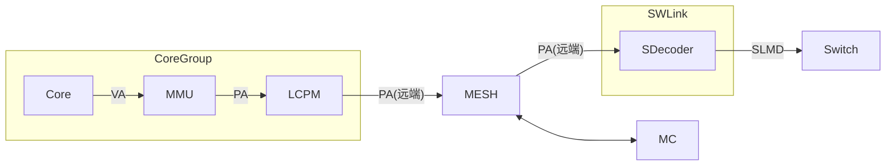
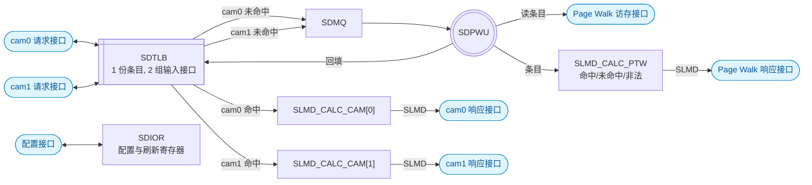
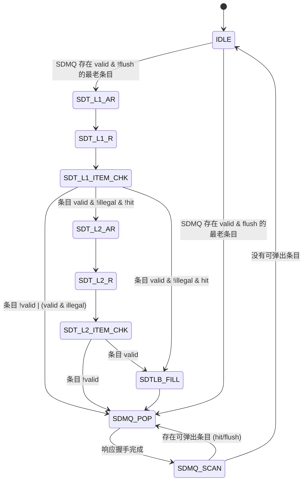
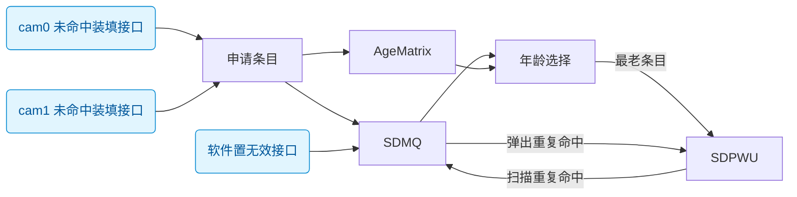
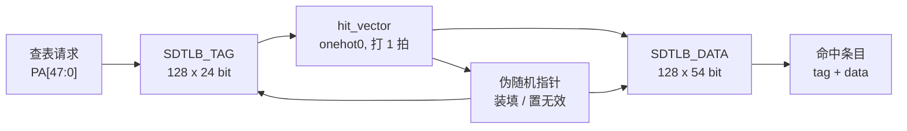

# SDecoder 设计方案

## 概述

### 基本功能

SDecoder 的核心功能做的是 **PA 到 SLMD 的代换**.

SDecoder 位于 User 侧 (内存物理资源的访问方), 挂在 SWLink 内, 它一方面接收从 MESH 网络传来的远端 PA 访问请求, 另一方面将这些请求转为 SLMD 并发送出去



图: SDecoder 在系统中的位置

### 缩写表

| 缩写 | 全称 |
| --- | --- |
| SDecoder | SWLink Decoder |
| SDTLB | SDecoder TLB |
| SDPWU | SDecoder Page Walk Unit |
| SDMQ | SDecoder Miss Queue |
| SLMD | SWLink Memory Descriptor |
| EID | Entity Identifier |
| TokenID | Token Identifier |
| SLA | SWLink Address |
| VA | Virtual Address |
| PA | Physical Address |
| TLB | Translation Lookaside Buffer |
| CAM | Content Addressable Memory |
| RSVD | Reserved |
| PW | Page Walk |
| IOR | IO Register |
| W1P | Write 1 to Pulse |
| W1C | Write 1 to Clear |

<!-- [TODO] 其他缩写表内容后续待补充 -->

## 架构

### SDecoder

#### 微结构



图: SDecoder 内部结构.

SDecoder 采用 "单 TLB + 双 CAM 接口 + 单 page table walker" 的结构

SDTLB 的物理实现只有 1 份, 但有 2 组独立的输入接口 (CAM), 分别接上游的 2 个请求, 两路 CAM 请求接口可以并行查表

两路 cam 请求未命中 SDTLB 都进入同一个 SDMQ, 由一套串行的 SDPWU 做 Page Walk, Page Walk 完成后回填 SDTLB

响应侧有 3 个相互独立的 `SLMD_CALC` 模块, 分别归属 cam0 命中, cam1 命中, Page Walk 结果, 每个 `SLMD_CALC` 模块互不阻塞, 独自响应, 只驱动自己那条响应通道

图上只画了 SDIOR 与配置接口的连接; 它输出的置无效 (刷新) 命令作用于 SDTLB, 统计的异常信息从 SDecoder 顶层输出, 寄存器编码见 "可配置的寄存器" 一节.

#### 接口分组

| 接口信号 | 定位 | 方向 | 说明 |
| --- | --- | --- | --- |
| `cam0_req_*` | Slave | 输入 | 上游 master 发起的请求 |
| `cam0_rsp_*` | Slave | 输出 | cam0 命中时返回 SLMD |
| `cam1_req_*` | Slave | 输入 | 上游 master 发起的请求 |
| `cam1_rsp_*` | Slave | 输出 | cam1 命中时返回 SLMD |
| `pw_rsp_*` | Slave | 输出 | SDTLB 未命中, Page Walk 完成后返回的 SLMD 或错误 |
| `pw_ar*` | Master | 输出 | Page Walk 访存请求, 读地址通道 |
| `pw_r*` | Master | 输入 | Page Walk 访存请求, 读数据通道 |
| `cfg_*` | Slave | 输入 / 输出 | 配置内部的寄存器 |

各接口逐信号的定义见 "接口信号" 一节; 另有 `clk` / `rst_n`, 单时钟域.

除配置接口外, 其余接口都采用 valid-ready 握手, 信号名为 `*valid` / `*ready` 风格: 握手完成于 `valid` 与 `ready` 同时为高的上升沿; 要求 `valid` 不得组合依赖 `ready`, 且 `valid` 拉高后到握手完成前荷载保持不变

由于响应**不**保序: 例如先到的请求未命中 SDTLB, 经过长时间 Page Walk 后才能响应, 但后到的请求如果命中 SDTLB, 则会先返回这个后到的命中 SDTLB 的响应. 为了使请求和响应能够匹配, 请求和响应接口都需要带 id 号, **且同一时刻在途的 id 必须唯一**, 上游只能按 id 进行匹配, 不能依赖响应顺序进行匹配

#### 模块划分

1. `SDTLB`: 全相联 CAM, 共 `SDTLB_ENTRIES` 个条目, 只有 1 份条目存储; 对外是 2 组输入接口 cam0 / cam1, 两路可以并行查表; 命中结果按来源从对应的 `camN_rsp_*` 返回. 回填和置无效都只作用于这一份 TLB 条目.
2. `SDMQ`: 深度 `SDMQ_DEPTH`, 存放未命中的 PA 和 `req_id`. TLB 的 2 个 CAM 出口都接到它, 两路未命中进同一个队列, 由年龄矩阵管理, 按年龄从老到年轻输出给 SDPWU.
3. `SDPWU`: 串行 Page Table Walker, 从 SDMQ 取请求做两级 Page Walk, 对 2 级页表做只读操作. Page Walk 完成后把结果交给 SLMD_CALC_PTW, 由它拼装 SLMD 并从 `pw_rsp_*` 返回; 检查通过的结果回填 SDTLB.
4. `SLMD_CALC_CAM[0]` / `SLMD_CALC_CAM[1]` / `SLMD_CALC_PTW`: 3 个实例相互独立. `SLMD_CALC_CAM[0]` / `SLMD_CALC_CAM[1]` 用 TLB 命中条目和请求 PA 算出 SLA 并拼出 SLMD; SLMD_CALC_PTW 用 SDPWU 的 Page Walk 结果判定命中 / 未命中 / 非法, 拼出 SLMD 或错误. 每个实例只驱动对应的响应接口, 实例之间不共享流水级, 一条通道反压不影响另外两条.
5. `SDIOR`: 配置与刷新寄存器, 输出 `SDecoder_PTBR` 和置无效命令, 置无效作用于 SDTLB.

#### 命中通路

1. 接收: cam0 和 cam1 两组接口独立握手, 两路可以同拍并行接收请求
2. 命中: 两路 cam 请求查的是同一份 TLB 条目, 命中后将 tag 和 data 输出
3. CAM 命中到响应输出的通路不设 FIFO, `SLMD_CALC_CAM[n]` 接收 tag 和 data 后, 拼装成 SLMD 输出到响应接口上

注: 由于不设 FIFO, 所以上级模块应尽快从响应接口取走数据, 取走不及时会反压该路的请求接口 (请求端 ready 拉低); 如果上游有能力做到无条件接收响应, 则例化 SDecoder 时可以把响应端的 ready 信号置为常 1

#### 未命中通路

1. 接收: cam0 和 cam1 两组接口独立握手, 两路可以同拍并行接收请求
2. 未命中: cam0 和 cam1 的未命中都写入同一个 SDMQ, 未命中通路与命中通路互不阻塞, 只要 SDMQ 没满就可以接收请求; SDMQ 将满时拉低对应路请求接口的 ready 接口反压上游请求
3. Page Walk: SDPWU 从 SDMQ 取请求, 并能通过最多 2 次访存获取到页表条目, Page Walk 完成后将结果交给 SLMD_CALC_PTW, 由 SLMD_CALC_PTW 判定命中 / 未命中 / 非法, 并拼装 SLMD 或错误, 并从响应接口返回数据
4. 如果 SLMD_CALC_PTW 判定 Page Walk 结果合法, 则回填 SDTLB
5. 如果 SLMD_CALC_PTW 判定 Page Walk 结果合法, 则 SDMQ 中命中同段/页的条目可以被提前弹出; 即 SDPWU 继续用该 Page Table Entry 去扫描 SDMQ, 弹出所有被该段/页覆盖的条目, 继续交由 SLMD_CALC_PTW 做 SLMD 拼装, 并从响应接口返回数据
6. 如果 SLMD_CALC_PTW 判定 Page Walk 结果非法, 则此次 Page Walk 结果不回填 SDTLB, 也不扫描 SDMQ, 直接从响应接口返回错误

注: SDPWU 是串行的, 一次只能处理一个请求, SDMQ 按年龄从老到年轻取请求, 响应仍按 `req_id` 乱序匹配.

注: 由于两路共用 SDMQ, 且 2 路 cam 请求机会均等, 所以 SDMQ 将满时同时反压 2 路 cam 请求

### SDPWU

#### Page Table 结构

##### 地址划分

核心视角的虚地址 VA 为 53 位, 物理地址 PA 为 48 位. PA[47] 用于区分地址空间:

- PA[47] = 0: Mem 空间, 共 128 TB
- PA[47] = 1: IO 空间, 共 128 TB

因为 SDecoder 只处理 Mem 空间, 所以断言 PA[47] 恒为 0, 实际有用的是 PA[46:0]

虽然 PA[47] 恒为 0, 但现在 Page Table 中仍然保留该位:

1. 一级表的基地址 SDecoder_PTBR[47]
2. 二级表的基地址 SDT_L2_BASE[47]

所以对于一个 PA 请求, 其位域划分如下:

| 名称 | 位域 | 说明 |
| --- | --- | --- |
| 地址空间标识 | [47] | 0: Mem 空间, 1: IO 空间 |
| 一级表索引 | [46:35] | 一级表条目**最大**覆盖 32GB |
| 二级表索引 | [34:30] | 二级表条目**固定**覆盖 1GB |
| 页内偏移 | [29:0] | 原样透传到 SLA[29:0], 不参与查表 |

##### 段页混合表

SDecoder 采用 "段页混合" 的两级代换表: 一级表条目描述一个段 (最大 32GB), 二级表条目描述一个 1GB 页

| 表 | 条目数 | 条目宽度 | 覆盖范围 | 存储开销 |
| --- | --- | --- | --- | --- |
| 一级表 | 4096 | 16B | 128TB | 64KB |
| 二级表 (单表) | 32 | 8B | 32GB | 256B |

注 1: 一级表在内存中只有 1 张, 二级表在内存中有 4096 张
注 2: 一级表的覆盖范围 (最大) = 32GB × 4096 = 128TB
注 3: 一级表的存储开销 = 16B × 4096 = 64KB
注 4: 二级表 (单表) 的覆盖范围 = 1GB × 32 = 32GB
注 5: 二级表 (单表) 的存储开销 = 8B × 32 = 256B
注 6: 二级表 (合计) 总存储开销 = 256B × 4096 = 1MB

软件约束:

1. 两级代换表必须存放在本芯片的本地 HBM / DDR 上, 不允许存放在远端池化内存中. 否则读表本身就会变成一次远端访问, 会经过一次 SWLink 环回
2. 两级代换表在内存中的基地址对界: 硬件只使用基地址的高位, 不对对界做检查
   1. SDecoder_PTBR 按 16B 对界 (一级条目大小为 16B)
   2. SDT_L2_BASE 按 8B 对界 (二级条目大小为 8B)
3. PA 查表的索引是"基地址 + 索引 × 条目宽度", 一级表本身基地址 SDecoder_PTBR 由软件填写 IO 寄存器, 二级表基地址 SDT_L2_BASE 由一级表条目提供

##### 一级表条目

一级表的条目宽度为 16B (128 bit)

| 位域 | 位宽 | 名称 | 说明 |
| --- | --- | --- | --- |
| [127:110] | 18 | RSVD | 保留 |
| [109:65] | 45 | SDT_L2_BASE[47:3] | 二级表基地址 |
| [64:54] | 11 | EID[10:0] | SLMD 的组成部分 |
| [53:44] | 10 | TokenID[9:0] | SLMD 的组成部分 |
| [43:34] | 10 | TokenValue[9:0] | SLMD 的组成部分 |
| [33:11] | 23 | S_PFN[52:30] | 段式代换的 SLA 基址, 以 1GB 对界 |
| [10:6] | 5 | SEG_LEN[34:30] | 段长度, 以 1GB 对界 |
| [5:1] | 5 | SEG_BASE[34:30] | 段基址, 以 1GB 对界 |
| [0] | 1 | Valid | 条目有效位 |

注 1: SEG_LEN 实际上是段表偏移, 其含义类似 AXI 的 AxLEN, 实际段的长度为 (SEG_LEN + 1) * 1GB
注 2: 段表下界为 SEG_BASE, 上界为 SEG_BASE + SEG_LEN
注 3: 这是 "段页混合" 式的表, 且段表有且仅有 1 个. 优先在一级表查是否命中段表, 不命中的话再去二级表查是否命中页表

一级表条目地址:

1. 按条目大小对界 (16B), 因此断言 SDecoder_PTBR[3:0] 为 4'h0, 硬件取 {SDecoder_PTBR[47:4], 4'h0}, 低 4 位忽略
2. L1 条目地址 = {SDecoder_PTBR[47:4], 4'h0} + PA[47:35] * 16

一级表命中条件:

1. 一级表条目位域 Valid = 1
2. SEG_BASE[34:30] <= PA[34:30] <= SEG_BASE[34:30] + SEG_LEN[34:30]

一级表命中计算 SLA:

1. SLA[52:30] = S_PFN[52:30] + (PA[34:30] - SEG_BASE[34:30])
2. SLA[29:0] = PA[29:0]

软件约束, 不能写非法的一级表条目:

1. SEG_BASE + SEG_LEN > 31
2. S_PFN[52:30] + (PA[34:30] - SEG_BASE[34:30]) 溢出

##### 二级表条目

二级表条目宽度 8B (64 bit)

| 位域 | 位宽 | 名称 | 说明 |
| --- | --- | --- | --- |
| [63:55] | 9 | RSVD | 保留 |
| [54:44] | 11 | EID[10:0] | SLMD 的组成部分 |
| [43:34] | 10 | TokenID[9:0] | SLMD 的组成部分 |
| [33:24] | 10 | TokenValue[9:0] | SLMD 的组成部分 |
| [23:1] | 23 | S_PFN[52:30] | 页式代换的 SLA 基址, 以 1GB 对界 |
| [0] | 1 | Valid | 二级条目有效位 |

二级表条目地址:

1. 按条目大小对界 (8B), 因此断言 SDT_L2_BASE[2:0] 为 3'h0, 硬件取 {SDT_L2_BASE[47:3], 3'h0}, 低 3 位忽略
2. L2 条目地址 = {SDT_L2_BASE[47:3], 3'h0} + PA[34:30] * 8

二级表命中条件:

1. 一级表条目位域 Valid = 1
2. 一级表未命中, 即 PA[34:30] 不在段范围内
3. 二级表条目位域 Valid = 1

二级表命中计算 SLA:

1. SLA[52:30] = S_PFN[52:30]
2. SLA[29:0] = PA[29:0]

#### Page Walk 状态机



图: SDPWU 状态机

注: flush 即 SDecoder 被 IO 寄存器的 `SDecoder_IA` / `SDecoder_IS` 置无效
注: 状态机图里的「条目」有两种含义, 注意区分: 一种是 SDMQ 条目 (如 `IDLE` 的选择条件, 以及 `SDMQ_SCAN` / `SDMQ_POP` 处理的条目), 另一种是 PageTable 条目 (如 `SDT_L1_ITEM_CHK` / `SDT_L2_ITEM_CHK` 检查的条目)
注: 目前 `SDT_L1_ITEM_CHK` 判为非法的情况是段的 1GB 上界超出本条目的 32GB 区间, 即 `SEG_BASE + SEG_LEN > 31`
注: 目前 `SDT_L2_ITEM_CHK` 不存在非法条目

`SDT_L1_ITEM_CHK` 状态转移表

| valid | illegal | hit | 行为 |
| --- | --- | --- | --- |
| 0 | X | X | 缺页异常, 不装填 SDTLB |
| 1 | 1 | X | 缺页异常, 不装填 SDTLB |
| 1 | 0 | 0 | 未命中一级表 (段表), 前往访问二级表 (页表) |
| 1 | 0 | 1 | 命中一级表 (段表), Page Walk 结束, 装填 SDTLB |


状态说明:

- `IDLE`: 空闲, 从 SDMQ 中选 valid 且年龄最老的条目; 该条目未被 flush 时进入 `SDT_L1_AR` 执行 Page Walk, 已被 flush 时直接进入 `SDMQ_POP` 弹出并响应, 不做 Page Walk
- `SDT_L1_AR`: Page Walk, 写一级表条目地址, 等 `arready`
- `SDT_L1_R`: Page Walk, 读一级表条目数据
- `SDT_L1_ITEM_CHK`: 检查一级表条目: `!valid` 或 `valid & illegal` 时转 `SDMQ_POP` (返回异常, 不装填 SDTLB); `valid & !illegal & !hit` 时转 `SDT_L2_AR` 去查二级表; `valid & !illegal & hit` 时转 `SDTLB_FILL`
- `SDT_L2_AR`: Page Walk, 写二级表条目地址, 等 `arready`
- `SDT_L2_R`: Page Walk, 读二级表条目数据
- `SDT_L2_ITEM_CHK`: 检查二级表条目: 条目无效 (`!valid`) 则转 `SDMQ_POP`, 条目有效 (`valid`) 则转 `SDTLB_FILL`
- `SDTLB_FILL`: 把合法的 Page Walk 结果装填进 SDTLB (写 Tag / Data 并置 `Valid = 1`), 装填完成后转 `SDMQ_POP`
- `SDMQ_POP`: 弹出待响应的 SDMQ 条目 (可能来自 `SDTLB_FILL` 之后的当前请求, 也可能来自 `SDMQ_SCAN` 选出的重复命中 / 已 flush 条目), 交给 SLMD_CALC_PTW 校验条目数据合法性并拼装 SLMD, 从 `pw_rsp_*` 返回; 已被 flush 的条目按特殊标识 (非法/已刷新) 直接响应; 响应握手完成后转 `SDMQ_SCAN`
- `SDMQ_SCAN`: 用本次 Page Walk 的结果扫描 SDMQ, 找出被同段/页覆盖的条目和已被 flush 的条目: 存在可弹出条目则转 `SDMQ_POP`, 没有则回 `IDLE`

注: 只有 Page Walk 得到的条目合法时才经过 `SDTLB_FILL` 回填 SDTLB; 之后扫描 SDMQ 的其他命中条目时, 不重复回填

#### 清空 SDMQ 中命中的条目


### SDMQ

#### 微结构



图: SDMQ 内部结构. 模块用矩形, 接口用圆角矩形. 两路 CAM 未命中经装填接口同拍申请条目, 同时写入 SDMQ 条目存储和 `AgeMatrix`; 年龄选择按年龄挑出最老的条目, 送给 SDPWU 做 Page Walk; Page Walk 完成后, 用结果扫描 SDMQ 中重复命中的条目, 并把它们弹出送给 SDPWU.


#### 条目内容

SDMQ 是一个深度为 `SDMQ_DEPTH` 的队列, 每个条目主要存储 SDTLB 未命中的 PA 以及附属的一些相关信息

SDMQ 条目的字段:

| 字段 | 位宽 | 说明 |
| --- | --- | --- |
| Valid | 1 | 条目有效位 |
| Invalidated | 1 | 条目被软件置无效位 |
| Illegal | 1 | 条目非法位, 由 SDPWU 完成后返回的结果判定 |
| PA[46:30] | 17 | 未命中请求的 PA[46:30] |
| req_id | `REQ_ID_WIDTH` | 未命中请求的 req_id |

注: SDMQ 只写位宽, 不写位域, 因为后续条目数和位宽值可能改变, 位域修改起来比较麻烦
注: 当 Valid 和 Invalidated 都为 1 时, 该条目被软件置无效, 等待被 SDMQ 弹出并通过 SDPWU 对外发起特殊标识的 `rsp_*` 响应

#### 申请条目

当 SDTLB 未命中时, 向 SDMQ 申请条目, 将该请求的 PA[46:30] 和 req_id 写入 SDMQ. 如果 SDMQ 将满, 则拉低 camN_req_ready 反压上游请求.

由于 SDTLB 有 2 个 CAM 接口, 所以 SDMQ 可以同拍接收 2 条请求的条目申请, 所以 "SDMQ 将满" 指的是 SDMQ 里还剩 0 或 1 个空闲条目

SDMQ 可以悬挂多个请求, 但这些 Miss 请求**不做**相关性判断, 由于本次设计中, "同一时刻在途的 `req_id` 必须唯一, `rsp_id` 完全乱序, 上游按 ID 匹配", 所以即使 PA[46:30] 完全相同, 它们的 `req_id` 也必然不同, 也就是请求必定不相关, 不可以在 SDMQ 中合并

注: 当 SDMQ 还剩 2 个空闲条目, 此时 camN_req_ready 还是处于高电平, 若此时 2 个请求同时申请 SDMQ, 则 SDMQ 会被写满, 即还剩 0 个空闲条目的情况, 同时 camN_req_ready 拉低反压上游请求, 直到 SDMQ 弹出 2 个条目后才恢复 camN_req_ready 高电平

注: 当 SDMQ 还剩 2 个空闲条目, 此时 camN_req_ready 还是处于高电平, 若此时仅有 1 个请求申请 SDMQ, 则 SDMQ 还能剩下 1 个空闲条目, 但为避免之后 2 个请求同时申请 SDMQ 而导致 SDMQ 溢出, 所以 camN_req_ready 提前拉低反压上游请求, 直到 SDMQ 弹出 1 个条目后才恢复 camN_req_ready 高电平

注: 与 Core 内 DTB 不同, 如果 Core 内 DTBMQ (DTB_MISS_QUEUE) 只有 1 个空闲条目, 则将空闲条目分配给流水线 A 上的请求, 流水线 B 上的请求做 "DTBMQ 满" 的冲突处理; SDecoder 的 2 个 CAM 请求接口是机会均等的, 应该不会出现优先把空闲条目分配给某一路请求的情况, 所以 SDMQ 将满但未满时提前拉低 camN_req_ready

注: 与 Core 内 DTB 不同, Core 内访存指令不命中 DTB 时, 是申请 DTBMQ 条目或与已分配的 DTBMQ 条目合并; 但 SDMQ 不合并完全一致的 PA[46:30] 未命中请求, 因为每个 req_id 都需要独立返回响应, 不能合并

#### 删除条目

Page Walk 完成时, 会与所有 SDMQ 条目做 CAM 比较, 如果 SDMQ 中存在与当前 Page Walk 命中 Page Table 同一个段/页的条目, 则 SDPWU 不再继续做 Page Walk, 而是按照这些命中条目的年龄关系, 把这些条目按年龄从老到年轻的顺序依次弹出 SDMQ, 拼装成 SLMD 并从 `pw_rsp_*` 依年龄顺序返回

#### 年龄矩阵

年龄矩阵的大小为 `SDMQ_DEPTH × SDMQ_DEPTH`, 记录 SDMQ 中每个条目的年龄关系, `AgeMatrix[i][j] = 1` 表示 SDMQ 中第 i 个条目比第 j 个条目更老

申请 SDMQ 条目时, 按照请求写入条目的顺序, 设置各个条目的年龄关系, 先写入的条目比后写入的条目更老

注: 因为 SDMQ 是乱序删除其中的条目的 (后写入的条目可能先被删除), 所以不能使用传统队列的读写指针控制 MISS 请求的输出, 所以这里用年龄矩阵来记录 SDMQ 中每个条目的年龄关系, 年老的条目优先输出, 即使后写入的条目先被删除后又被申请, 该条目也是最年轻的

注: 如果 2 个 Miss 请求同拍申请 SDMQ 条目, 那么申请到条目号比较大的那个请求更年轻

注: 年龄矩阵主要解决的是当 SDMQ 中存在多个条目命中同一个段/页的情况, SDMQ 删除这些条目后, 能知道下一个准备做 Page Walk 的请求是哪个

### SDTLB

#### 微结构



| 功能 | 说明 |
| --- | --- |
| 概述 | 缓存 PA 到 SLMD 的映射, 命中给出命中的 TLB 条目值 |
| 组织结构 | 全相联 (CAM + FF + Latch) |
| 条目数 | 128 |
| 条目粒度 | 1GB 到 32GB |
| 查表 | 单读端口, tag 比较组合, hit 向量打 1 拍 |
| 写入 | 仅由 Page Walk 结果在检查通过后回填, 软件不可写 |
| 清除 | 由刷新接口置无效 |

段式和页式统一按 "段" 处理, 把 1GB 页看作长度为 1 的段. 命中判断和 SLA 计算只有一套逻辑, 不需要为两种映射各做一张快表. 页和段都用 `PA_Base` / `PA_Up` 表示, 不设额外的粒度位.

#### 条目内容

| 模块 | 字段 | 位宽 | 存储 | 说明 |
| --- | --- | --- | --- | --- |
| Tag | `PA_Base[47:30]` | 18 | Latch | 段/页基址, 1GB 对界 |
| Tag | `PA_Up[34:30]` | 5 | Latch | 段/页上界 (含), 1GB 对界 |
| Tag | `Valid` | 1 | FF | 条目有效位 |
| Data | `EID[10:0]` | 11 | Latch | Entity 标识 |
| Data | `TokenID[9:0]` | 10 | Latch | 查找上下文使用 |
| Data | `TokenValue[9:0]` | 10 | Latch | 凭据校验使用 |
| Data | `S_PFN[52:30]` | 23 | Latch | SLA 基址, 1GB 对界 |

注: 页: `PA_Base[34:30] = PA_Up`;
注: 段: `PA_Up = SEG_BASE + SEG_LEN`.

#### 访问条目

命中条件:

1. `Valid = 1`.
2. `PA[47:35] == PA_Base[47:35]`.
3. `PA_Base[34:30] <= PA[34:30] <= PA_Up`.

- 128 个 Tag 并行比较, 得到 onehot0 的 `hit_vector`; 正常配置下最多命中一个; 多命中属于配置错误, 行为未定义 (仿真用 onehot0 断言检查, 不考虑写成异常).
- Tag CAM 比较是组合逻辑; `hit_vector` 打 1 拍后再用; 请求拍 T 的命中结果固定在 T+1 有效.
- Data 用 `hit_vector` 做 onehot 选路, 输出命中条目的 tag/data.
- 装填在时钟沿更新 Tag/Data 与 `Valid`; 查表只读, 同拍请求看到的是装填前的条目.

命中后的 SLA:

```text
SLA[52:30] = S_PFN[52:30] + (PA[34:30] - PA_Base[34:30])
SLA[29:0]  = PA[29:0]
```

#### 装填条目

SDTLB 只允许硬件装填, 即通过 SDPWU 的 Page Walk 结果回填 SDTLB, 软件不允许直接写入 SDTLB

- 如果 Page Walk 命中的是有效的一级表 (段表), 则回填的 SDTLB 的 Tag 条目为
  - `PA_Base = {PA[47:35], SEG_BASE[34:30]}`
  - `PA_Up = SEG_BASE + SEG_LEN`
- 如果 Page Walk 命中的是有效的二级表 (页表), 则回填的 SDTLB 的 Tag 条目为
  - `PA_Base = PA[47:30]`
  - `PA_Up = PA[34:30]`
- 无论 Page Walk 命中的是一级表还是二级表, 回填的 SDTLB 的 Data 条目原样不变
  - `EID / TokenID / TokenValue / S_PFN`

只有无异常的 Page Walk 结果才会回填 SDTLB

当 SDTLB 有空闲条目时, 将装填数据填入到空闲的 SDTLB 条目中, 若有多条空闲条目, 则优先装填低位的空闲条目

当 SDTLB 没有空闲条目时, 将装填数据填入到**伪随机**选择的 SDTLB 条目中, SDTLB 只有一级, 所以被淘汰的条目被完全丢弃, 只能通过 Page Walk 重新装填

装填在时钟沿写 Tag 和 Data, 并置 `Valid = 1`; 同一拍同一条目上置无效 (刷新) 优先, 此次装填丢弃

### SDIOR

## 参数

| 参数 | 默认值 |
| --- | --- |
| `PA_WIDTH` | 48 |
| `PA_MEM_WIDTH` | 47 |
| `SLA_WIDTH` | 53 |
| `EID_WIDTH` | 11 |
| `TOKEN_ID_WIDTH` | 10 |
| `TOKEN_VALUE_WIDTH` | 10 |
| `REQ_ID_WIDTH` | 8 |
| `SDTLB_ENTRIES` | 128 |
| `SDMQ_DEPTH` | 8 |
| `SDIOR_DATA_WIDTH` | 64 |
| `PW_RSP_ERR_WIDTH` | 6 |
| `CAM_RSP_ERR_WIDTH` | 1 |

注: `SDIOR_DATA_WIDTH` 目前是 64 bit, 但建议用 32 bit 以匹配 APB

## 接口信号

### 请求接口 (CAM)

| 信号 | 方向 | 位宽 | 说明 |
| --- | --- | --- | --- |
| `camN_req_valid` | I | 1 | / |
| `camN_req_ready` | O | 1 | / |
| `camN_req_pa` | I | `PA_WIDTH` | / |
| `camN_req_id` | I | `REQ_ID_WIDTH` | / |

注 1: 共有 2 组请求接口 (CAM), N 可取 [0, 1], 分别对应 TLB 的两组输入接口 (cam0 / cam1)

### 响应接口 (CAM)

| 信号 | 方向 | 位宽 | 说明 |
| --- | --- | --- | --- |
| `camN_rsp_valid` | O | 1 | / |
| `camN_rsp_ready` | I | 1 | / |
| `camN_rsp_id` | O | `REQ_ID_WIDTH` | / |
| `camN_rsp_eid` | O | `EID_WIDTH` | / |
| `camN_rsp_token_id` | O | `TOKEN_ID_WIDTH` | / |
| `camN_rsp_token_value` | O | `TOKEN_VALUE_WIDTH` | / |
| `camN_rsp_sla` | O | `SLA_WIDTH` | / |
| `camN_rsp_err` | O | `CAM_RSP_ERR_WIDTH` | / |

注 1: 共有 2 组响应接口 (CAM), N 可取 [0, 1], 分别对应 TLB 两组输入接口 (cam0 / cam1) 的响应

`camN_rsp_err` 位域含义:

| 名称 | 位域 | 说明 |
| --- | --- | --- |
| `camN_rsp_hit_onehot0_fail` | [0] | CAM 命中 SDTLB 的条目不唯一 |

注: 当软件修改了 Page Table 但未对 SDTLB 做刷新, 可能会出现 SDTLB 中存在多个条目命中同一个 PA 的情况, 这属于配置错误, 行为未定义, 但可以通过 `camN_rsp_hit_onehot0_fail` 位来检测到

### 响应接口 (Page Walk)

| 信号 | 方向 | 位宽 | 说明 |
| --- | --- | --- | --- |
| `pw_rsp_valid` | O | 1 | / |
| `pw_rsp_ready` | I | 1 | / |
| `pw_rsp_id` | O | `REQ_ID_WIDTH` | / |
| `pw_rsp_eid` | O | `EID_WIDTH` | / |
| `pw_rsp_token_id` | O | `TOKEN_ID_WIDTH` | / |
| `pw_rsp_token_value` | O | `TOKEN_VALUE_WIDTH` | / |
| `pw_rsp_sla` | O | `SLA_WIDTH` | / |
| `pw_rsp_err` | O | `PW_RSP_ERR_WIDTH` | / |

`pw_rsp_err` 位域含义:

| 名称 | 位域 | 说明 |
| --- | --- | --- |
| `pw_ctrl_err` | [5] | Page Walk 发生控制错 |
| `pw_ecc_err` | [4] | Page Walk 发生 ECC 错 |
| `pw_no_valid_sdt` | [3] | Page Walk 无法找到有效的表 |
| `pw_illegal_sdt_item` | [2] | Page Walk 发现非法条目 |
| `pw_illegal_sdt_l2_base` | [1] | Page Walk 发现二级表基地址非法 |
| `pw_illegal_sdt_l1_base` | [0] | Page Walk 发现一级表基地址非法 |

注: Page Walk 发生非法一/二级地址错示例, 本地只有 512GB 的 HBM/DDR, 但一级表或二级表的基地址被软件写成了超出 512GB 范围的地址 (可能实现不了, 待商榷)
注: Page Walk 发生非法条目错示例, `SEG_BASE + SEG_LEN > 31` 或 `S_PFN[52:30] + (PA[34:30] - SEG_BASE[34:30])` 溢出
注: Page Walk 无法找到有效的表示例, 一级表或二级表的 Valid = 0

### 访存接口 (Page Walk)

| 信号 | 方向 | 位宽 | 说明 |
| --- | --- | --- | --- |
| `pw_araddr` | O | `PA_WIDTH` | / |
| `pw_arvalid` | O | 1 | / |
| `pw_arready` | I | 1 | / |
| `pw_rdata` | I | 128 | / |
| `pw_rvalid` | I | 1 | / |
| `pw_rready` | O | 1 | / |

注: pw_rdata 是总线返回响应的宽度, 暂定 128bit

### 寄存器接口

#### 配置接口

| 信号 | 方向 | 位宽 | 说明 |
| --- | --- | --- | --- |
| `cfg_wr` | I | 1 | 写使能, 1 拍脉冲 |
| `cfg_rd` | I | 1 | 读使能, 1 拍脉冲 |
| `cfg_addr` | I | 2 | 寄存器索引 |
| `cfg_wdata` | I | `SDIOR_DATA_WIDTH` | 写数据 |
| `cfg_rdata` | O | `SDIOR_DATA_WIDTH` | 读数据 |

### 异常统计信号

异常统计信号不是 `cfg_*` 接口的一部分, 异常发生的下一拍, SDIOR 的异常统计寄存器的对应位置 1, 由 SDIOR 直通到 SDecoder 顶层输出.

| 信号 | 方向 | 位宽 | 说明 |
| --- | --- | --- | --- |
| `invalid_item` | O | 1 | 条目无效 |
| `illegal_page_table_addr` | O | 1 | 页表地址非法 (越界) |
| `data_ecc_err` | O | 1 | 页表数据 ECC 错 |
| `ctrl_ecc_err` | O | 1 | 页表控制 ECC 错 |

异常寄存器可以通过软件读出 (`SDecoder_ES`), 也可以通过 W1C (Write 1 Clear) 的方式清除, 写 1 清除对应的寄存器位, 写 0 不影响寄存器位

`pw_rsp_err` 的位与异常统计信号的对应关系:

| `pw_rsp_err` 位 | 异常统计信号 |
| --- | --- |
| `pw_ctrl_err` | `ctrl_ecc_err` |
| `pw_ecc_err` | `data_ecc_err` |
| `pw_no_valid_sdt` | `invalid_item` |
| `pw_illegal_sdt_item` | `invalid_item` |
| `pw_illegal_sdt_l1_base` | `illegal_page_table_addr` |
| `pw_illegal_sdt_l2_base` | `illegal_page_table_addr` |
| `camN_rsp_hit_onehot0_fail` | `invalid_item` |

注: 多个 `pw_rsp_err` 位可以落到同一个异常统计信号, 统计信号是这一类异常出现过的汇总位

## 软件接口

### 页表条目

见 "Page Table 结构" 一节

### 代换基址

一级表基地址寄存器定名为 `SDecoder_PTBR`

### 软件刷新

SDecoder_IA
SDecoder_IS.INVL_UPA[46:30], 位宽 17 bits, 放在 SDecoder_IS[16:0] 里

## 异常处理

可能会有由于 valid-ready 握手导致的死锁/活锁问题

有些异常是没法处理的, 尤其是当软件修改了 Page Table 的内容, 但忘记了去刷新 SDecoder 的 SDTLB 的情况


## 可配置的寄存器

| `cfg_addr` | 寄存器 | 属性 | 说明 |
| --- | --- | --- | --- |
| 0 | `SDecoder_IA` | W1P | 写 bit0 = 1, 置无效全部 SDTLB 条目 |
| 1 | `SDecoder_IS` | W1P | 置无效覆盖 `INVL_UPA[46:30]` 的条目; 该字段放在 `SDecoder_IS[16:0]`, 见 "软件接口" 一节 |
| 2 | `SDecoder_PTBR` | RW | 一级表基地址 `PA[47:0]`, 16B 对界 |
| 3 | `SDecoder_ES` | RW / W1C | 异常统计寄存器, 各位对应 `invalid_item` / `illegal_page_table_addr` / `data_ecc_err` / `ctrl_ecc_err`, 写 1 清除 |
| 4 | `SDecoder_ES_CTL` | RW | 异常统计寄存器使能控制寄存器, 每一位控制一个 `SDecoder_ES` 的异常位 |
| 5 | `SDecoder_Perf_CTL` | RW | 性能计数使能控制寄存器 |
| 6 | `SDecoder_SDTLB_AccessCnt` | RW | 统计过程中 SDTLB 快表查询次数 |
| 7 | `SDecoder_SDTLB_HitCnt` | RW | 统计过程中 SDTLB 快表命中次数 |
| 8 | `SDecoder_SDT_L1_AccessCnt` | RW | 统计过程中访问一级 Page Table 命中次数 |
| 9 | `SDecoder_SDT_L2_AccessCnt` | RW | 统计过程中访问二级 Page Table 命中次数 |


### SDecoder_ES


