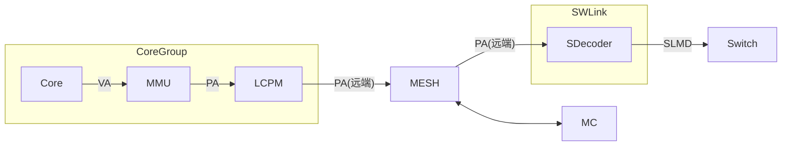

# SDecoder 设计方案

## 概述

### 总体描述

SDecoder 的核心功能做的是 **PA 到 SLMD 的代换**.

SDecoder 位于 User 侧 (内存物理资源的访问方), 挂在 SWLink 内, 它一方面接收从 MESH 网络传来的远端 PA 访问请求, 另一方面将这些请求转为 SLMD 并发送出去

图: SDecoder 在系统中的位置

### 缩写表

| 缩写 | 全称 |
| --- | --- |
| SDecoder | SWLink Decoder |
| SDTLB | SDecoder TLB |
| SDPTW | SDecoder Page Table Walker |
| MISS_FIFO | Miss FIFO |
| SLMD | SWLink Memory Descriptor |
| EID | Entity Identifier |
| TokenID | Token Identifier |
| SLA | SWLink Address |
| VA | Virtual Address |
| PA | Physical Address |
| TLB | Translation Lookaside Buffer |
| CAM | Content Addressable Memory |
| RSVD | Reserved |
| PW | Page Walk |
| PTW | Page Table Walker |
| IOR | IO Register |
| W1P | Write 1 to Pulse |

<!-- [TODO] 其他缩写表内容后续待补充 -->

## 架构

### SDecoder

### SDPTW

#### 地址划分

核心视角的虚地址 VA 为 53 位, 物理地址 PA 为 48 位. PA[47] 用于区分地址空间:

- PA[47] = 0: Mem 空间, 共 128 TB
- PA[47] = 1: IO 空间, 共 128 TB

因为 SDecoder 只处理 Mem 空间, 所以断言 PA[47] 恒为 0, 实际参与索引与匹配的是 PA[46:0]

虽然 PA[47] 恒为 0, 但现在 Page Table 仍然保留该位:

1. 一级表的基地址 SDT_L1_BASE[47]
2. 二级表的基地址 SDT_L2_BASE[47]

所以对于一个 PA 请求, 其位域划分如下:

| 名称 | 位域 | 说明 |
| --- | --- | --- |
| 地址空间标识 | [47] | 0: Mem 空间, 1: IO 空间 |
| 一级表索引 | [46:35] | 一级表的表项最大覆盖 32GB |
| 二级表索引 | [34:30] | 二级表的表项固定覆盖 1GB |
| 页内偏移 | [29:0] | 原样透传到 SLA[29:0], 不参与查表 |

#### 代换表结构

SDecoder 采用"段页混合"的两级代换表: 一级表条目描述一个段 (最大 32GB), 二级表条目描述一个 1GB 页

| 表 | 条目数 | 条目宽度 | 覆盖范围 | 存储开销 |
| --- | --- | --- | --- | --- |
| 一级表 | 4096 | 16B | 128TB | 64KB |
| 二级表 (单表) | 32 | 8B | 32GB | 256B |

注 1: 一级表在内存中只有 1 张, 二级表在内存中有 4096 张
注 1: 一级表的覆盖范围 = 32GB × 4096 = 128TB
注 2: 一级表的存储开销 = 16B × 4096 = 64KB
注 3: 二级表 (单表) 的覆盖范围 = 1GB × 32 = 32GB
注 4: 二级表 (单表) 的存储开销 = 8B × 32 = 256B
注 5: 二级表 (合计) 总存储开销 = 256B × 4096 = 1MB

### 代换表表项格式

一级表条目宽度 16B (128 bit).

| 位域 | 名称 | 位宽 | 说明 |
| --- | --- | --- | --- |
| [127:96] | RSVD | 32 | 保留 |
| [94:50] | L2_BASE[47:3] | 45 | 二级表基地址 |
| [49:39] | EID[10:0] | 11 | 段式代换使用的 Entity 标识 |
| [38:29] | TokenID[9:0] | 10 | 段式代换使用的逻辑池标识 |
| [28:11] | S_PFN[47:30] | 18 | 段式代换的 SLA 基址, 以 1GB 对界 |
| [10:6] | SEG_LEN[34:30] | 5 | 段长度编码, 段上界 = SEG_BASE + SEG_LEN |
| [5:1] | SEG_BASE[34:30] | 5 | 段基址, 以 1GB 对界 |
| [0] | Valid | 1 | 一级条目有效位 |

### SDTLB

## 参数

## 接口信号

### 请求接口

### 响应接口

### 访存接口

## 可配置的寄存器
