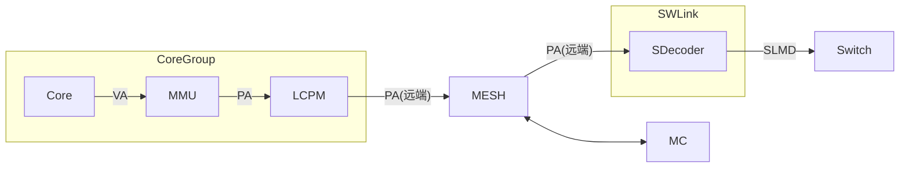
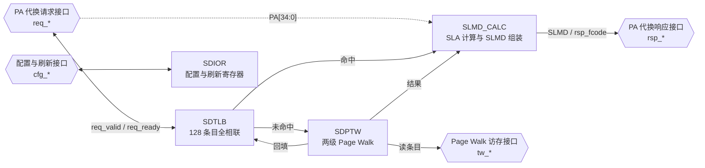
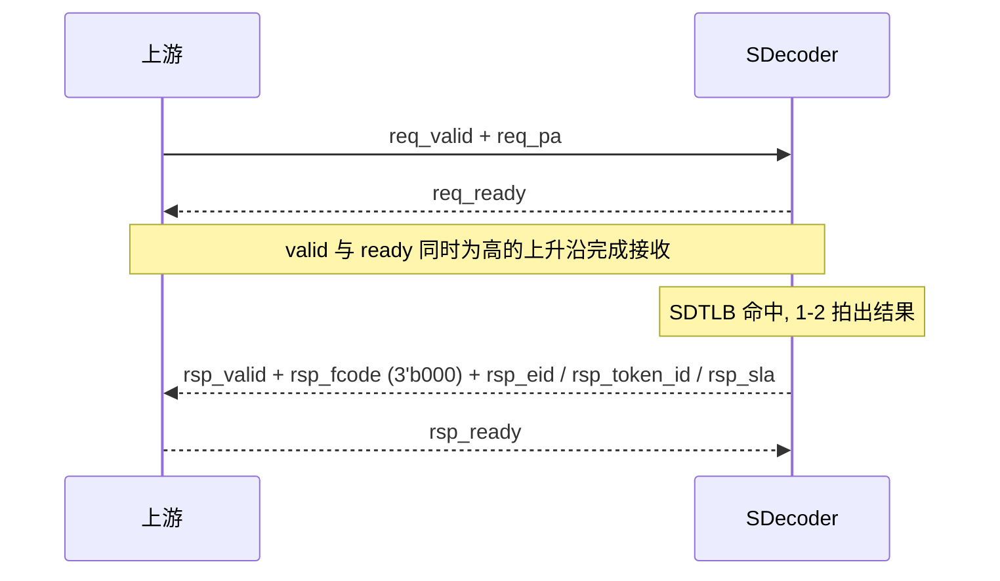
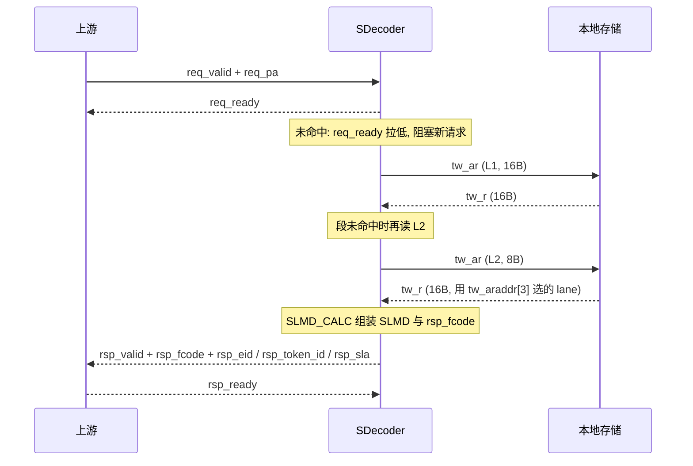

# SDecoder 设计方案

## 概述

SDecoder 位于 User 侧 (内存物理资源的访问方), 挂在 SWLink 内, 它一方面接收从 MESH 网络传来的远端 PA 访问请求, 另一方面将这些请求转为 SLMD 并发送出去

SDecoder 做的是 **PA 到 SLMD 的代换**.



图: SDecoder 在系统中的位置

本方案描述 SDecoder IP 内部的以下核心模块:

- **SDTLB**: 代换快表, 缓存已经算出来的 PA 到 SLMD 映射, 覆盖绝大多数访存
- **SDPTW**: Page Walk 模块, SDTLB 未命中时按两级代换表算出结果, 并把结果回填 SDTLB
- **SDIOR**: IO 寄存器模块, 提供 SDecoder 的控制/配置寄存器
- **SLMD_CALC**: SLMD 计算模块, 用于计算 SLMD 值 (主要是 SLA, EID 和 TokenID 原样透传)

## 缩写表

| 缩写 | 全称 |
| --- | --- |
| SDecoder | SWLink Decoder |
| SDTLB | SDecoder TLB |
| SDPTW | SDecoder Page Table Walker |
| SLMD | SWLink Memory Descriptor |
| EID | Entity Identifier |
| TokenID | Token Identifier |
| SLA | SWLink Address |
| VA | Virtual Address |
| PA | Physical Address |
| TLB | Translation Lookaside Buffer |
| PW | Page Walk |
| PTW | Page Table Walker |
| IOR | IO Register |
| W1P | Write 1 to Pulse |
| AMBA | Advanced Microcontroller Bus Architecture |
| APB | Advanced Peripheral Bus |
| AXI | Advanced eXtensible Interface |

<!-- [TODO] 其他缩写表内容后续待补充 -->

## 地址代换

### 地址划分

核心视角的虚地址 VA 为 53 位, 物理地址 PA 为 48 位. PA[47] 用于区分地址空间:

- PA[47] = 0: Mem 空间, 共 128TB.
- PA[47] = 1: IO 空间, 共 128TB.

SDecoder 只处理 Mem 空间, 因此断言 PA[47] 恒为 0, 实际参与索引与匹配的是 PA[46:0].

虽然 PA[47] 恒为 0, 但为了保持地址结构的完整性, 仍然保留该位. 主要包括以下几个地方:

1. SDecoder 的 PA 请求 PA[47]
2. 一级表 SDT_L1 的基地址 SDT_L1_BASE[47]
3. 二级表 SDT_L2 的基地址 L2_BASE[47]
4. 快表 SDTLB 的 TAG.PA_Base[47]

| 地址位 | 名称 | 用途 |
| --- | --- | --- |
| PA[47] | 地址空间标识 | 0: Mem 空间, 1: IO 空间 |
| PA[46:35] | 一级表索引 | 索引 SDT_L1, 每个条目覆盖 32GB |
| PA[34:30] | 二级表索引 / 段内偏移 | 索引 SDT_L2, 或作为段内 1GB 偏移 |
| PA[29:0] | 页内偏移 | 原样透传到 SLA[29:0], 不参与查表 |

### 代换表结构

SDecoder 采用"段页混合"的两级代换表: 一级表条目描述一个段 (最大 32GB), 二级表条目描述一个 1GB 页.

| 表 | 条目数 | 条目宽度 | 覆盖范围 | 存储开销 |
| --- | --- | --- | --- | --- |
| SDT_L1 | 4096 | 16B | 128TB | 64KB |
| SDT_L2 (单表) | 32 | 8B | 32GB | 256B |

注 1: SDT_L1 的覆盖范围 = 32GB × 4096 = 128TB
注 2: SDT_L1 的存储开销 = 16B × 4096 = 64KB
注 3: SDT_L2 的单表覆盖范围 = 1GB × 32 = 32GB
注 4: SDT_L2 的单表存储开销 = 8B × 32 = 256B
注 5: SDT_L2 的总存储开销 = 256B × 4096 = 1MB

### 计算表项地址

PA 查表的索引是"基地址 + 索引 × 条目宽度", 一级表本身基地址由软件填写, 二级表基地址由一级条目提供

一级表基地址: SDT_L1_BASE, 由软件配置, 按条目大小 16B 对界, 因此断言 SDT_L1_BASE[3:0] 为 4'h0
二级表基地址: L2_BASE, 来自一级表条目, 按条目大小 8B 对界, 因此断言 L2_BASE[2:0] 为 3'h0

硬件取 {SDT_L1_BASE[47:4], 4'h0} / {L2_BASE[47:3], 3'h0}, 低 4/3 位忽略

```text
L1 条目地址 = {SDT_L1_BASE[47:4], 4'h0} + PA[47:35] * 16
L2 条目地址 = {    L2_BASE[47:3], 3'h0} + PA[34:30] *  8
```

### 一级表表项格式

一级表条目宽度 16B (128 bit).

| 位域 | 名称 | 位宽 | 说明 |
| --- | --- | --- | --- |
| [127:96] | RSVD | 32 | 保留 |
| [95:51] | L2_BASE[47:3] | 45 | 二级表基地址 |
| [50:40] | EID[10:0] | 11 | 段式代换使用的 Entity 标识 |
| [39:30] | TokenID[9:0] | 10 | 段式代换使用的逻辑池标识 |
| [29:12] | S_PFN[47:30] | 18 | 段式代换的 SLA 基址, 以 1GB 对界 |
| [11:7] | SEG_LEN[34:30] | 5 | 段长度编码, 段上界 = SEG_BASE + SEG_LEN |
| [6:2] | SEG_BASE[34:30] | 5 | 段基址, 以 1GB 对界 |
| [1] | Type | 1 | 1 表示该 32GB 区间存在 1 个段式映射, 0 表示无段式映射 |
| [0] | Valid | 1 | 一级条目有效位 |

注 1: SEG_LEN 实际上是段表偏移, 其含义类似 AXI 的 AxLEN, 实际段的长度为 (SEG_LEN + 1) * 1GB
注 2: 段表下界为 SEG_BASE, 上界为 SEG_BASE + SEG_LEN
注 3: 这是段页混合式的表, 当 Type = 1 时, 该 32 GB 空间范围内除此 1 个段式映射外, 还可能在二级表中存在 0, 1 或 N 个页式映射
注 4: 软件约束, 段必须落在本条目所属的 32GB 区间内, 即 SEG_BASE + SEG_LEN <= 31.

非法的一级表条目:

1. SEG_BASE + SEG_LEN > 31
2. S_PFN[47:30] + (PA[34:30] - SEG_BASE[34:30]) 溢出
   1. 注意 PA[47] 断言为 0 的问题

### 二级表表项格式

二级表条目宽度 8B (64 bit).

| 位域 | 名称 | 位宽 | 说明 |
| --- | --- | --- | --- |
| [63:40] | RSVD | 24 | 保留 |
| [39:29] | EID[10:0] | 11 | 页式代换使用的 Entity 标识 |
| [28:19] | TokenID[9:0] | 10 | 页式代换使用的逻辑池标识 |
| [18:1] | S_PFN[47:30] | 18 | 页式代换的 SLA 基址, 以 1GB 对界 |
| [0] | Valid | 1 | 二级条目有效位 |

### 段表命中/代换

一级表的条目条目描述一个段: 段基址 SEG_BASE, 段上界 SEG_BASE + SEG_LEN, 段内 1GB 为单位, 一个段最大为 32GB

命中条件:

1. 一级表条目 Valid = 1
2. 一级表条目 Type = 1
3. SEG_BASE[34:30] <= PA[34:30]
4. PA[34:30] <= SEG_BASE[34:30] + SEG_LEN[34:30]

命中后计算 SLA:

1. SLA[47:30] = S_PFN[47:30] + (PA[34:30] - SEG_BASE[34:30])
2. SLA[29:0] = PA[29:0]

### 页表命中/代换

二级表的条目描述一个页: 二级条目描述的页的大小为 1GB

命中条件:

1. 一级表条目 Valid = 1
2. 二级表条目 Valid = 1
3. 一级表条目未命中段式代换, 即 Type = 0 或 PA[34:30] 不在段范围内

命中后计算 SLA:

1. SLA[47:30] = S_PFN[47:30]
2. SLA[29:0] = PA[29:0]

### 代换表的存储要求

1. 两级代换表必须存放在本芯片的本地 HBM / DDR 上, 不允许存放在远端池化内存中. 否则读表本身就会变成一次远端访问, 会经过一次 SWLink 环回
2. 对界: 硬件只使用基地址的高位, 不对对界做检查. 软件约定 SDT_L1_BASE 按 16B 对界 (一级表项大小为 16B), L2_BASE 按 8B 对界 (二级表项大小为 8B)

## SDecoder 设计

### 概述

SDecoder 的内部结构图如下所示:



SDIOR 是相对独立的寄存器模块, 图上只画它与配置与刷新接口的连接; 它与其他模块的控制关系在 SDIOR 设计一节说明.

初版不设未命中队列 (MISS FIFO): SDTLB 未命中时直接交给 SDPTW; SDPTW 同一时刻只处理一个 walk, 忙时通过 `req_ready` 反压, 阻塞新的 PA 请求, 直到本次 walk 完成并回填. SDPTW 只输出原始条目和 `rsp_sdt_l2_read`, 不直接产生响应码; 段/页选择, SLA 拼装和 `rsp_fcode` 由 SLMD_CALC 完成. 这样响应顺序与请求顺序天然一致, 不需要额外的保序逻辑. 用 FIFO 做 hit-under-miss 的性能优化留到后续版本, 四种做法与决策点见 [未命中队列与响应保序](未命中队列与响应保序.md).

### 接口

SDecoder 对外使用 native 接口 (自定义 valid/ready 握手), 不引入 AMBA 协议. 首版按四组划分: 代换请求, 代换响应, Page Walk 访存, 配置与刷新; 另有 `clk` / `rst_n`. 以后交付标准形态时, 在 IP 外面加一层薄 wrapper (配置挂 APB 从口, 访存挂 AXI 主口), 本节的字段语义不变.

#### 接口分组

| 接口组 | 前缀 | 方向 | 说明 |
| --- | --- | --- | --- |
| 时钟与复位 | `clk` / `rst_n` | 输入 | 单时钟域, `rst_n` 低有效 |
| 代换请求 | `req_*` | 输入 | 上游发起 PA 到 SLMD 的代换 |
| 代换响应 | `rsp_*` | 输出 | 返回 SLMD 或异常 |
| Page Walk 访存 | `tw_*` | 主端口 | 读本地 SDT_L1 / SDT_L2 |
| 配置与刷新 | `cfg_*` | 从端口 | 软件配置基地址, 置无效 SDTLB |

本 IP 只有一个时钟域; `rst_n` 异步复位, 建议同步释放. 复位期间 `req_ready` / `rsp_valid` / `tw_arvalid` / `tw_rready` 为 0.

#### 参数

| 参数 | 默认值 | 说明 |
| --- | --- | --- |
| `PA_WIDTH` | 48 | `PA[47:0]` |
| `SLA_WIDTH` | 48 | `SLA[47:0]` |
| `EID_WIDTH` | 11 | `EID[10:0]` |
| `TOKEN_ID_WIDTH` | 10 | `TokenID[9:0]` |
| `SDTLB_ENTRIES` | 128 | SDTLB 条目数 |
| `SDIOR_DATA_WIDTH` | 64 | `cfg_*` 寄存器字宽 |

一级/二级条目宽度由表项格式固定 (16B / 8B), 不作为可配参数; 见代换表结构和计算表项地址.

#### 代换请求接口

| 信号 | 方向 | 位宽 | 说明 |
| --- | --- | --- | --- |
| `req_valid` | I | 1 | 请求有效 |
| `req_ready` | O | 1 | 本 IP 可接收请求; SDPTW 忙时拉低 |
| `req_pa` | I | `PA_WIDTH` | `PA[47:0]`; 只处理 Mem 空间, `req_pa[47]` 必须为 0 |

约定:

1. `req_valid` 与 `req_ready` 同时为高的上升沿完成一次接收.
2. `req_valid` 拉高后必须保持, 直到握手完成; 保持期间 `req_pa` 不得变化.
3. `req_ready` 不得组合依赖 `req_valid`; 复位期间为 0.
4. 首版完全阻塞: 一次未命中在途时, `req_ready` 拉低, 不再接收新请求; 详见 "握手与顺序".
5. 本版不做权限检查, 请求接口不含 `rw`; 如果后续异常登记需要, 再扩展.

#### 代换响应接口

| 信号 | 方向 | 位宽 | 说明 |
| --- | --- | --- | --- |
| `rsp_valid` | O | 1 | 响应有效, 保持到 `rsp_ready` |
| `rsp_ready` | I | 1 | 下游可接收响应 |
| `rsp_fcode` | O | 3 | 响应码: 3'b000 正常; 非 0 为异常 |
| `rsp_eid` | O | `EID_WIDTH` | 仅 `rsp_fcode = 3'b000` 时有效 |
| `rsp_token_id` | O | `TOKEN_ID_WIDTH` | 仅 `rsp_fcode = 3'b000` 时有效 |
| `rsp_sla` | O | `SLA_WIDTH` | 仅 `rsp_fcode = 3'b000` 时有效 |

约定:

1. 每个被接收的请求恰好产生一个响应, 不丢不多.
2. 首版按请求顺序返回; 单 outstanding, 不需要事务标识.
3. `rsp_fcode != 3'b000` 时 `rsp_eid` / `rsp_token_id` / `rsp_sla` 无意义, 下游不得使用.
4. `rsp_fcode` 由 SLMD_CALC 统一产生, 具体检查见 "非法条目检查与异常处理".

`rsp_fcode` 编码:

| 编码 | 名称 | 触发条件 |
| --- | --- | --- |
| 3'b000 | 无异常 | 正常返回 SLMD |
| 3'b001 | 地址非法 | 条目无效, 段越界, SLA 溢出 |
| 3'b010 | 不可纠错错误 | 保留, 后续用于 Page Walk 读错误 |
| 3'b011 | Page Walk 控制错 | 保留, Page Walk 过程出现非法状态 |
| 其他 | 保留 | - |

#### Page Walk 访存接口

SDPTW 通过本接口读本地存储中的 SDT_L1 / SDT_L2, 是只读主端口.

| 信号 | 方向 | 位宽 | 说明 |
| --- | --- | --- | --- |
| `tw_araddr` | O | `PA_WIDTH` | 条目字节地址 |
| `tw_arvalid` | O | 1 | 读地址有效 |
| `tw_arready` | I | 1 | 本地存储可接收地址 |
| `tw_rdata` | I | 128 | 读回 16B 数据 |
| `tw_rvalid` | I | 1 | 读数据有效 |
| `tw_rready` | O | 1 | 本 IP 可接收读数据 |

约定:

1. 只读, 不发写请求.
2. 首版同一时刻只有一个未完成的读事务, 不需要事务标识.
3. 一级条目读 16B, 用整条 `tw_rdata`; 二级条目读 8B, 由 `tw_araddr[3]` 选 16B 总线上的对应 8B lane (AXI 单拍 lane 规则).
4. `tw_*` 是延迟敏感通路: 一次 Page Walk 最坏两次读, 集成方要保证优先响应, 不被长时间饿死.
5. 首版不实现 burst 和写通道; 以后挂标准 AXI 时由 wrapper 转换.

#### 配置与刷新接口

| 信号 | 方向 | 位宽 | 说明 |
| --- | --- | --- | --- |
| `cfg_wr` | I | 1 | 写使能, 1 拍脉冲 |
| `cfg_rd` | I | 1 | 读使能, 1 拍脉冲 |
| `cfg_addr` | I | 2 | 寄存器索引 |
| `cfg_wdata` | I | `SDIOR_DATA_WIDTH` | 写数据 |
| `cfg_rdata` | O | `SDIOR_DATA_WIDTH` | 读数据, 组合输出 |

约定:

1. 写同步, 在 `clk` 上升沿生效; 读组合, `cfg_rd` 当拍给出 `cfg_rdata`.
2. `cfg_addr` 编码见下表; 位域细节见 SDIOR 设计.
3. `cfg_*` 是 native 寄存器接口; 首版不做 APB 从口. 交付标准形态时在外面包一层 APB wrapper, 寄存器语义不变.
4. 修改 `SDT_L1_BASE` 后必须做一次全部置无效; 对界见 "代换表的存储要求".

`cfg_addr` 编码:

| `cfg_addr` | 寄存器 | 属性 | 说明 |
| --- | --- | --- | --- |
| 0 | `SDecoder_IA` | W1P | 写 bit0 = 1, 置无效全部 SDTLB 条目 |
| 1 | `SDecoder_IS` | W1P | 写 bit63 = 1, 置无效覆盖 `PA[47:30]` 的条目; 低 48 位为 PA |
| 2 | `SDT_L1_BASE` | RW | 一级表基地址 `PA[47:0]`, 16B 对界 |

#### 握手与顺序

1. 所有 valid/ready 接口遵循同一套规则: 握手完成于 `valid` 和 `ready` 同时为高的上升沿; `valid` 不得组合依赖 `ready`; `valid` 拉高后到握手完成前载荷保持不变.
2. 首版完全阻塞: SDTLB 未命中时, SDPTW 同一时刻只处理一个 walk; `req_ready` 在 walk 期间以及结果未被 `rsp_ready` 接收时拉低, 新请求不被接收. 因此不存在 hit-under-miss, 也不存在响应乱序.
3. 响应顺序与请求顺序一致; 每个请求恰好一个响应. 首版单 outstanding, 不需要 `req_id` / `rsp_id`; 后续如果要支持 hit-under-miss 或乱序, 再引入事务标识并讨论重排, 见 [未命中队列与响应保序](未命中队列与响应保序.md).
4. `req_pa[47]` 必须为 0: SDecoder 只处理 Mem 空间. 首版按断言处理; 如果上游误发 1, 属于集成错误.
5. 复位: `rst_n` 低有效; 复位期间 `req_ready` / `rsp_valid` / `tw_arvalid` / `tw_rready` 为 0; `cfg_rdata` 读回 0.

#### 时序示意

命中:



图: SDTLB 命中时序. 命中时 1-2 拍出响应; 单 outstanding, 响应对应唯一在途请求.

未命中:



图: SDTLB 未命中时序. 未命中期间 `req_ready` 拉低, 新请求被阻塞; 最坏两次本地读.

## SDTLB 设计

### 概述

| 功能 | 说明 |
| --- | --- |
| 功能 | 缓存 PA 到 SLMD 的映射, 命中给出命中的 TLB 条目值 |
| 组织结构 | 全相联 (CAM + FF + Latch) |
| 条目数 | 128 |
| 条目粒度 | 1GB 到 32GB |
| 查表 | 单读端口, 每个请求一拍完成比较 |
| 写入 | 仅由 SDPTW 的 Page Walk 结果回填, 软件不可写 |
| 清除 | 由刷新接口置无效 |

段式和页式统一按 "段" 处理, 把 1GB 页看作长度为 1 的段. 命中判断和 SLA 计算只有一套逻辑, 不需要为两种映射各做一张快表

<!-- SDTLB, SDTLB_CTRL, SDTLB_TAG, SDTLB_TAG_ITEM, SDTLB_DATA, SDTLB_DATA_ITEM -->

软件约束

- **不做软件装填**: 软件不直接写 SDTLB 条目, 只能通过刷新寄存器置无效, 条目内容一律由硬件在 Page Walk 完成后填充

### 表项格式

### 命中判断

### 条目填充

### 替换策略

### 置无效

## SDPTW 设计

### 概述

### 状态机

### Page Walk 流程

### 结果输出

## SLMD_CALC 设计

### 非法条目检查与异常处理

## SDIOR 设计

