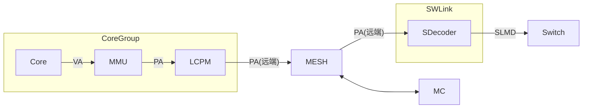
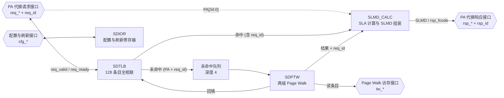
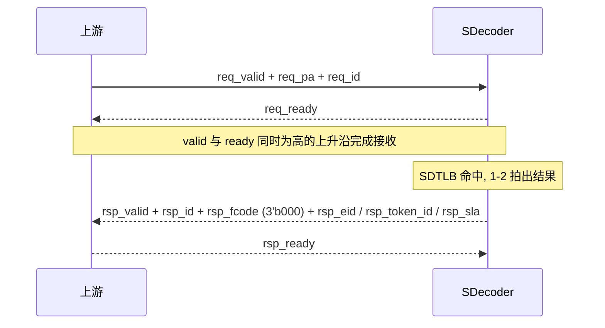
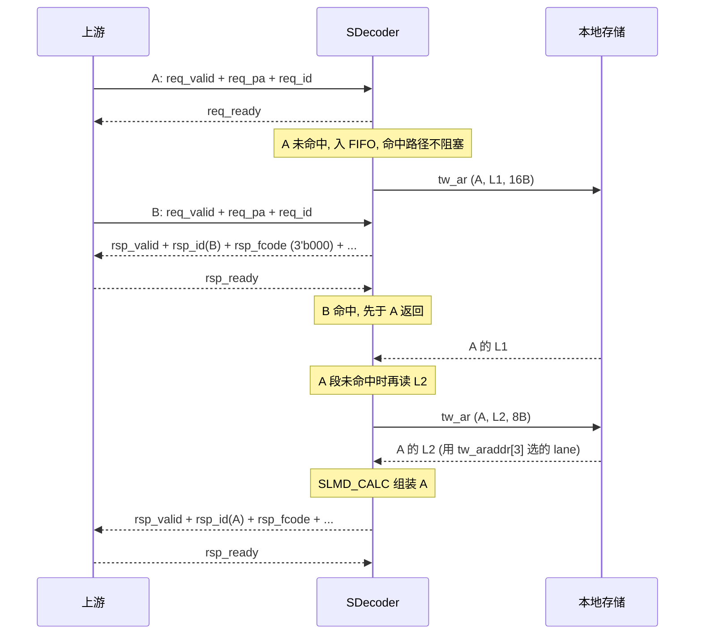
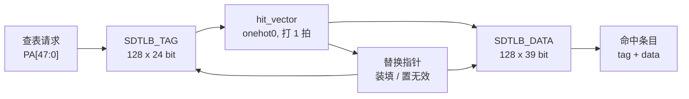
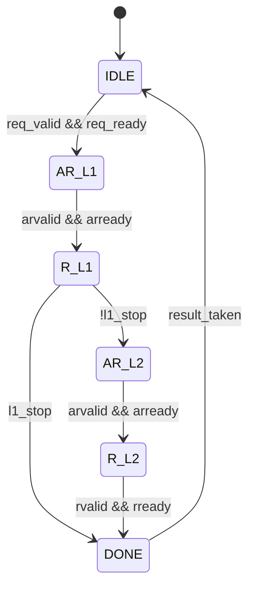

# SDecoder 设计方案

## 概述

SDecoder 位于 User 侧 (内存物理资源的访问方), 挂在 SWLink 内, 它一方面接收从 MESH 网络传来的远端 PA 访问请求, 另一方面将这些请求转为 SLMD 并发送出去

SDecoder 做的是 **PA 到 SLMD 的代换**.



图: SDecoder 在系统中的位置

本方案描述 SDecoder IP 内部的以下核心模块:

- **SDTLB**: 代换快表, 缓存已经算出来的 PA 到 SLMD 映射, 覆盖绝大多数访存
- **MFIFO**: 未命中队列, 暂存 SDTLB 未命中的 `PA[47:0]` 和 `req_id`, 深度 4, 让命中路径不被未命中阻塞
- **SDPTW**: Page Walk 模块, SDTLB 未命中时按两级代换表算出结果, 并把结果回填 SDTLB
- **SDIOR**: IO 寄存器模块, 提供 SDecoder 的控制/配置寄存器
- **SLMD_CALC**: SLMD 计算模块, 用于计算 SLMD 值 (主要是 SLA, EID 和 TokenID 原样透传)

## 缩写表

| 缩写 | 全称 |
| --- | --- |
| SDecoder | SWLink Decoder |
| SDTLB | SDecoder TLB |
| SDPTW | SDecoder Page Table Walker |
| MFIFO | Miss FIFO |
| SLMD | SWLink Memory Descriptor |
| EID | Entity Identifier |
| TokenID | Token Identifier |
| SLA | SWLink Address |
| VA | Virtual Address |
| PA | Physical Address |
| TLB | Translation Lookaside Buffer |
| CAM | Content Addressable Memory |
| RSVD | Reserved |
| PW | Page Walk |
| PTW | Page Table Walker |
| IOR | IO Register |
| W1P | Write 1 to Pulse |
| AMBA | Advanced Microcontroller Bus Architecture |
| APB | Advanced Peripheral Bus |
| AXI | Advanced eXtensible Interface |

<!-- [TODO] 其他缩写表内容后续待补充 -->

## 地址代换

### 地址划分

核心视角的虚地址 VA 为 53 位, 物理地址 PA 为 48 位. PA[47] 用于区分地址空间:

- PA[47] = 0: Mem 空间, 共 128TB.
- PA[47] = 1: IO 空间, 共 128TB.

SDecoder 只处理 Mem 空间, 因此断言 PA[47] 恒为 0, 实际参与索引与匹配的是 PA[46:0].

虽然 PA[47] 恒为 0, 但为了保持地址结构的完整性, 仍然保留该位. 主要包括以下几个地方:

1. SDecoder 的 PA 请求 PA[47]
2. 一级表 SDT_L1 的基地址 SDT_L1_BASE[47]
3. 二级表 SDT_L2 的基地址 L2_BASE[47]
4. 快表 SDTLB 的 TAG.PA_Base[47]

| 地址位 | 名称 | 用途 |
| --- | --- | --- |
| PA[47] | 地址空间标识 | 0: Mem 空间, 1: IO 空间 |
| PA[46:35] | 一级表索引 | 索引 SDT_L1, 每个条目覆盖 32GB |
| PA[34:30] | 二级表索引 / 段内偏移 | 索引 SDT_L2, 或作为段内 1GB 偏移 |
| PA[29:0] | 页内偏移 | 原样透传到 SLA[29:0], 不参与查表 |

### 代换表结构

SDecoder 采用"段页混合"的两级代换表: 一级表条目描述一个段 (最大 32GB), 二级表条目描述一个 1GB 页.

| 表 | 条目数 | 条目宽度 | 覆盖范围 | 存储开销 |
| --- | --- | --- | --- | --- |
| SDT_L1 | 4096 | 16B | 128TB | 64KB |
| SDT_L2 (单表) | 32 | 8B | 32GB | 256B |

注 1: SDT_L1 的覆盖范围 = 32GB × 4096 = 128TB
注 2: SDT_L1 的存储开销 = 16B × 4096 = 64KB
注 3: SDT_L2 的单表覆盖范围 = 1GB × 32 = 32GB
注 4: SDT_L2 的单表存储开销 = 8B × 32 = 256B
注 5: SDT_L2 的总存储开销 = 256B × 4096 = 1MB

### 计算表项地址

PA 查表的索引是"基地址 + 索引 × 条目宽度", 一级表本身基地址由软件填写, 二级表基地址由一级条目提供

一级表基地址: SDT_L1_BASE, 由软件配置, 按条目大小 16B 对界, 因此断言 SDT_L1_BASE[3:0] 为 4'h0
二级表基地址: L2_BASE, 来自一级表条目, 按条目大小 8B 对界, 因此断言 L2_BASE[2:0] 为 3'h0

硬件取 {SDT_L1_BASE[47:4], 4'h0} / {L2_BASE[47:3], 3'h0}, 低 4/3 位忽略

```text
L1 条目地址 = {SDT_L1_BASE[47:4], 4'h0} + PA[47:35] * 16
L2 条目地址 = {    L2_BASE[47:3], 3'h0} + PA[34:30] *  8
```

### 一级表表项格式

一级表条目宽度 16B (128 bit).

| 位域 | 名称 | 位宽 | 说明 |
| --- | --- | --- | --- |
| [127:96] | RSVD | 32 | 保留 |
| [95:51] | L2_BASE[47:3] | 45 | 二级表基地址 |
| [50:40] | EID[10:0] | 11 | 段式代换使用的 Entity 标识 |
| [39:30] | TokenID[9:0] | 10 | 段式代换使用的逻辑池标识 |
| [29:12] | S_PFN[47:30] | 18 | 段式代换的 SLA 基址, 以 1GB 对界 |
| [11:7] | SEG_LEN[34:30] | 5 | 段长度编码, 段上界 = SEG_BASE + SEG_LEN |
| [6:2] | SEG_BASE[34:30] | 5 | 段基址, 以 1GB 对界 |
| [1] | Type | 1 | 1 表示该 32GB 区间存在 1 个段式映射, 0 表示无段式映射 |
| [0] | Valid | 1 | 一级条目有效位 |

注 1: SEG_LEN 实际上是段表偏移, 其含义类似 AXI 的 AxLEN, 实际段的长度为 (SEG_LEN + 1) * 1GB
注 2: 段表下界为 SEG_BASE, 上界为 SEG_BASE + SEG_LEN
注 3: 这是段页混合式的表, 当 Type = 1 时, 该 32 GB 空间范围内除此 1 个段式映射外, 还可能在二级表中存在 0, 1 或 N 个页式映射
注 4: 软件约束, 段必须落在本条目所属的 32GB 区间内, 即 SEG_BASE + SEG_LEN <= 31.

非法的一级表条目:

1. SEG_BASE + SEG_LEN > 31
2. S_PFN[47:30] + (PA[34:30] - SEG_BASE[34:30]) 溢出
   1. 注意 PA[47] 断言为 0 的问题

### 二级表表项格式

二级表条目宽度 8B (64 bit).

| 位域 | 名称 | 位宽 | 说明 |
| --- | --- | --- | --- |
| [63:40] | RSVD | 24 | 保留 |
| [39:29] | EID[10:0] | 11 | 页式代换使用的 Entity 标识 |
| [28:19] | TokenID[9:0] | 10 | 页式代换使用的逻辑池标识 |
| [18:1] | S_PFN[47:30] | 18 | 页式代换的 SLA 基址, 以 1GB 对界 |
| [0] | Valid | 1 | 二级条目有效位 |

### 段表命中/代换

一级表的条目条目描述一个段: 段基址 SEG_BASE, 段上界 SEG_BASE + SEG_LEN, 段内 1GB 为单位, 一个段最大为 32GB

命中条件:

1. 一级表条目 Valid = 1
2. 一级表条目 Type = 1
3. SEG_BASE[34:30] <= PA[34:30]
4. PA[34:30] <= SEG_BASE[34:30] + SEG_LEN[34:30]

命中后计算 SLA:

1. SLA[47:30] = S_PFN[47:30] + (PA[34:30] - SEG_BASE[34:30])
2. SLA[29:0] = PA[29:0]

### 页表命中/代换

二级表的条目描述一个页: 二级条目描述的页的大小为 1GB

命中条件:

1. 一级表条目 Valid = 1
2. 二级表条目 Valid = 1
3. 一级表条目未命中段式代换, 即 Type = 0 或 PA[34:30] 不在段范围内

命中后计算 SLA:

1. SLA[47:30] = S_PFN[47:30]
2. SLA[29:0] = PA[29:0]

### 代换表的存储要求

1. 两级代换表必须存放在本芯片的本地 HBM / DDR 上, 不允许存放在远端池化内存中. 否则读表本身就会变成一次远端访问, 会经过一次 SWLink 环回
2. 对界: 硬件只使用基地址的高位, 不对对界做检查. 软件约定 SDT_L1_BASE 按 16B 对界 (一级表项大小为 16B), L2_BASE 按 8B 对界 (二级表项大小为 8B)

## SDecoder 设计

### 概述

SDecoder 的内部结构图如下所示:



SDIOR 是相对独立的寄存器模块, 图上只画它与配置与刷新接口的连接; 它与其他模块的控制关系在 SDIOR 设计一节说明.

初版采用做法 B (hit-under-miss, 允许乱序响应): SDTLB 未命中时, 把 `PA[47:0]` 和 `req_id` 写入未命中队列 (深度 4); SDPTW 按队列顺序走表; 命中路径直通 SLMD_CALC, 不需要等未命中. SDPTW 只输出原始条目, `rsp_sdt_l2_read` 和 `req_id`, 不直接产生响应码; 段/页选择, SLA 拼装和 `rsp_fcode` 由 SLMD_CALC 完成. 响应可以乱序, 用 `rsp_id` 回显 `req_id` 匹配. 未命中队列满或响应 FIFO 将满时, 顶层拉低 `req_ready`; 四种做法与取舍见 [未命中队列与响应保序](未命中队列与响应保序.md).

### 接口

SDecoder 对外使用 native 接口 (自定义 valid/ready 握手), 不引入 AMBA 协议. 首版按四组划分: 代换请求, 代换响应, Page Walk 访存, 配置与刷新; 另有 `clk` / `rst_n`. 以后交付标准形态时, 在 IP 外面加一层薄 wrapper (配置挂 APB 从口, 访存挂 AXI 主口), 本节的字段语义不变.

#### 接口分组

| 接口组 | 前缀 | 方向 | 说明 |
| --- | --- | --- | --- |
| 时钟与复位 | `clk` / `rst_n` | 输入 | 单时钟域, `rst_n` 低有效 |
| 代换请求 | `req_*` | 输入 | 上游发起 PA 到 SLMD 的代换 |
| 代换响应 | `rsp_*` | 输出 | 返回 SLMD 或异常 |
| Page Walk 访存 | `tw_*` | 主端口 | 读本地 SDT_L1 / SDT_L2 |
| 配置与刷新 | `cfg_*` | 从端口 | 软件配置基地址, 置无效 SDTLB |

本 IP 只有一个时钟域; `rst_n` 异步复位, 建议同步释放. 复位期间 `req_ready` / `rsp_valid` / `tw_arvalid` / `tw_rready` 为 0.

#### 参数

| 参数 | 默认值 | 说明 |
| --- | --- | --- |
| `PA_WIDTH` | 48 | `PA[47:0]` |
| `SLA_WIDTH` | 48 | `SLA[47:0]` |
| `EID_WIDTH` | 11 | `EID[10:0]` |
| `TOKEN_ID_WIDTH` | 10 | `TokenID[9:0]` |
| `REQ_ID_WIDTH` | 8 | `req_id` / `rsp_id` |
| `SDTLB_ENTRIES` | 128 | SDTLB 条目数 |
| `MISS_FIFO_DEPTH` | 4 | 未命中队列深度 |
| `RSP_FIFO_DEPTH` | 2 | 响应 FIFO 深度 |
| `SDIOR_DATA_WIDTH` | 64 | `cfg_*` 寄存器字宽 |

一级/二级条目宽度由表项格式固定 (16B / 8B), 不作为可配参数; 见代换表结构和计算表项地址.

#### 代换请求接口

| 信号 | 方向 | 位宽 | 说明 |
| --- | --- | --- | --- |
| `req_valid` | I | 1 | 请求有效 |
| `req_ready` | O | 1 | 本 IP 可接收请求; 未命中队列满或响应 FIFO 将满时拉低 |
| `req_pa` | I | `PA_WIDTH` | `PA[47:0]`; 只处理 Mem 空间, `req_pa[47]` 必须为 0 |
| `req_id` | I | `REQ_ID_WIDTH` | 事务标识, 由上游分配, 响应时回显到 `rsp_id` |

约定:

1. `req_valid` 与 `req_ready` 同时为高的上升沿完成一次接收.
2. `req_valid` 拉高后必须保持, 直到握手完成; 保持期间 `req_pa` / `req_id` 不得变化.
3. `req_ready` 不得组合依赖 `req_valid`; 复位期间为 0.
4. 初版 hit-under-miss: 未命中入队, 命中继续; `req_ready` 只在未命中队列满或响应 FIFO 将满时拉低; 详见 "握手与顺序".
5. 本版不做权限检查, 请求接口不含 `rw`; 如果后续异常登记需要, 再扩展.

#### 代换响应接口

| 信号 | 方向 | 位宽 | 说明 |
| --- | --- | --- | --- |
| `rsp_valid` | O | 1 | 响应有效, 保持到 `rsp_ready` |
| `rsp_ready` | I | 1 | 下游可接收响应 |
| `rsp_id` | O | `REQ_ID_WIDTH` | 对应请求的 `req_id` |
| `rsp_fcode` | O | 3 | 响应码: 3'b000 正常; 非 0 为异常 |
| `rsp_eid` | O | `EID_WIDTH` | 仅 `rsp_fcode = 3'b000` 时有效 |
| `rsp_token_id` | O | `TOKEN_ID_WIDTH` | 仅 `rsp_fcode = 3'b000` 时有效 |
| `rsp_sla` | O | `SLA_WIDTH` | 仅 `rsp_fcode = 3'b000` 时有效 |

约定:

1. 每个被接收的请求恰好产生一个响应, 不丢不多.
2. 响应可以乱序; 每个响应带 `rsp_id`, 下游按 ID 匹配; 同一请求恰好一个响应.
3. `rsp_id` 始终有效; `rsp_fcode != 3'b000` 时 `rsp_eid` / `rsp_token_id` / `rsp_sla` 无意义, 下游不得使用.
4. `rsp_fcode` 由 SLMD_CALC 统一产生, 具体检查见 "非法条目检查与异常处理".

`rsp_fcode` 编码:

| 编码 | 名称 | 触发条件 |
| --- | --- | --- |
| 3'b000 | 无异常 | 正常返回 SLMD |
| 3'b001 | 地址非法 | 条目无效, 段越界, SLA 溢出 |
| 3'b010 | 不可纠错错误 | 保留, 后续用于 Page Walk 读错误 |
| 3'b011 | Page Walk 控制错 | 保留, Page Walk 过程出现非法状态 |
| 其他 | 保留 | - |

#### Page Walk 访存接口

SDPTW 通过本接口读本地存储中的 SDT_L1 / SDT_L2, 是只读主端口.

| 信号 | 方向 | 位宽 | 说明 |
| --- | --- | --- | --- |
| `tw_araddr` | O | `PA_WIDTH` | 条目字节地址 |
| `tw_arvalid` | O | 1 | 读地址有效 |
| `tw_arready` | I | 1 | 本地存储可接收地址 |
| `tw_rdata` | I | 128 | 读回 16B 数据 |
| `tw_rvalid` | I | 1 | 读数据有效 |
| `tw_rready` | O | 1 | 本 IP 可接收读数据 |

约定:

1. 只读, 不发写请求.
2. 首版同一时刻只有一个未完成的读事务, 不需要事务标识.
3. 一级条目读 16B, 用整条 `tw_rdata`; 二级条目读 8B, 由 `tw_araddr[3]` 选 16B 总线上的对应 8B lane (AXI 单拍 lane 规则).
4. `tw_*` 是延迟敏感通路: 一次 Page Walk 最坏两次读, 集成方要保证优先响应, 不被长时间饿死.
5. 首版不实现 burst 和写通道; 以后挂标准 AXI 时由 wrapper 转换.

#### 配置与刷新接口

| 信号 | 方向 | 位宽 | 说明 |
| --- | --- | --- | --- |
| `cfg_wr` | I | 1 | 写使能, 1 拍脉冲 |
| `cfg_rd` | I | 1 | 读使能, 1 拍脉冲 |
| `cfg_addr` | I | 2 | 寄存器索引 |
| `cfg_wdata` | I | `SDIOR_DATA_WIDTH` | 写数据 |
| `cfg_rdata` | O | `SDIOR_DATA_WIDTH` | 读数据, 组合输出 |

约定:

1. 写同步, 在 `clk` 上升沿生效; 读组合, `cfg_rd` 当拍给出 `cfg_rdata`.
2. `cfg_addr` 编码见下表; 位域细节见 SDIOR 设计.
3. `cfg_*` 是 native 寄存器接口; 首版不做 APB 从口. 交付标准形态时在外面包一层 APB wrapper, 寄存器语义不变.
4. 修改 `SDT_L1_BASE` 后必须做一次全部置无效; 对界见 "代换表的存储要求".

`cfg_addr` 编码:

| `cfg_addr` | 寄存器 | 属性 | 说明 |
| --- | --- | --- | --- |
| 0 | `SDecoder_IA` | W1P | 写 bit0 = 1, 置无效全部 SDTLB 条目 |
| 1 | `SDecoder_IS` | W1P | 写 bit63 = 1, 置无效覆盖 `PA[47:30]` 的条目; 低 48 位为 PA |
| 2 | `SDT_L1_BASE` | RW | 一级表基地址 `PA[47:0]`, 16B 对界 |

#### 握手与顺序

1. 所有 valid/ready 接口遵循同一套规则: 握手完成于 `valid` 和 `ready` 同时为高的上升沿; `valid` 不得组合依赖 `ready`; `valid` 拉高后到握手完成前载荷保持不变.
2. 初版 hit-under-miss: SDTLB 未命中时把请求写入未命中队列; SDPTW 单 walker 按队列顺序处理未命中; 命中路径不因 SDPTW 忙而阻塞. 未命中队列满或响应 FIFO 将满时, `req_ready` 拉低.
3. 响应可以乱序; 每个请求恰好一个响应, `rsp_id` 回显 `req_id`. 同一时刻在途的 `req_id` 必须唯一; 上游按 ID 匹配, 必要时自己重排. 见 [未命中队列与响应保序](未命中队列与响应保序.md).
4. `req_pa[47]` 必须为 0: SDecoder 只处理 Mem 空间. 首版按断言处理; 如果上游误发 1, 属于集成错误.
5. 复位: `rst_n` 低有效; 复位期间 `req_ready` / `rsp_valid` / `tw_arvalid` / `tw_rready` 为 0; `cfg_rdata` 读回 0.
6. 响应 FIFO: 命中与未命中的结果共用一个 2 深响应 FIFO; `rsp_ready` 低时 FIFO 头保持; FIFO 将满时, 命中和未命中的结果等待, 顶层拉低 `req_ready`.

#### 时序示意

命中:



图: SDTLB 命中时序. 命中时 1-2 拍出响应, 响应带 `rsp_id`; 命中不等待未命中.

未命中 + 命中越过:



图: 未命中 + 命中越过的时序. A 未命中入队后, B 命中先返回; 响应用 `rsp_id` 匹配; 只有未命中队列满或响应 FIFO 将满时才反压.

## SDTLB 设计

### 概述

| 功能 | 说明 |
| --- | --- |
| 功能 | 缓存 PA 到 SLMD 的映射, 命中给出命中的 TLB 条目值 |
| 组织结构 | 全相联 (CAM + FF) |
| 条目数 | 128 |
| 条目粒度 | 1GB 到 32GB |
| 查表 | 单读端口, tag 比较组合, hit 向量打 1 拍 |
| 写入 | 仅由 Page Walk 结果在检查通过后回填, 软件不可写 |
| 清除 | 由刷新接口置无效 |

段式和页式统一按 "段" 处理, 把 1GB 页看作长度为 1 的段. 命中判断和 SLA 计算只有一套逻辑, 不需要为两种映射各做一张快表. 页和段都用 `PA_Base` / `PA_Up` 表示, 不设额外的粒度位.

软件约束:

- **不做软件装填**: 软件不直接写 SDTLB 条目, 只能通过刷新寄存器置无效, 条目内容一律由硬件在 Page Walk 完成后填充.

内部结构:



图: SDTLB 内部结构. Tag 做全并行比较, hit 向量打 1 拍后选 Data; 装填和置无效都通过控制逻辑改 Tag/Data.

### 表项格式

| 部分 | 字段 | 位宽 | 存储 | 说明 |
| --- | --- | --- | --- | --- |
| Tag | `PA_Base[47:30]` | 18 | FF | 段/页基址, 1GB 对界 |
| Tag | `PA_Up[34:30]` | 5 | FF | 段/页上界 (含), 1GB 对界 |
| Tag | `Valid` | 1 | FF | 条目有效位 |
| Data | `EID[10:0]` | 11 | FF | Entity 标识 |
| Data | `TokenID[9:0]` | 10 | FF | 逻辑池标识 |
| Data | `S_PFN[47:30]` | 18 | FF | SLA 基址, 1GB 对界 |

- Tag 24 bit, Data 39 bit, 共 63 bit; 不强行凑 64 bit.
- `PA_Base[47:35]` 是 32GB 区间号, `PA_Base[34:30]` 是段/页在区间内的基址.
- 页: `PA_Base[34:30] = PA_Up`; 段: `PA_Up = SEG_BASE + SEG_LEN`.
- `PA_Base[47]` 恒为 0 (请求 `PA[47] = 0`); `S_PFN[47]` 必须为 0, 由 SLMD_CALC 检查.
- 表项所有字段用 FF; 复位清 0; 装填在时钟沿写 Tag/Data 并置 `Valid = 1`; 置无效只清 `Valid`, Tag/Data 保留.

### 命中判断

命中条件:

1. `Valid = 1`.
2. `PA[47:35] == PA_Base[47:35]`.
3. `PA_Base[34:30] <= PA[34:30] <= PA_Up`.

判断与读出:

- 128 个 Tag 并行比较, 得到 onehot0 的 `hit_vector`; 正常配置下最多命中一个; 多命中属于配置错误, 行为未定义 (仿真用 onehot0 断言检查).
- Tag 比较是组合逻辑; `hit_vector` 打 1 拍后再用; 请求拍 T 的命中结果在 T+1 有效.
- Data 用 `hit_vector` 做 onehot 选路, 输出命中条目的 tag/data.
- 装填在时钟沿更新 Tag/Data 与 `Valid`; 查表只读, 同拍请求看到的是装填前的条目.
- 请求的 `PA[29:0]` 不参与查表, 直接送到 SLMD_CALC 拼 SLA 的低位.
- 未命中时 SDTLB 不产生响应, 由顶层启动 SDPTW.
- SDTLB 支持连续查表; 未命中不阻塞后续命中, 未命中请求带 `req_id` 进入 MFIFO.

命中后的 SLA:

```text
SLA[47:30] = S_PFN[47:30] + (PA[34:30] - PA_Base[34:30])
SLA[29:0]  = PA[29:0]
```

页的 `PA_Base[34:30] = PA_Up`, 偏移为 0, 公式退化为 `SLA = {S_PFN, PA[29:0]}`. EID / TokenID 直接取 Data. `SLA[47]` 必须为 0, 由 SLMD_CALC 检查.

### 条目填充

装填来源是 SDPTW 的 Page Walk 结果, 只有 SLMD_CALC 检查通过 (无异常) 才允许回填.

| 结果 | `PA_Base[47:30]` | `PA_Up[34:30]` | EID / TokenID / S_PFN |
| --- | --- | --- | --- |
| 段 | `{PA[47:35], SEG_BASE[34:30]}` | `SEG_BASE + SEG_LEN` | 一级条目 |
| 页 | `PA[47:30]` | `PA[34:30]` | 二级条目 |

- 装填条目由替换指针选出, 一次未命中只填一个条目.
- `SEG_BASE + SEG_LEN <= 31`; 越界时按异常处理, 不装填.
- 装填在时钟沿写 Tag 和 Data, 并置 `Valid = 1`; 同一拍同一 entry 上置无效优先, 装填丢弃.
- 异常结果不装填; 命中路径不装填.

### 替换策略

- 128 条目全相联, 任意条目都可被替换.
- 替换指针是严格 onehot 的左移循环寄存器: 复位指向 0 号, 每次装填请求左移一格, 到尾回绕.
- 指针指向的条目无论有效与否都直接覆盖; 不做 invalid-first 搜索, 不做 LRU / 随机.
- 指针只在装填请求时步进; 置无效不改变指针.

### 置无效

- `inv_all`: 128 个条目的 `Valid` 全部清 0.
- `inv_en` + `inv_pa`: 清掉所有覆盖 `inv_pa[47:30]` 的条目, 条件是 `Valid = 1`, `PA_Base[47:35] == inv_pa[47:35]`, `PA_Base[34:30] <= inv_pa[34:30] <= PA_Up`; 可能一次清掉多个条目 (例如一个段和它内部的页).
- `inv_pa[29:0]` 不使用; 置无效是 1GB 粒度, 软件必须把低 30 位写 0.
- 置无效只清 `Valid`; Tag/Data 的其他字段可以保留.
- 同一 entry 上置无效优先于装填; 同一拍冲突时装填丢弃.
- **初版限制**: 不实现 epoch / flush / busy. 如果未命中队列里的请求或一次 walk 在 `inv_all` 之前已经读到旧条目, 它在 `inv_all` 之后仍可能把旧映射回填进 SDTLB; 软件在改表 / 置无效前应保证没有未完成的请求 (含 MFIFO 里的), 或者接受这个风险.

## SDPTW 设计

### 概述

SDPTW 从 SDTLB 的未命中队列 MFIFO 取请求, 按两级代换表读出原始条目, 并给出 "是否读了二级表" 的过程标志; 它不判断异常, 异常由 SLMD_CALC 统一产生.

| 项目 | 规格 |
| --- | --- |
| 功能 | 从 MFIFO 取请求, 读 SDT_L1 / SDT_L2, 输出原始条目 |
| 并行度 | 1, 同一时刻只处理一个 walk |
| 队列 | MFIFO, 深度 4, 表项 `PA[47:0]` + `req_id` |
| 最坏访存 | 2 次: 一级 16B, 二级 8B |
| 读数据宽度 | 16B (`tw_rdata`) |
| 结果 | 一级条目, 二级条目, `rsp_sdt_l2_read`, `req_id`, 请求 `PA[34:0]` |
| 异常 | 不产生; 由 SLMD_CALC 检查 |
| 完成 | 结果保持到 SLMD_CALC 取走 |

- 初版 hit-under-miss: SDPTW 单 walker 按 MFIFO 顺序处理未命中; 命中不受 SDPTW 忙影响; MFIFO 满时顶层反压上游.
- 一次 walk 只发一个 AR, 收到 R 后再决定是否发第二个 AR; 不支持 burst / 写 / 乱序.
- 首版不实现读错误响应 (`tw_rresp` 不在接口里); 本地存储读失败属于集成或系统问题, 不在 SDPTW 里恢复.

### 未命中队列 MFIFO

- 深度 4, 表项 56 bit: `PA[47:0]` (48) + `req_id` (8).
- SDTLB 未命中时写入; SDPTW 在 `IDLE` 取出一条并锁存; 取出后该表项空出.
- 先进先出; 未命中按入队顺序走表, 命中不经过队列.
- 队列满时顶层拉低 `req_ready`; 队列空时 SDPTW 保持 `IDLE`.
- 不做同地址合并: 同一个 PA 的多次未命中各占一个表项, 各做一次 walk.
- 读写可以同拍发生; 单时钟域, 标准同步 FIFO.

### 状态机



图: SDPTW 状态机. `l1_stop = !l1.valid || seg_hit`; `seg_hit = l1.type && SEG_BASE <= PA[34:30] <= SEG_BASE + SEG_LEN`.

状态说明:

- `IDLE`: 等 MFIFO 非空; 接收时锁存 `PA[47:0]` 和 `req_id`.
- `AR_L1`: 发一级读地址, 等 `arready`.
- `R_L1`: 收 16B 一级条目; 若 `l1_stop`, 直接 `DONE` (段命中或一级无效); 否则发二级读.
- `AR_L2`: 发二级读地址, 等 `arready`.
- `R_L2`: 收 16B 数据, 按 `araddr[3]` 选 8B; 转 `DONE`.
- `DONE`: 结果有效, 保持; 响应带 `req_id`; `result_taken` 后回 `IDLE`.

### Page Walk 流程

1. 顶层在 SDTLB 未命中时, 把 `PA[47:0]` 和 `req_id` 写入 MFIFO; SDPTW 在 `IDLE` 从 MFIFO 取请求, 锁存 `PA[47:0]` 和 `req_id`, 用 `PA[47:30]` 走表.
2. 一级表地址: `{SDT_L1_BASE[47:4], 4'h0} + PA[47:35] * 16`; 读 16B.
3. 收到一级条目后判段:
   - `l1.valid = 0`: 不再读二级 (`L2_BASE` 不可信), 直接 `DONE`.
   - `l1.type = 1` 且 `SEG_BASE <= PA[34:30] <= SEG_BASE + SEG_LEN`: 段命中, 不再读二级, 直接 `DONE`.
   - 否则读二级.
4. 二级表地址: `{l1.L2_BASE[47:3], 3'h0} + PA[34:30] * 8`; 读 8B.
5. 二级读回的是 16B 总线数据, 按 `araddr[3]` 选 8B: `araddr[3] = 0` 用 `rdata[63:0]`, `= 1` 用 `rdata[127:64]`.
6. `DONE` 保持一级/二级条目, `rsp_sdt_l2_read`, `req_id` 和请求 `PA[34:0]`, 直到 SLMD_CALC 取走 (`result_taken`).

补充约束:

- `PA[47]`, `SDT_L1_BASE[47]`, `L2_BASE[47]` 都必须为 0; 前两个由接口 / 软件保证, `L2_BASE[47]` 由软件保证 (硬件只断言). 如果 `L2_BASE[47] = 1`, 二级地址会落到 IO 空间, 行为未定义.
- 一级条目无效时不再读二级; 二级条目的 `Valid` 不在 SDPTW 判断, 交给 SLMD_CALC.
- `SEG_BASE + SEG_LEN` 用 6 bit 计算; 超过 31 的条目由 SLMD_CALC 判为异常.
- 地址公式的推导见 "计算表项地址".

### 结果输出

- 一级条目: 16B 原始条目.
- 二级条目: 8B 原始条目; 没读二级时清 0.
- `rsp_sdt_l2_read`: 本次是否读了二级; 0 表示只读了一级.
- `req_id`: 从 MFIFO 表项带出, 用于 SLMD_CALC 生成 `rsp_id`.
- 请求 `PA[34:0]`: 段偏移用 `PA[34:30]`, 页内偏移用 `PA[29:0]`; 从 MFIFO 表项带出.
- 结果有效在 `DONE` 拉高; 结果保持到 SLMD_CALC 取走 (`result_taken`).
- `rsp_sdt_l2_read` 是 SLMD_CALC 区分 "段命中" 和 "一级无效 / 段外且二级无效" 的关键; 这两种情况的一级/二级 Valid 看起来一样.
- 异常由 SLMD_CALC 产生; SDPTW 不输出 `rsp_fcode`.

## SLMD_CALC 设计

### 概述

SLMD_CALC 把命中或 Page Walk 的结果组装成最终响应: 选段 / 页, 算 SLA, 选 EID / TokenID, 产生 `rsp_fcode` 和 `rsp_id`; 检查通过时同时回填 SDTLB.

- 输入: SDTLB 的命中 tag/data + 请求 PA + `req_id`, 或 SDPTW 的一级/二级条目 + `rsp_sdt_l2_read` + 请求 PA + `req_id`.
- 输出: `rsp_id`, `rsp_eid`, `rsp_token_id`, `rsp_sla`, `rsp_fcode`.
- 命中与未命中可以同时在途; 两个结果谁先到谁先出, 不保序; 响应带 `rsp_id`, 只做匹配.
- 命中与未命中共用一个 2 深响应 FIFO; `rsp_ready` 低时 FIFO 头保持; 同时就绪时按到达顺序入 FIFO.
- 本版不做权限检查, 不处理读错误 / 机器检查错; 异常只有 "地址非法".
- `rsp_eid` / `rsp_token_id` / `rsp_sla` 仅在 `rsp_fcode = 3'b000` 时有效; `rsp_id` 始终有效.

### 命中与未命中的选择

| 来源 | 条件 | 选择 |
| --- | --- | --- |
| SDTLB 命中 | `req_hit = 1` | 用 SDTLB 的 tag/data |
| 段 | `l1.valid = 1`, `l1.type = 1`, `SEG_BASE <= PA[34:30] <= SEG_BASE + SEG_LEN` | 用一级条目 |
| 页 | `l1.valid = 1`, 非段命中, `l2_read = 1`, `l2.valid = 1` | 用二级条目 |
| 异常 | 其他 | `rsp_fcode = 3'b001` |

- 命中路径不需要区分段/页: SDTLB 用 `PA_Base` / `PA_Up` 统一表示, 偏移为 `PA[34:30] - PA_Base[34:30]`.
- 未命中路径先判段, 段不命中再判二级.
- 二级没读 (`l2_read = 0`) 且不是段命中, 属于异常.
- 命中和未命中可以同时就绪; 响应仲裁不要求顺序, 先到先出.

### SLA 计算

命中:

```text
SLA[47:30] = data.S_PFN[47:30] + (PA[34:30] - tag.PA_Base[34:30])
SLA[29:0]  = PA[29:0]
```

未命中段:

```text
SLA[47:30] = l1.S_PFN[47:30] + (PA[34:30] - l1.SEG_BASE[34:30])
SLA[29:0]  = PA[29:0]
```

未命中页:

```text
SLA[47:30] = l2.S_PFN[47:30]
SLA[29:0]  = PA[29:0]
```

- 段/页的 EID / TokenID: 段取一级条目, 页取二级条目, 命中取 SDTLB Data.
- `SLA[47]` 必须为 0; 为 1 表示地址落到 IO 空间或加法溢出, 报 `3'b001`.
- 加法按 18 bit 做; 进位到 bit 47 也算 `SLA[47] = 1`.

### 非法条目检查与异常处理

首版只产生 `3'b000` (正常) 和 `3'b001` (地址非法); `3'b010` / `3'b011` 保留.

`3'b001` 的触发条件:

1. 一级条目 `Valid = 0`.
2. 段式: `SEG_BASE + SEG_LEN > 31`.
3. 段式: `SLA[47] = 1` (含 `S_PFN[47] = 1` 和加法进位).
4. 页式: 二级条目 `Valid = 0`.
5. 页式: `SLA[47] = 1` (即 `l2.S_PFN[47] = 1`).
6. 未命中路径既不是段命中, 也没有有效的二级条目.

处理:

- `rsp_fcode = 3'b001` 时, `rsp_eid` / `rsp_token_id` / `rsp_sla` 无意义, 不装填 SDTLB; `rsp_id` 仍然回显.
- `rsp_fcode = 3'b000` 时, 输出 SLMD 字段; 如果是未命中, 按 SDTLB 的 "条目填充" 回填.
- 命中路径只检查 `SLA[47]`; 命中条目已经由装填时检查过, 但输出前仍要再查一次.
- 本版不检查权限 / 读错误 / 机器检查错; `3'b010` / `3'b011` 保留.
- 异常结果不回填; 命中与未命中结果都进同一个 2 深响应 FIFO.

## SDIOR 设计

### 概述

SDIOR 是相对独立的 IO 寄存器模块, 提供三个 64 bit 寄存器: 全部置无效, 按地址置无效, 一级表基地址. 首版不做 APB 从口, 寄存器由接口章节的 `cfg_*` 直接访问; 以后交付标准形态时在外面包一层 APB wrapper, 寄存器语义不变.

- 只做 SDecoder 需要的 3 个寄存器; 没有 enable / status / errinfo.
- W1P 寄存器不留存值; 读回 0.
- `SDT_L1_BASE` 是唯一的 RW 寄存器.

### 寄存器

寄存器索引和属性见接口章节的 `cfg_addr` 编码表; 本节只列位域.

| 寄存器 | 位域 | 说明 |
| --- | --- | --- |
| `SDecoder_IA` | [0] | W1P; 写 1 触发 `inv_all`, 清全部 SDTLB 条目 |
| `SDecoder_IS` | [63] | W1P; 写 1 触发 `inv_en` |
| | [47:0] | `PA[47:0]`; SDTLB 只用 `PA[47:30]`, `PA[29:0]` 必须为 0 |
| `SDT_L1_BASE` | [47:0] | 一级表基地址; 16B 对界; 复位 0 |
| | [63:48] | RSVD |

- `SDecoder_IA` / `SDecoder_IS` 的其余位保留; 写 0 不产生脉冲.
- `SDecoder_IS` 的 `PA[47]` 必须为 0; `PA[29:0]` 必须为 0 (1GB 粒度).
- `SDT_L1_BASE` 的 `PA[47]` 必须为 0; `PA[3:0]` 必须为 0 (16B 对界).
- `cfg_addr` 为 2 bit; 索引 3 保留, 访问未定义.

### 行为

- 写同步: `cfg_wr` 在 `clk` 上升沿生效.
- 读组合: `cfg_rd` 当拍给出 `cfg_rdata`.
- W1P: `IA` 的 bit0 / `IS` 的 bit63 写 1 时, 当拍产生 1 拍 `inv_all` / `inv_en`; 写 0 不产生脉冲; 读回 0.
- `inv_pa` 直接取 `cfg_wdata[47:0]`; `inv_en` 有效时 SDTLB 用 `PA[47:30]` 比较.
- `SDT_L1_BASE` 写入后下一拍由 SDPTW 使用; 复位值 0.
- `cfg_rdata`: `SDT_L1_BASE` 读回低 48 位基地址, 高位 0; `IA` / `IS` 读回 0; 其他索引读回 0.

### 软件流程

1. 写 `SDT_L1_BASE`, 在本地 HBM / DDR 建立 SDT_L1 / SDT_L2.
2. 映射变化时, 先改表项, 再置无效:
   - 大范围变化: 写 `SDecoder_IA`, 清全部条目.
   - 局部变化: 写 `SDecoder_IS`, 清覆盖该 `PA[47:30]` 的条目.
3. 修改 `SDT_L1_BASE` 后必须写一次 `SDecoder_IA`, 否则会残留按旧基地址算出的条目.
4. 首版没有 enable / busy: 软件在改表 / 置无效前应保证没有未完成的请求 (含 MFIFO 里的); 详细限制见 SDTLB 的 "置无效".

### 与其他模块的连接

- `inv_all` / `inv_en` / `inv_pa` 送 SDTLB, 清 Tag 的 Valid.
- `sdt_l1_base` 送 SDPTW, 作为一级表基地址.
- 没有其他连接; SDIOR 在顶层图上只画到 `cfg_*`.

