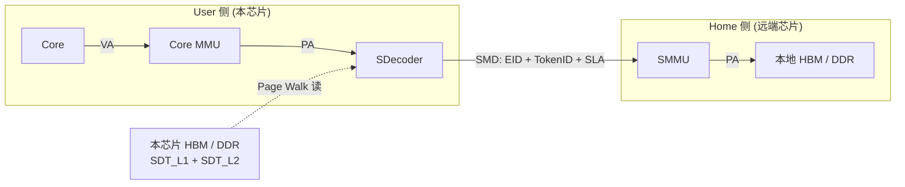
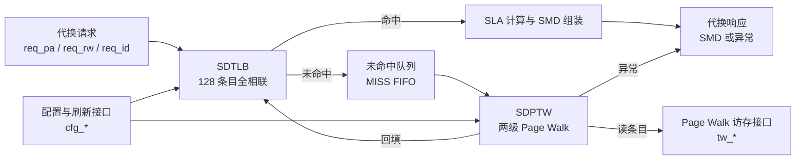
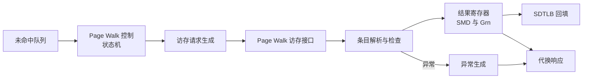
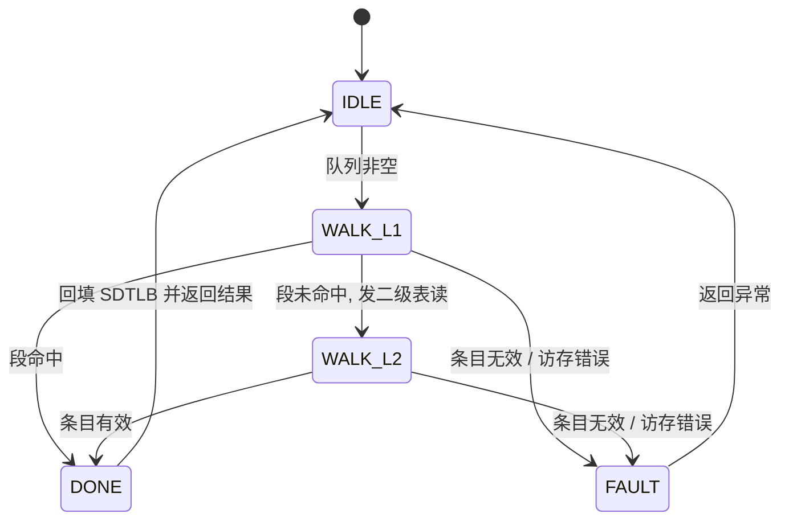
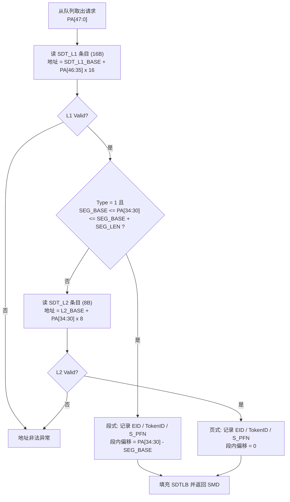

# SDecoder 设计方案

| 项目 | 内容 |
| --- | --- |
| 文档名称 | SDecoder 设计方案 |
| 版本 | v0.2 |
| 状态 | 初稿, 待确认问题已评审关闭 |
| 日期 | 2026-09-30 |
| 适用 IP | SDecoder |
| 上游文档 | [内存池化SDecoder和SMMU部件设计方案v2.6](../内存池化SDecoder和SMMU部件设计方案2.6/内存池化SDecoder和SMMU部件设计方案v2.6.md) |
| 配套文档 | [SDecoder 接口手册](../SDecoder接口手册/SDecoder接口手册.md) |

## 概述

### SDecoder 的定位

SDecoder 位于 User 侧 (内存物理资源的访问方), 挂在核心 MMU 与 SWLink 之间.

一次远端访存要经过两段代换:

1. 核心 MMU 把虚地址 VA 代换成物理地址 PA (本方案不涉及).
2. SDecoder 把该 PA 代换成三元组 SMD, 经 SWLink 发往 Home 侧.
3. Home 侧 SMMU 把 SMD 代换成 Home 本地 PA (本方案不涉及).

因此一句话概括: **SDecoder 做的是 PA 到 SMD 的代换**.



图 1: SDecoder 在系统中的位置. User 侧完成 VA 到 PA 后, SDecoder 把 PA 代换为 SMD, Page Walk 用的两级代换表存放在本芯片本地存储.

### 输入与输出

| 方向 | 内容 |
| --- | --- |
| 输入 | User 侧物理地址 PA[47:0], 访问类型 (读 / 写) |
| 输出 | 三元组 SMD, 即 EID[10:0] + TokenID[9:0] + SLA[47:0] |
| 输出 | 代换异常 (地址非法, 机器检查错) |

### 设计范围

本方案描述 SDecoder IP 内部的两个核心模块:

- **SDTLB** (SDecoder TLB): 代换快表, 缓存已经算出来的 PA 到 SMD 映射, 覆盖绝大多数访存.
- **SDPTW** (SDecoder Page Table Walker): Page Walk 模块, SDTLB 未命中时按两级代换表算出结果, 并把结果回填 SDTLB.

不在本方案范围内: 核心 MMU, Home 侧 SMMU, SWLink 路由与流控, 远端内存的管理服务.

### 设计原则

1. **先做对, 再做快**: 首版以功能正确, 接口清晰为第一优先级, 面积与吞吐按需迭代.
2. **简单可验证**: Page Walk 一次只处理一个未命中请求, 不做推测执行, 不做乱序返回.
3. **代换表本地化**: 两级代换表必须存放在本芯片的 HBM / DDR 上, 不允许放在远端池化内存里, 否则读表本身就会变成一次远端访问.
4. **不做软件装填**: 软件不直接写 SDTLB 条目, 只能通过刷新寄存器置无效, 条目内容一律由硬件在 Page Walk 完成后填充.

## 缩写表

| 缩写 | 全称 | 中文说明 |
| --- | --- | --- |
| SDecoder | SDecoder | 本 IP 名称, 完成 User 侧 PA 到 SMD 的代换 |
| SDTLB | SDecoder TLB | SDecoder 代换快表, 本方案核心模块之一 |
| SDPTW | SDecoder Page Table Walker | SDecoder 的 Page Walk 模块, 本方案核心模块之一 |
| SMD | SW Memory Descriptor | 内存描述符, 即 (EID, TokenID, SLA) 三元组 |
| EID | Entity Identifier | 实体标识, 只用于 SWLink 路由, 不参与地址代换 |
| TokenID | Token Identifier | 逻辑池标识, 用于索引上下文 |
| SLA | SWLink Address | 网络侧虚地址, 即三元组中的地址部分 |
| VA | Virtual Address | 虚地址 (核内视角) |
| PA | Physical Address | 物理地址 (User 侧视角的物理地址, 含远端内存) |
| TLB | Translation Lookaside Buffer | 地址代换快表 |
| PW | Page Walk | 遍历代换表得到代换结果的行为, 本方案中由 SDPTW 完成 |
| PTW | Page Table Walker | 执行 Page Walk 的模块 (本方案中即 SDPTW) |
| SDT_L1 | SDecoder Table Level 1 | SDecoder 一级代换表 (段式) |
| SDT_L2 | SDecoder Table Level 2 | SDecoder 二级代换表 (页式) |
| MMU | Memory Management Unit | 核心内的地址代换部件 |
| SMMU | System MMU | Home 侧地址代换与访问控制部件 |
| SWLink | - | 超节点互连链路, SDecoder 与 SMMU 的挂载点 |
| Home | - | 内存物理资源的拥有方 |
| User | - | 内存物理资源的访问方 |
| IP | Intellectual Property | 可复用的设计交付件 |
| IOR | IO Register | IO 寄存器 (软件配置与刷新入口) |
| CSR | Control and Status Register | 控制状态寄存器 |
| FOR | Fault On Read | 读故障位, 为 1 表示该空间不可读 |
| FOW | Fault On Write | 写故障位, 为 1 表示该空间不可写 |
| S_PFN | Source PFN | 代换后 SLA 的基址 (以 1GB 对界) |
| SEG_BASE | Segment Base | 段基址, 以 1GB 对界 |
| SEG_LEN | Segment Length | 段长度编码, 单位 1GB |
| Grn | Granularity | 粒度位, 区分段式与页式映射 |
| RSVD | Reserved | 保留位, 写 0, 读忽略 |
| MCHK | Machine Check | 机器检查异常 |
| FIFO | First In First Out | 先入先出队列 |


## 地址与代换规则

### 地址划分

核心视角的虚地址 VA 为 53 位, 物理地址 PA 为 48 位. PA[47] 用于区分地址空间:

- PA[47] = 0: Mem 空间, 共 128TB.
- PA[47] = 1: IO 空间, 共 128TB.

SDecoder 只处理 Mem 空间, 因此 PA[47] 恒为 0, 实际参与索引与匹配的是 PA[46:0].

| 地址位 | 名称 | 用途 |
| --- | --- | --- |
| PA[46:35] | 一级表索引 | 索引 SDT_L1, 每个条目覆盖 32GB |
| PA[34:30] | 二级表索引 / 段内偏移 | 索引 SDT_L2, 或作为段内 1GB 偏移 |
| PA[29:0] | 页内偏移 | 原样透传到 SLA[29:0], 不参与查表 |

### 两级代换表结构

SDecoder 采用"段页混合"的两级代换表: 一级表条目描述一个段 (最大 32GB), 二级表条目描述一个 1GB 页.

| 表 | 条目数 | 条目宽度 | 覆盖范围 | 存储开销 |
| --- | --- | --- | --- | --- |
| SDT_L1 | 4096 | 16B | 128TB / 32GB = 4096 | 64KB |
| SDT_L2 | 每个一级条目对应 32 个 | 8B | 32GB / 1GB = 32 | 每个二级表 256B, 全部共 1MB |

索引方式是"基地址 + 索引乘条目宽度":

```text
L1 条目地址 = {SDT_L1_BASE[47:4], 4'h0} + {32'h0, PA[46:35], 4'h0}
L2 条目地址 = {L2_BASE[47:3], 3'h0}    + {40'h0, PA[34:30], 3'h0}
```

### 一级表条目格式

一级表条目宽度 16B (128 bit).

位域约定 (本文各表项一致): 有含义的字段从 bit 0 起连续排布, RSVD 集中在高位.

| 位域 | 名称 | 位宽 | 说明 |
| --- | --- | --- | --- |
| [127:96] | RSVD | 32 | 保留 |
| [95:51] | L2_BASE[47:3] | 45 | 二级表基地址 |
| [50:40] | EID[10:0] | 11 | 段式代换使用的 Entity 标识 |
| [39:30] | TokenID[9:0] | 10 | 段式代换使用的逻辑池标识 |
| [29:12] | S_PFN[47:30] | 18 | 段式代换的 SLA 基址, 以 1GB 对界 |
| [11:7] | SEG_LEN[34:30] | 5 | 段长度编码, 段上界 = SEG_BASE + SEG_LEN |
| [6:2] | SEG_BASE[34:30] | 5 | 段基址, 以 1GB 对界 |
| [1] | Type | 1 | 1 表示该 32GB 区间存在 1 个段式映射, 0 表示无段式映射 |
| [0] | Valid | 1 | 一级条目有效位 |

软件约束: 段必须落在本条目所属的 32GB 区间内, 即 SEG_BASE + SEG_LEN <= 31.

### 二级表条目格式

二级表条目宽度 8B (64 bit).

| 位域 | 名称 | 位宽 | 说明 |
| --- | --- | --- | --- |
| [63:40] | RSVD | 24 | 保留 |
| [39:29] | EID[10:0] | 11 | 页式代换使用的 Entity 标识 |
| [28:19] | TokenID[9:0] | 10 | 页式代换使用的逻辑池标识 |
| [18:1] | S_PFN[47:30] | 18 | 页式代换的 SLA 基址, 以 1GB 对界 |
| [0] | Valid | 1 | 二级条目有效位 |

### 段式代换规则

一级条目描述一个段: 段基址 SEG_BASE, 段上界 SEG_BASE + SEG_LEN, 段内 1GB 为单位.

命中条件 (闭区间, 两端都含):

```text
Type = 1 且 SEG_BASE[34:30] <= PA[34:30] <= SEG_BASE[34:30] + SEG_LEN[34:30]
```

命中后计算 SLA:

```text
PA_Offset[34:30] = PA[34:30] - SEG_BASE[34:30]
SLA[47:30]       = S_PFN[47:30] + {13'h0, PA_Offset[34:30]}
SLA[47:0]        = {SLA[47:30], PA[29:0]}
```

S_PFN 的加法产生进位 (即 SLA[47:30] 溢出) 时报地址非法异常.

### 页式代换规则

二级条目描述一个 1GB 页.

命中条件: 二级条目 Valid = 1.

命中后计算 SLA:

```text
SLA[47:30] = S_PFN[47:30]
SLA[47:0]  = {S_PFN[47:30], PA[29:0]}
```

### 代换表的存储要求

1. 两级代换表必须存放在本芯片的本地 HBM / DDR 上, 不允许存放在远端池化内存中.
2. 一级表基地址由软件配置, 二级表基地址来自一级条目.
3. 硬件只读这两张表, 不回写 ACCESSED 之类的软件位.
4. 对界: 硬件只使用基地址的高位, 不对对界做检查. 软件约定 SDT_L1_BASE 按 64KB 对界 (表大小), L2_BASE 按 256B 对界 (每个二级表 32 x 8B).

## 顶层结构

### 模块划分



图 2: SDecoder 顶层结构. 命中走快表通路, 未命中进队列由 SDPTW 执行 Page Walk, 结果回填 SDTLB.

### 三条主要通路

| 通路 | 触发条件 | 处理 |
| --- | --- | --- |
| 命中通路 | SDTLB 命中 | 一拍查表, 一拍算 SLA 并组 SMD, 输出响应 |
| 未命中通路 | SDTLB 未命中 | 进未命中队列, SDPTW 读一级表, 必要时再读二级表 |
| 异常通路 | 地址非法 / 访存错误 | 按异常码随响应返回, 并登记状态 |

### 为什么未命中要排队

SDPTW 一次只处理一个请求, 一次 Page Walk 最坏要两次本地访存, 耗时远大于一拍. 上游可能连续发多个未命中请求, 因此需要一个浅队列做缓冲, 队列满时用 `req_ready` 反压上游.

## SDTLB 设计

### 功能与规格

| 项目 | 规格 |
| --- | --- |
| 功能 | 缓存 PA 到 SMD 的映射, 命中即直接给出 SLA |
| 组织结构 | 全相联 (CAM + RAM) |
| 条目数 | 128 |
| 覆盖容量 | 条目粒度 1GB 到 32GB, 合计覆盖 128GB 到 4TB |
| 查表 | 单读端口, 每个请求一拍完成比较 |
| 写入 | 仅由 SDPTW 的 Page Walk 结果回填, 软件不可写 |
| 清除 | 由刷新接口置无效 |

实现方式上, 段式和页式统一按"段"处理, 把 1GB 页看作长度为 1 的段 (粒度位 Grn = 0). 这样命中判断和 SLA 计算只有一套逻辑, 不需要为两种映射各做一张快表.

### 表项格式

表项分 Tag 与 Data 两段, 分别存放: Tag 存于 CAM (全并行比较), Data 存于 RAM/SRAM (单读端口). 两段各自独立定宽, 不强制拼成整数位宽.

Tag 段, 共 23 bit:

| 位域 | 名称 | 位宽 | 说明 |
| --- | --- | --- | --- |
| [22:6] | PA_Base[46:30] | 17 | 段空间基址, 以 1GB 对界 |
| [5:1] | PA_Up[34:30] | 5 | 段空间上界 (含), 以 1GB 对界 |
| [0] | Valid | 1 | 条目有效位 |

Data 段, 共 40 bit:

| 位域 | 名称 | 位宽 | 说明 |
| --- | --- | --- | --- |
| [39:29] | EID[10:0] | 11 | Entity 标识 |
| [28:19] | TokenID[9:0] | 10 | 逻辑池标识 |
| [18:1] | S_PFN[47:30] | 18 | SLA 基址, 以 1GB 对界 |
| [0] | Grn | 1 | 粒度位, 1 表示段式, 0 表示 1GB 页式 |

### 命中判断

用请求地址 Req_PA[46:30] 与全部 128 个条目并行比较, 同时满足三条才算命中:

1. 条目 Valid = 1;
2. Req_PA[46:35] 与 PA_Base[46:35] 相等;
3. Req_PA[34:30] 落在闭区间 [PA_Base[34:30], PA_Up[34:30]] 内.

按构造, 同一个地址最多命中一个条目. 若出现多命中, 取索引最小的条目并可选地记一次状态位 (正常配置下不应发生).

### 代换结果计算

命中后, 段式与页式共用同一个公式:

```text
PA_Offset[34:30] = Req_PA[34:30] - PA_Base[34:30]
SLA[47:30]       = S_PFN[47:30] + {13'h0, PA_Offset[34:30]}
SLA[47:0]        = {SLA[47:30], Req_PA[29:0]}
```

页式条目满足 PA_Base[34:30] = PA_Up[34:30], 所以 PA_Offset 恒为 0, 公式退化为 `SLA = {S_PFN, Req_PA[29:0]}`, 与页式代换规则一致.

### 条目填充

| Page Walk 结果 | PA_Base[46:30] | PA_Up[34:30] | S_PFN | Grn |
| --- | --- | --- | --- | --- |
| 段式 | {Req_PA[46:35], SEG_BASE[34:30]} | SEG_BASE + SEG_LEN | 一级条目的 S_PFN | 1 |
| 页式 | Req_PA[46:30] | Req_PA[34:30] | 二级条目的 S_PFN | 0 |

EID, TokenID 按对应条目的内容填入. 段式取一级条目, 页式取二级条目.

填充与回填响应都发生在 SDPTW 的 DONE 状态. 首版不做写分配优化, 一次未命中只填一个条目.

### 替换策略

全相联结构需要一个替换指针, 只在填充时使用:

- 首版采用轮转 (Round Robin), 指针指向最久没有被填充过的条目.
- 若该条目仍是有效状态, 直接覆盖.
- 后续如命中率不达标, 可换成伪 LRU, 接口不变.

### 无效化

| 操作 | 行为 |
| --- | --- |
| 全部置无效 | 128 个条目的 Valid 全部清 0 |
| 按地址置无效 | 清掉所有覆盖该地址的条目, 即 Valid = 1 且 PA_Base[46:35] 匹配且该地址落在 [PA_Base[34:30], PA_Up[34:30]] 内的条目 |

按地址置无效可能一次命中多个条目 (例如一个 32GB 的段条目和它内部的一些页条目), 硬件要把命中的条目全部清掉.

无效化与正在进行的 Page Walk 填充之间存在竞争: 若一次 Page Walk 的结果在无效化之后才到达, 硬件必须丢弃该结果, 不能让一条已经失效的映射被重新写回去. 首版做法是无效化期间阻塞填充, 并让无效化优先.

### 资源估算

| 项 | 规模 | 备注 |
| --- | --- | --- |
| Tag 存储 | 128 x 23 bit | CAM, 全并行比较 |
| Data 存储 | 128 x 40 bit | 单读端口 RAM |
| 比较逻辑 | 128 组 | 相等比较与区间比较 |
| 命中编码 | 1 组 | 优先级编码, 理论上只会命中一个 |

具体门数与面积待综合评估, 本表只用于估算相对规模.

## SDPTW 设计

### 功能与规格

| 项目 | 规格 |
| --- | --- |
| 功能 | 执行 Page Walk, 依次读 SDT_L1 与 SDT_L2, 算出 PA 对应的 SMD |
| 并行度 | 1, 同一时刻只处理一个未命中请求 |
| 最坏访存次数 | 2 次 (一次一级条目, 一次二级条目) |
| 访存宽度 | 一级条目 16B, 二级条目 8B |
| 结果去向 | 回填 SDTLB, 同时组 SMD 响应 |

### 内部结构



图 3: SDPTW 内部结构. Page Walk 控制从队列取请求, 生成访存, 解析条目, 输出结果或异常.

未命中队列中每个条目保存: 请求地址 Req_PA[47:0], 读写属性 rw, 事务标识 req_id. 队列下标同时用作 Page Walk 访存标识 `tw_req_id`.

### 状态机



图 4: SDPTW Page Walk 状态机.

| 状态 | 动作 | 出口条件 |
| --- | --- | --- |
| IDLE | 等待未命中队列非空 | 队列非空则锁存请求, 发出 L1 读 |
| WALK_L1 | 等待 L1 条目返回 | 段命中转 DONE; 否则发出 L2 读转 WALK_L2; 条目无效或访存错转 FAULT |
| WALK_L2 | 等待 L2 条目返回 | 条目有效转 DONE; 否则转 FAULT |
| DONE | 回填 SDTLB, 组装 SMD 响应 | 无条件回 IDLE |
| FAULT | 生成异常码与异常响应 | 无条件回 IDLE |

### Page Walk 流程



图 5: SDPTW 两级 Page Walk 流程.

说明: Type 位是硬件的分支依据 (本轮评审确认). Type = 0 表示该 32GB 区间没有段式映射, 跳过段命中判断直接读二级表; Type = 1 时先比较段, 段未命中再读二级表, 也就是一个 32GB 区间内段与页可以混用.

### 结果与检查

Page Walk 得到的结果包含: EID, TokenID, S_PFN, Grn, 段内偏移.

检查顺序如下:

1. 条目 Valid = 0: 报地址非法异常.
2. SLA 计算溢出 (S_PFN 加偏移产生进位): 报地址非法异常.
3. 访存返回错误的处理见下节.

### 访存错误处理

| tw_rsp_err | 含义 | 处理 |
| --- | --- | --- |
| 2'b00 | 正常 | 继续解析条目 |
| 2'b01 | 可纠错错误 | 硬件已纠正, 继续解析, 可选地记一次状态 |
| 2'b10 | 不可纠错错误 | 中止 Page Walk, 报机器检查错 (MCHK) |
| 2'b11 | 保留 | 按不可纠错处理 |

### 与 SDTLB 的配合

1. SDPTW 在 DONE 状态按条目填充的规则把结果写入 SDTLB.
2. 首版不做未命中合并: 队列里的每个请求各自做一次 Page Walk, 即使地址完全相同. 好处是控制逻辑简单, 代价是重复访存, 但放大有上限: 队列只有 4 深, 更深的请求会被 `req_ready` 反压.
3. 无效化期间禁止回填, 详见无效化一节.

### 资源估算

| 项 | 规模 | 备注 |
| --- | --- | --- |
| 未命中队列 | 深度 4, 每项 57 bit | 地址 48 + rw 1 + req_id 8 |
| 结果寄存器 | 约 80 bit | SMD 与属性 |
| Page Walk 控制 | 1 组状态机 | 5 个状态 |
| 加法与比较 | 少量 | 18 bit 加法, 5 bit 比较 |

## 异常与错误处理

### 异常类型

| 编号 | 类型 | 触发条件 | 上报 |
| --- | --- | --- | --- |
| 1 | 地址非法 | 条目无效, 段越界, SLA 溢出, PA[47] = 1 | 报地址非法异常 |
| 2 | 机器检查错 | Page Walk 访存不可纠错错误, 控制错 | 报 MCHK |

异常不占用新的异常入口, 不新增 CSR, 只登记状态寄存器并按异常码随响应返回.

### 异常上报对象

本 IP 只识别并回报**本地产生**的异常 (上表两类), 回报对象就是发起访问的上游 (User 侧).

远端发现的异常 (例如 Home 侧 SMMU 判定 SLA 非法, 或访问 Home 内存时出现不可纠错错误) 发生在本 IP 完成代换之后, 由 SWLink 与 SMMU 的异常回传机制处理, 不在本 IP 范围内 (含 A3 作 Home 时异常归属哪个节点的问题).

本 IP 不产生中断输出: 异常只通过响应通道与状态寄存器两个出口暴露, 是否中断, 如何聚合由集成方决定.

### 与快表命中的关系

命中通路与 Page Walk 通路使用同一套异常码, 见接口手册. 命中时唯一的异常来源是 SLA 计算溢出 (报地址非法); 条目无效与访存错误只可能出现在 Page Walk 通路.

## 参数一览

| 参数 | 默认值 | 说明 |
| --- | --- | --- |
| PA_WIDTH | 48 | User 侧物理地址位宽 |
| SLA_WIDTH | 48 | 网络侧虚地址位宽 |
| EID_WIDTH | 11 | Entity 标识位宽 |
| TOKENID_WIDTH | 10 | 逻辑池标识位宽 |
| SDTLB_ENTRIES | 128 | SDTLB 条目数 |
| SDT_L1_ENTRIES | 4096 | 一级表条目数 |
| SDT_L1_ENTRY_BYTES | 16 | 一级条目字节数 |
| SDT_L2_ENTRIES | 32 | 每个二级表的条目数 |
| SDT_L2_ENTRY_BYTES | 8 | 二级条目字节数 |
| MISS_FIFO_DEPTH | 4 | 未命中队列深度 |
| REQ_ID_WIDTH | 8 | 事务标识位宽 |
| WALK_ID_WIDTH | 3 | Page Walk 访存标识位宽 |

## 性能预期

| 场景 | 延迟 | 吞吐 |
| --- | --- | --- |
| SDTLB 命中 | 2 拍出结果 | 可流水, 理论 1 请求每拍 |
| SDTLB 未命中 | 2 拍查表 + Page Walk 时间 | 受未命中率与本地访存往返时间支配 |

Page Walk 时间取决于本地访存往返时间: 最坏两次访存, 即一次一级条目读加一次二级条目读.

已知限值:

- 并行度为 1: 未命中密集时 (冷启动, 快表刷新后的重新填充) 只能串行处理, 吞吐会明显下降. 扩容路径是先升到 2.
- 不做未命中合并: 同地址的重复未命中各自做一次 Page Walk, 放大上限是队列深度 4 倍.
- 替换策略为轮转: 全相联结构没有冲突失效, 替换策略只影响工作集超过 4TB 之后的取舍, 对命中率的影响待实测.

命中率方面, 全相联 128 条目对段式映射比较友好 (一个 32GB 段只占一个条目), 但最终数据要靠典型负载仿真给出.

## 评审结论

原待确认问题 Q1 到 Q12 已于本轮评审全部关闭, 结论见下表.

| 编号 | 问题 | 结论 |
| --- | --- | --- |
| Q1 | TokenID 位宽 | 冻结 10 bit, 即最多 1024 个逻辑池 |
| Q2 | EID 位宽 | 冻结 11 bit |
| Q3 | Type 位是否作为硬件分支依据 | 是, Type = 1 时先比段, 段未命中继续查二级表 |
| Q4 | 异常上报对象 | 只报本地异常给上游; 远端回传归 SWLink / SMMU |
| Q5 | Page Walk 访存通路 | 挂共享本地互连, 集成方保证优先响应; 本 IP 不做 QOS |
| Q6 | 是否需要 PSC 或 Page Walk 缓存 | 不做 |
| Q7 | Page Walk 并行度 | 全串行 (并行度 1) |
| Q8 | 表基地址对界 | 硬件不收紧也不检查, 但建议软件填成与 SDecoder 容量对界一致 |
| Q9 | SDTLB 替换策略 | 轮转 (核内为随机替换) |
| Q10 | 未命中合并 | 不做, 放大上限为队列深度 |
| Q11 | 独立中断输出 | 不加, 中断由集成方决定 |
| Q12 | 是否区分请求来源 | 不区分, 各通路一视同仁 (C1/A3 核的 Load / Store, iDMA 引擎) |

## 与 v2.6 方案的差异说明

本节列出本方案在实现口径上对 v2.6 的澄清与修正, 需要评审确认.

| 编号 | v2.6 的表述 | 本方案的处理 | 理由 |
| --- | --- | --- | --- |
| D1 | 一级表索引同时出现 PA[46:35] (12 bit) 与 PA[47:35] (13 bit) | 统一取 PA[46:35] | Mem 空间 PA[47] = 0, 128TB / 32GB = 4096 条目, 与 v2.6 的 4096 条目 / 64KB 开销自洽 |
| D2 | SDTLB Tag 写作 PA_Base[47:30] (18 bit) | 收窄为 PA_Base[46:30] (17 bit) | 随 D1 一起调整, 保持索引与匹配口径一致 |
| D3 | SDTLB 表项写作共 54 bit | 按同表字段实算为 Tag 24 bit ([23:0]) + Data 42 bit; 本方案收窄 Tag (D2) 并去掉权限位后为 Tag 23 bit + Data 40 bit | v2.6 同表列出的字段与 54 bit 不自洽, 且 S_PFN 与 FOW / FOR / Grn 位域重叠 |
| D4 | L2_BASE 写作 [63:3] (61 bit) | 按 48 bit PA 取 L2_BASE[47:3] (45 bit) | PA 只有 48 位, 61 bit 基址无实际意义; v2.7 版本已修改 |

## 修订记录

| 版本 | 日期 | 修订人 | 说明 |
| --- | --- | --- | --- |
| v0.1 | 2026-09-30 | - | 首版, 覆盖 SDTLB 与 SDPTW 的初步设计 |
| v0.2 | 2026-09-30 | - | 评审关闭待确认问题; 补异常上报对象, 对界软件约定, 性能已知限值 |
