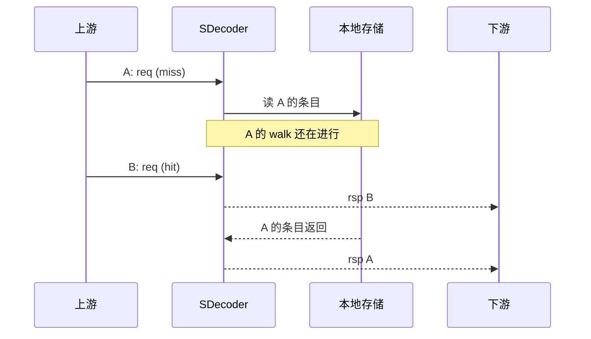
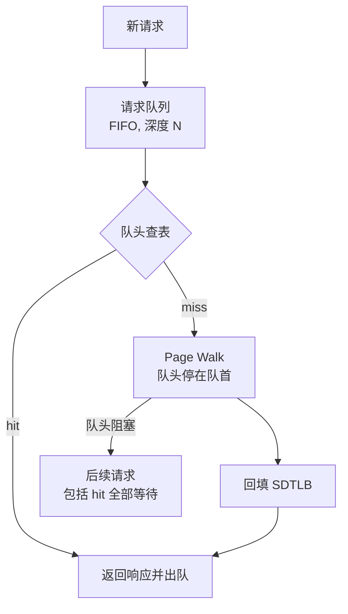

# 未命中队列 (MISS_FIFO) 与响应保序

状态: 讨论稿. 当前决策: 初版采用做法 B (hit-under-miss, 允许乱序响应), 设 MISS_FIFO (深度 4), 请求/响应带 `req_id` / `rsp_id`; A/C/D 保留为备选.

## 背景

`SDecoder 设计方案` 的顶层结构把 SDTLB 的命中通路和未命中通路分开:

- 命中: `SDTLB -> CALC -> RSP`
- 未命中: `SDTLB -> MISS_FIFO -> SDPTW -> RSP`

评审时提出两个问题:

1. 为什么需要 MISS_FIFO?
2. 它会不会导致请求或响应不保序?

评审后初版决定采用做法 B: 保留 MISS_FIFO (深度 4), hit-under-miss, 允许乱序响应, 请求/响应带 `req_id` / `rsp_id`. 本文保留当时的分析和 A/C/D 三种备选做法, 供后续取舍参考.

## 结论摘要

1. MISS_FIFO 是性能优化, 不是功能必需: 它把 1-2 拍的命中通路和几十到几百拍的 Page Walk 解耦.
2. FIFO 本身不重排; 乱序来自 "命中绕过未命中". 初版采用 B, 响应可以乱序, 用 `req_id` / `rsp_id` 匹配.
3. 保序有三条路: A 阻塞, C ROB, D 队头阻塞; B 是允许乱序.
4. 只靠一个 miss FIFO 做不到 "hit-under-miss + 保序": 必须加 ROB (C), 或者接受队头阻塞 (D), 或者改接口契约 (B).
5. 初版已选 B (hit-under-miss, 允许乱序, 带 `req_id` / `rsp_id`); 后续若要保序, 再在 A/C/D 里选.

## 术语

| 术语 | 含义 |
| --- | --- |
| 请求接收顺序 | 上游把请求交给 SDecoder 的顺序. 单 `req` 通道下天然是先进先收. |
| 响应返回顺序 | SDecoder 把 SLMD 或异常还给上游的顺序. 本文说的 "保序" 指这个. |
| SLMD | 内存描述符, 即 (EID, TokenID, SLA) 三元组. 早期文档也写作 SMD. |
| hit-under-miss | 未命中在走表时, 后续命中仍然可以查表并返回. |
| 队头阻塞 (head-of-line blocking) | 队列或流水线的队头是 miss 时, 后面的请求 (包括 hit) 都不能前进. |
| 保序 | 响应顺序与请求接收顺序一致. 默认指全局保序, 也可以按来源或按 ID 放宽. |

## 为什么需要 MISS_FIFO

### 延迟量级差

命中通路是 tag 比较加 data 读出, 1-2 拍. 未命中要读两级代换表, 最坏两次本地 HBM 或 DDR 访存, 几十到几百拍. 两条路直接串在一起, 快的一方会被慢的一方拖住.

### 不阻塞命中

如果没有队列, 一个 miss 就要在整段 walk 期间拉低 `req_ready`, 后面的 hit 也进不来. 有 FIFO, miss 可以先存起来, 命中继续以每拍一个的速率流动.

### 吸收突发

冷启动和 `inv_all` 之后会连续出现 miss. 浅队列可以平滑突发, 队列满后再用 `req_ready` 反压上游.

注意: 它只是把反压推迟 FIFO 深度那么多拍, 不消除反压. 如果 walk 比 miss 到达慢, FIFO 迟早会满.

### 工作队列与响应上下文

单 walker 需要从某个地方取请求; 队列项里除了 `PA[47:0]`, 还要存 `req_id`, `rw`, 可能的 epoch. 旧设计算的是 57 bit x 4 项, 见本地旧设计稿 (backup/doc/SDecoder设计方案.md, 未入库) 第 453 行.

### 不是功能必需

如果上游能一直等, miss 率又低, 一个 1 深的 holding register 加阻塞就够了. 是否要 FIFO, 取决于 "命中通路要不要绕过未命中", 而这又直接决定保序问题.

## 乱序是怎么发生的

### 当前通路

当前顶层图把命中通路和未命中通路分开, 命中不经过 FIFO:

- 命中: `SDTLB -> CALC -> RSP`
- 未命中: `SDTLB -> MISS_FIFO -> SDPTW -> RSP`

### 时间线

图: A 未命中, B 命中的时间线. B 的响应可以先于 A 返回. Mermaid 不表达真正的并发, 关键是 B 的响应发生在 A 完成之前. 初版采用 B, 这个乱序时间线就是实际行为, 用 `rsp_id` 匹配.

### 结论

- FIFO 内部是先进先出, 多个 miss 之间保序.
- 乱序来自 hit 绕过 FIFO: 后到的 hit 可以越过先到的 miss.
- 即使命中不绕过, 共享 `RSP` 端口也需要按 "谁更老" 仲裁; 固定优先级不够.
- 如果 FIFO 放在 SDTLB 之前, 顺序能保住, 但 hit 会被队头 miss 挡住, 这就是做法 D.
- 响应乱序可能变成访存乱序. 对同一地址, 同一来源的 order 要求, 要在系统层面单独确认.

## 四种做法

### 做法 A: 阻塞, 不做 hit-under-miss

机制:

- 有 miss 在途时, 拉低 `req_ready`, 不再接收新请求.
- 如果继续接收, 就要把后续命中结果存住, 等 miss 完成后再按序放行; 这已经是 C 的简化版, 不再是纯 A.
- miss 完成并回填后, 再放行后面的请求.

顺序: 天然保序.

队列: 1 深 holding register 就够, 不需要多深 FIFO.

代价: miss 的完整延迟暴露给整条流水, miss 期间命中带宽为 0.

适用: miss 率低, 上游能反压.

### 做法 B: hit-under-miss, 允许乱序响应

机制:

- 命中直接返回, 未命中进 FIFO 等 walk.
- 请求带 `req_id`; 响应把 `req_id` 原样回显成 `rsp_id`, 下游按 ID 匹配, 必要时自己重排.
- ID 由上游分配, SDecoder 只保存并回显, 不自己分配; 位宽按最大 outstanding 数定, 8 bit 足够.
- 访存顺序如果需要保序, 由下游或更上层负责.

B 的前提是多个 outstanding: 一个 miss 在走时, 后面的 hit 还能被接收并返回. 响应乱序后, 唯一的匹配手段就是 ID; 所以 `req_id` 和 `rsp_id` 都要有, 且 `rsp_id` 回显 `req_id`. 没有 ID 就只能退回 A / C 的保序做法.

顺序: 乱序.

代价: 接口要加 `req_id` / `rsp_id`, 下游要能重排; 旧接口手册写的是 "首版按请求顺序返回响应, `rsp_id` 预留", 见本地旧接口手册 (backup/doc/SDecoder接口手册.md, 未入库) 第 142 行, 需要按 B 更新.

适用: 下游支持多 outstanding, 能按 ID 重排或容忍乱序.

### 做法 C: hit-under-miss, 保序 (ROB 或 scoreboard)

机制:

- 每个被接收的请求分配一个序号.
- 命中结果先写进 ROB 对应的槽位, 不能直接返回.
- miss 完成也写进自己的槽位.
- 只有队头 (最老的未完成请求) 可以 retire; retire 时才真正返回响应.
- 需要 valid 和 done 位, 序号管理, 以及 `rsp_ready` 的反压.

顺序: 保序.

代价: ROB 面积, 序号管理, 验证复杂度. 仍有 head-of-line blocking: 一个长 walk 会挡住后面所有 hit 的 retire, 只是 hit 的查表和计算已经提前做完.

适用: 既要 hit-under-miss 又要保序.

### 做法 D: 队头阻塞 (head-of-line blocking)

机制:

- 把请求队列放在 SDTLB 之前, 所有请求按序排队, 按序查表.
- 队头是 hit: 查表, 返回响应, 出队.
- 队头是 miss: 走 Page Walk, 回填 SDTLB, 返回响应, 出队; 在这之前, 队头不前进.
- 队头不前进, 后面的请求 (包括本来能命中的) 全部停在队列里等.
- 不需要 ROB, 不需要 scoreboard, 不需要请求序号; 只需要队列加一个 "队头未完成" 的阻塞信号.

顺序: 天然保序.

队列深度 N 的作用: 吸收突发, 让上游在 N 个请求内不被立刻反压. 它不提升 miss 期间的吞吐, 只是把阻塞点从 `req_ready` 移到队头.

与 A 的区别: A 是立刻反压 (深度 1), D 是先缓冲 N 个再阻塞.

与 C 的区别: C 会继续查表并把命中结果暂存在 ROB, D 连后面的查表都不做. C 的响应在 retire 阶段等, D 的请求在队列里等. C 的硬件复杂, D 的硬件简单.

代价: head-of-line blocking, miss 期间命中带宽为 0; 队列越深, `inv_all` 的在途窗口越大, 刷新语义越难定义.

适用: 必须保序, 上游有突发, 又不想做 ROB. 如果 LCPM 接口上已经有 bypass FIFO, 可以直接复用它做这个请求队列.

图: 做法 D 的队头阻塞. 队头 miss 不完成, 后面的请求不前进.

#### 做法 D 的队列位置

做法 D 的队列必须是 "请求队列", 不是 TLB 之后的 miss 队列:

1. 队列在 SDTLB 之前: 所有请求入队, 按序处理. 队头 miss 阻塞后面所有请求. 深度 N 有意义, 可以吸收突发.
2. 保留 TLB 之后的 MISS_FIFO, 但在 miss 在途时挡住后续响应或请求: 这等价于 A 加一个 1 深 miss 寄存器. 此时 MISS_FIFO 深度 N 对保序没有额外帮助, 因为 hit 不经过它; 而上游在 miss 之后的第一个 hit 处就被挡住, 队列也填不满.

因此, 选 D 就要把队列放在 TLB 前, 或者复用 LCPM 的 bypass FIFO; 当前顶层图里 MISS_FIFO 的位置需要调整. 如果坚持把队列放在 TLB 后, 那实际上回到 A 或 C 的结构, 不是 D.

### 四种做法对比

| 方案 | hit-under-miss | 响应顺序 | 队列位置 | 额外硬件 | miss 期间 | 主要代价 |
| --- | --- | --- | --- | --- | --- | --- |
| A 阻塞 | 否 | 保序 | 1 深 holding | 无 | 命中带宽 0 | miss 延迟暴露 |
| B 乱序 | 是 | 乱序 | miss FIFO | `req_id` / `rsp_id`, 下游重排 | 满速 | 接口契约和下游复杂度 |
| C ROB | 是 | 保序 | miss FIFO 加 ROB | ROB 或 scoreboard | 查表满速, 响应等 retire | 面积和验证复杂度 |
| D 队头阻塞 | 否 | 保序 | 请求队列在 TLB 前 | 队列和阻塞控制 | 命中带宽 0 | 队头阻塞, 深队列只吸收突发 |

## 建议

1. 当前决策: 初版采用 B, hit-under-miss, 允许乱序, 设 MISS_FIFO (深度 4), 请求/响应带 `req_id` / `rsp_id`; 响应 FIFO 深度 2. 下游按 ID 匹配, 必要时自己重排; 后续若要保序, 再在 A/C/D 里选.
2. 后续如果要改保序或改队列深度, 先定响应顺序契约: 保序还是乱序; 保序的粒度是全局, 按来源还是按 ID. 这三条不定, FIFO 深度和 ROB 都没法定.
3. 后续如果 B 的乱序不可接受: 上游能接受阻塞选 A; 必须保序又想做 hit-under-miss 选 C; 必须保序, 只想吸收突发, 不想做 ROB 选 D.
4. 不建议 "深度 4 的 miss FIFO 加声明保序" 而不给机制. 深度 4 只在允许 hit-under-miss 且能乱序 (B), 或者有 ROB (C), 或者队列在 TLB 前按序处理 (D) 时才有意义; 在 A 下深度 4 是多余的.
5. 如果选 D 且复用 LCPM 的 bypass FIFO, 要明确两级队列的分工: 上游 FIFO 只吸收突发, 不提供 hit-under-miss; SDecoder 内部不再放 miss FIFO, 否则队列串联会拉长在途窗口.
6. 无论初版还是后续改法, 都要补 `inv_all` 与在途请求的交互: 走表途中的请求在 `inv_all` 之后回填, 可能把旧表内容写回 TLB. 需要 epoch, flush 或 quiesce 规则. 这是 [一些思考.md:17-26](../一些思考.md#L17-L26) 里 bypass-fifo 那条担心的同类问题.

## 需要写进设计方案的决策点

初版 B 下: 多 outstanding, 允许乱序, 有 FIFO, 有 `req_id` / `rsp_id`. 后续如果要改保序或改深度, 需要重新确认:

- 响应保序的粒度: 全局, 按来源或按 `req_id`.
- 是否允许 hit-under-miss.
- MISS_FIFO 的位置: TLB 前 (请求队列) 还是 TLB 后 (miss 队列).
- FIFO 深度, 满和空的行为, 是否合并同地址.
- `req_id` / `rsp_id` 的语义: 只做匹配, 还是参与保序和重排.
- `inv_all` 和 `inv_en` 与队列, 在途 walk, 回填的先后关系.
- 填充与无效化的优先级.
- 性能目标: 可接受的 miss 延迟, 突发长度, 命中率假设.

## 与现有文档和 RTL 的对照

- 当前设计方案: 初版采用 B, 保留 MISS_FIFO (深度 4), hit-under-miss, 响应乱序; SDPTW 只输出原始条目, `rsp_sdt_l2_read` 和 `req_id`, 异常统一在 SLMD_CALC 产生; 请求/响应带 `req_id` / `rsp_id`. SDIOR 在图上只保留配置与刷新接口. 见 [SDecoder 设计方案.md:196-208](<SDecoder 设计方案.md#L196-L208>) 和其后的说明.
- 本地旧设计稿: FIFO 深度 4, 每项 57 bit (含 rw), 单 walker; 初版 MISS_FIFO 每项 56 bit (PA[47:0] + req_id, 不含 rw); 旧稿没有给出乱序匹配机制.
- 本地旧接口手册: 写 "首版按请求顺序返回响应 (先进先出), 接口保留 `rsp_id`", 见 backup/doc/SDecoder接口手册.md 第 142 行 (未入库); 初版 B 用 `rsp_id` 做乱序匹配, 手册的保序描述需要更新.
- RTL: `sdptw` 是单 walker, `req_ready` 只在 IDLE, 见 [sdptw.sv:103](../../../rtl/sdptw.sv#L103); `rtl/` 目前没有 miss FIFO, 也没有顶层, 初版的 B 策略 (MISS_FIFO + 响应保持 + ID) 需要在顶层实现.
- 一些思考: LCPM 的 bypass FIFO 与 `inv_all` 的一致性担心, 见 [一些思考.md:17-26](../一些思考.md#L17-L26).

## 参考资料

- [SDecoder 设计方案](<SDecoder 设计方案.md>)
- [内存池化SDecoder和SMMU部件设计方案v2.6](../内存池化SDecoder和SMMU部件设计方案2.6/内存池化SDecoder和SMMU部件设计方案v2.6.md)
- [一些思考.md](../一些思考.md)
- [sdptw.sv](../../../rtl/sdptw.sv)
- 本地旧稿: backup/doc/SDecoder设计方案.md, backup/doc/SDecoder接口手册.md (未入库, 仅供本地对照)
