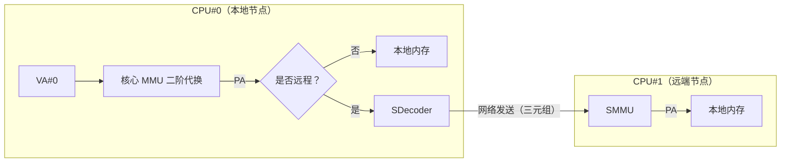
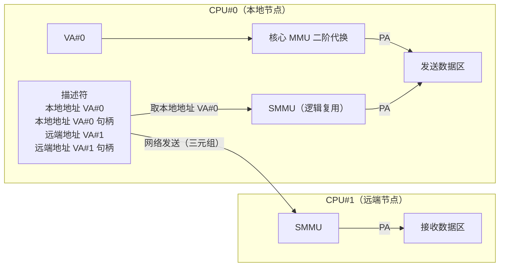
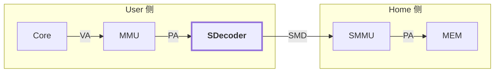
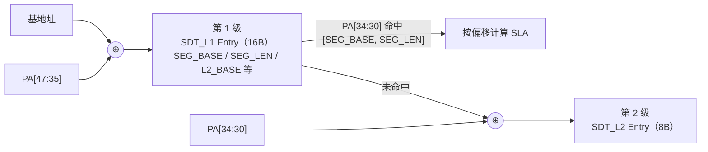
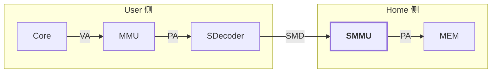
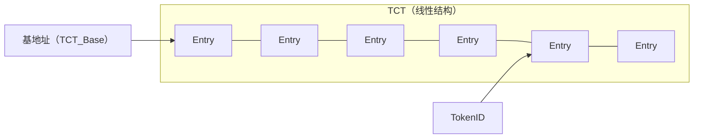
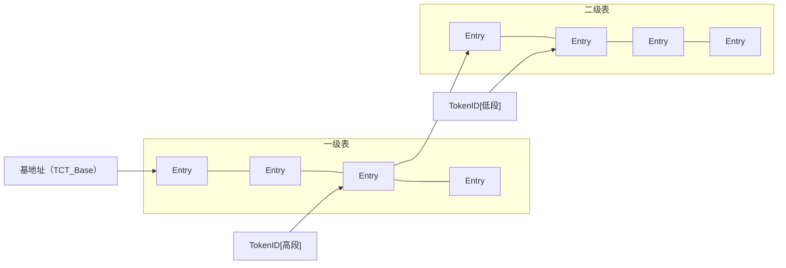
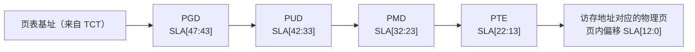

# SW576超节点系统

**内存池化SDecoder和SMMU部件设计方案**

创建时间：2026.08.11

更新时间：2026.09.19

主要撰写人：外网略

版本号：v2.6

## 背景需求

SW新一代智能芯片组由C1、A3、X1三款芯片构成。基于这三款芯片构建的SW576超节点系统，拟实现“对等互连、统一编址、内存共享”的功能特性，因此需要支持内存提供方（Home侧）和内存使用方（User侧）的统一地址编址，支持内存池化共享。

其中，“对等互连”是指超节点系统中C1芯片和A3芯片均采用内存注册机制实现内存池化共享。“统一编址”是相对超节点大内存池而言，内存池虚地址（GVA）可以跨节点直接引用，一定对应相同的物理位置。

## 地址空间说明

C1芯片核心（即ACore-1核心）支持的地址宽度相对CoreX系列核心保持不变。虚地址VA保持53位（[52:0]），共8PB空间；物理地址PA保持48位（[47:0]），最高位仍然用于区分Mem空间（PA[47]位为0）和IO空间（PA[47]位为1），因此Mem空间和IO空间均为128TB。

远端内存访问（物理位置在远端）对于ACore-1核心而言是透明的（即ACore-1核心对本地内存访问和远端内存访问不做区分），但要求ACore-1核心对远端内存必须是虚地址访问（与对本地内存的虚地址访问一致），且必须是不可Cache访问（在页表中填写NCSpace标志）。**特别的，推测路径上的直接物理地址访问可能指向远端内存。**

ACore-1核心只负责根据MMU代换得到物理地址PA（该OS视角下的物理地址，含远端内存）。核外一致性处理部件（LCPM）会根据地址界标（软件可配置）判定是本地内存或者远端内存。本地内存访问由本芯片LCPM处理，远端内存访问会通过SWLink发到目标芯片。**特别的，如果基于本地内存与其他芯片进行共享交互，对本芯片而言推荐使用本地视角（即不要映射到远程PA，否则会经过SWLink环回）**。

## 术语说明

Home是内存物理资源的拥有者，User是内存物理资源的访问者。User基于三元组（EID+TokenID+SLA）和相应的地址代换逻辑完成对远端内存的访问。

表1：术语说明

| 术语    | 说明                 | 用于                                                                                                                                                                                             |
| ------- | -------------------- | ------------------------------------------------------------------------------------------------------------------------------------------------------------------------------------------------ |
| EID     | Entity Identifier    | 用于SWLink网络路由。                                                                                                                                                                             |
| TokenID | Token Identifier     | 用于索引得到句柄信息。 一个逻辑池使用相同的TokenID，相同逻辑池中不同Home导出的SLA连续（且TokenID相同）。导出时以哪个SLA地址对外可见由上层管理服务指定（与V2.5版相比，TockenID的理解有变化）。 |
| SLA     | SWLink Address       | 虚地址                                                                                                                                                                                           |
| SMD     | SW Memory Descriptor | 内存描述符（即三元组），用于描述576超节点系统中的共享内存段。                                                                                                                                    |
| GVA     | 全局虚地址           | 核心（ACore-1或ICore）视角下的虚地址。 对于超节点大内存池而言，该虚地址视为全局虚地址（GVA），GVA可以跨节点直接引用（全系统的load/store访问）。                                               |

## 访存流程说明

表2：C1和A3（ICore）支持的访存操作

| 类型       | 数据传输          | C1         | iCore |
| ---------- | ----------------- | ---------- | ----- |
| Load/store | 寄存器HBM或DDR    | 支持       | 支持  |
| iDMA       | LDM(SM)HBM或DDR   | **不支持** | 支持  |
| XMA        | HBM或DDR HBM或DDR | 支持       | 支持  |

### Load/Store（iDMA）

图1：Load/Store 访存流程。核心经 MMU 二阶代换得到 PA，核外判定本地或远端；远端访问由 SDecoder 转换为三元组，经 SWLink 发往 Home 侧 SMMU，再代换为 Home 本地 PA。

### XMA

图2：XMA 访存流程。描述符中的本地地址复用 SMMU 逻辑代换为 PA；远端地址以三元组形式经网络发往 Home 侧 SMMU，代换后写入接收数据区。

说明：XMA描述符本地地址是虚地址，基于SMMU同一套逻辑进行地址代换（与核心MMU不是同一套表，只是映射关系相同。SMMU设计见第5章）。XMA描述符远端地址是三元组，直接通过SWLINK发送到远端，由远端侧的SMMU完成地址代换。

## 内存池化地址代换设计

### SDecoder设计

SDecoder作为576超节点系统中User侧CPU/GPU/xPU（在Load/Store同步访问时）对SMD访问的入口，在User侧按需将本地PA转换为SMD发送给Home侧。具体通过查找SDecoder Table，完成PA→SMD的地址转换。

图3：SDecoder 功能——User 侧的 PA 到 SMD（包含 FA）的地址转换。User 侧完成 VA→PA 后由 SDecoder 完成 PA→SMD 代换，SMD 经网络送达 Home 侧 SMMU。

#### 两级代换表结构

SDecoder采用两级代换表结构，通过基地址（IO寄存器，软件可配置）和PA地址逐级索引，最终获得代换表的表项。

SDecoder一级表（L1 SDecoder Table，SDT_L1）本身的基地址（SDT_L1_BASE[47:4]）需由软件填写，硬件在代换过程中使用。SDT_L1表共4096个条目（注：索引为PA[47:35]共13位，但SDecoder的请求断言PA[47]=0，因此实际只有低半区的4K个条目可达；即128TB/32GB=4K个；SDT_L1_BASE[47]同理保留但断言为0），每个条目长度设置为16B，因此SDT_L1表的存储开销为64KB。

SDecoder二级表（L2 SDecoder Table，SDT_L2）本身的基地址（SDT_L2_BASE[47:3]）可从一级表中获得。每个一级表条目所对应的SDT_L2表共32个条目（注：PA[34:30]共5位，对应32个条目；即32GB/1GB=32个），每个条目长度设置为8B，因此每个一级表条目所对应的SDT_L2表的存储开销为256B，所有SDT_L2表的存储开销共计为4K\*256B=1MB（按可达的4K个一级条目计）。

表3：SDecoder一级表（SDT_L1）条目内容

| 域名            | 范围              | 描述                                                                               |
| --------------- | ----------------- | ---------------------------------------------------------------------------------- |
| L2_BASE[47:3]   | *45位*            | 二级表基地址                                                                       |
| EID[10:0]       | *11位*            | Entity标识，消息路由使用                                                           |
| TokenID[9:0]    | *10位*            | 查找上下文使用                                                                     |
| S_PFN[47:30]    | *18位*            | SLA基址（以1GB对界）                                                               |
| SEG_LEN[34:30]  | [11:7]            | 段长(注1)                                                                          |
| SEG_BASE[34:30] | [6:2]             | 段的基地址（以1GB对界）                                                            |
| Type            | [1]               | 类型位：为1表示该32G空间范围内有且仅有1个段表(注2)；为0表示该32G空间范围内均为页表 |
| Valid           | [0]               | 有效位                                                                             |

注1: *实际指的是段的上界偏移, 如 AXI 的 AxLEN*
注2: *当 Type = 1 时, 该 32GB 空间内除此 1 个段表外, 还可能包含 0, 1 或多个页表*
注3: *FOW/FOR 已取消(SDecoder 表不设权限位)*
注4: *L2_BASE[47] 保留(见设计方案 表5 的注), 但代换拼二级表地址时断言该位为 0: SDecoder 只处理 Mem 空间*

表4：SDecoder二级表（SDT_L2）条目内容

| 域           | 范围             | 描述                            |
| ------------ | ---------------- | ------------------------------- |
| EID[10:0]    | *11位*           | Entity标识，消息路由使用        |
| TokenID[9:0] | *10位*           | 查找上下文使用                  |
| S_PFN[47:30] | *18位*           | SLA的基址（以1GB对界）          |
| Valid        | [0]              | 有效位                          |

注1: *FOW/FOR 已取消(SDecoder 表不设权限位)*

#### 两级代换流程示意图

SDecoder两级代换流程的示意图如下：

图4：SDecoder 两级代换流程

#### 一级代换表SDT_L1查询

进行PA→SMD的地址转换时，首先查询SDecoder一级表SDT_L1，判断是否为段式代换。如果该32G空间范围内存在段式代换、且该PA落在所对应的段地址范围内，则完成代换；否则，需要继续查询SDecoder二级表SDT_L2。

SDT_L1条目中主要存储段基址SEG_Base[34:30]（段必须按照1GB对界）、段长SEG_LEN[34:30]（以1GB为单位，不超过32GB）、网络地址的基址S_PFN[47:30]，代换过程如下：

a. 以PA[47:35]为索引访问SDT_L1代换表，读取对应条目；
b. 读条目内容（SEG_Base[34:30]/SEG_LEN[34:30]）；
c. 判断PA是否落入段表范围内。方式如下：
① 计算偏移：PA_Offset[34:30] = PA[34:30] – SEG_BASE[34:30]；
② 如果PA_Offset大于等于0，且PA_Offset小于等于SEG_LEN，则说明可以按照段式代换，跳至步骤d。否则，按照页式代换，跳转至查询SDecoder第二级代换表SDT_L2。
d. **段式代换得到网络地址SLA的基址，为：**

**SLA[47:30]={S_PFN[47:30] + {13’h0, PA_Offset[34:30]} },**

**拼上页内偏移后，获得最终SLA为：**

**SLA[47:0]={ {S_PFN[47:30] + {13’h0, PA_Offset[34:30]} }, PA[29:0] }**

#### 二级代换表SDT_L2查询

如果该32G空间范围内不存在段式代换，或该PA未落在所对应的段地址范围内，需要继续查询SDecoder二级表SDT_L2，进行页式代换。

采用页式代换时，SDT_L1代换表条目中存储二级表SDT_L2的基址，代换过程如下：

a. 如前所述，以U_PA[47:35]为索引访问一级表SDT_L1条目，得到二级表基地址L2_BASE[47:3]；
b. 以U_PA[34:30]为索引访问二级表SDT_L2条目；
① 从命中条目中读出网络地址FA的基址S_PFN[47:30]；
② 拼上页内偏移后，获得最终SLA为：

**SLA[47:0]={ S_PFN[47:30], PA[29:0] }**

#### SDecoder代换快表（SDTLB）

SDecoder代换快表（SDTLB）可采用多种实现方式。

第一种方式是利用两张快表，分别存储段式和页式代换关系。

第二种方式是只用一张快表，在其中融合段式和页式代换关系。

第三种方式是按照段式代换关系进行实现（将页当做特殊段）。

第四种方式是按照页式代换关系进行实现（将段拆分为多个页）。

经过初步评估，优先采用第三种方式，完全按照段式的代换关系进行实现。

硬件设置SDecoder的代换快表（SDecoder TLB，SDTLB）缓存结构，存储PA→SMD的映射关系。SDTLB采用全相联的组织结构，共设置128个条目（可覆盖128GB至4TB容量范围）。

表5：SDecoder代换快表（SDTLB）结构

| 域名 |                | 范围           | 含义描述                                                                                   |
| ---- | -------------- | -------------- | ------------------------------------------------------------------------------------------ |
| Tag  | PA_Base[47:30] | [23:6]         | 段空间基址（1GB地址边界） PA落在PA_Base和PA_Up所表示的范围内，则认为命中                |
|      | PA_Up[34:30]   | [5:1]          | 段空间上限（1GB地址边界） 对于1GB的页式代换，该条目的PA_Base[34:30]与PA_Up[34:30]相等。 |
|      | Valid          | [0]            | 有效位                                                                                     |
| Data | EID[10:0]      | [39:29]        | Entity标识，消息路由使用                                                                   |
|      | TokenID[9:0]   | [28:19]        | 查找上下文使用                                                                             |
|      | S_PFN[47:30]   | [18:1]         | SLA的基址（以1GB对界）                                                                     |
|      | Grn            | [0]            | 粒度位：为1表示段空间；为0表示页空间（1GB页粒度）。                                        |

注: PA[47] = 1 是 IO 空间, SDecoder 的请求断言 PA[47] = 0; Tag 里保留 PA_Base[47] 只为维持 48 位地址口径
(这样 Tag 为 24 位, 与 40 位 Data 正好凑成 64 位条目), 装填时该位恒为 0, 因此 PA_Base[47] = 1 的条目永远不会命中

当进行SDecoder命中判断时，使用User侧物理地址Req_PA[47:30]与SDTLB的128个条目的Tag部分进行比较，若满足以下条件，则认为命中对应条目：

1） SDTLB快表条目有效；

2） 地址的[47:35]位匹配，即Req_PA[47:35] = PA_Base[47:35]；

3） Req_PA落在PA_Base和PA_Up所表示的范围内，即PA_Base[34:30] <= Req_PA[34:30] <= PA_Up[34:30]。

命中对应条目后，得到的代换结果为：

**SLA[47:0]={ {S_PFN[47:30] + {13’h0, {Req_PA[34:30] - PA_Base[34:30]} } , Req_PA[29:0] }**

### SMMU设计

SMMU作为576超节点系统中的内存访问控制组件，在Home侧提供内存资源的地址映射（以及访问权限校验）。

SMMU代换的完整流程包含四个步骤：配置查找、上下文查找、地址转换、权限校验。其中，EID只用于网络路由，不参与地址代换。Token ID用于索引上下文查找表（确定页表基址、页表类型），SLA用于索引地址转换表和权限校验表（完成地址代换和权限检查）。

图5：SMMU 功能——Home 侧的 FA 到 PA 的地址转换和权限校验。Home 侧 SMMU 将 SMD 中的 SLA 代换为本地 PA，再访问 MEM。

#### 页表基址

Target Context Table（TCT）用于存放上下文信息（页表基址和页表类型等）。华为UMMU中TCT基址是通过EID查找Target Entity Configuration Table（TECT）得到。在我们的设计中，EID只用于网络路由，不参与地址代换。

TCT基址和类型由软件填写。TCT_Base用于指定TCT表基址，TCT_Type用于指定TCT表类型（类似华为的线性和二级表两种结构。在我们的设计中可以只实现线性结构，取决于TokdenID位宽）。SMMU地址代换首先根据TCT表基址、TCT表类型和TokenID，得到对应的TCT条目。

图6：TCT 表结构（线性）。以 TCT 基址定位表首，TokenID 直接索引对应 TCT 条目，无二次间接。

图7：TCT 表结构（二级表）。TokenID 高段索引一级表定位二级表基址，低段再索引二级表得到最终 TCT 条目。

TCT条目指定页表基址（PTBR）和页表类型（PTType）。页表类型可以指定页表是采用几级结构（最大是四级结构，对应SLA[47:0]），该功能与建立页表时Malloc空间的大小有关。以8KB基础页为例，三级表可覆盖8TB的地址空间（8KB\*1024\*1024\*1024），二级表可覆盖8GB的地址空间。如果通信库只Malloc 1GB空间，可以只建立二级表结构。

图8：SLA 四级代换结构。SLA[47:43]/[42:33]/[32:23]/[22:13] 依次索引 PGD/PUD/PMD/PTE，SLA[12:0] 为页内偏移。

SMMU页面粒度保持与核心MMU相同（或只实现部分页面粒度）。硬件Pagewalk会判断页面粒度，对于超过8KB粒度的大页，PageWalk时不需要访问到最后一级页表即可获得最终的代换地址。

补充说明：

1. 对于“通信库只Malloc 1GB空间”的情况，使用四级表结构还是二级表结构，两者的差异在于存储资源开销和代换延时开销。对于四级表结构，前两级页表的基地址也需要占用内存（8KB页面）。延时开销是四级表结构多了两次访存（尽管设置PSC，但首次访问时两次访存必不可少）。
2. **在V2.5版方案中，对于“通信库Malloc 1GB空间，只建立二级表结构”的情况，限定SLA在1GB空间内（高位地址位零）。为应对更为灵活的情况，特别是V2.6版方案对TokenID的理解（一个逻辑池使用相同的TokenID，相同逻辑池中不同Home导出的SLA连续），建议在TCT条目中增加SLA_BASE。SLA减去SLA_BASE之后，在进行页表代换。**

#### 页表结构

页表类型可以指定页表是采用几级结构（最大是四级结构），该功能与建立页表时Malloc空间的大小有关。本节以四级页式页表进行说明。

SMMU页表分为四级：一级页表目录PGD、二级页表目录PUD、三级页表目录PMD、四级页表PTE。PGD/PUD/PMD/PTE的页表条目内容结构，与核心GPT页表设置基本一致。

表6：SMMU页表条目内容

| 域名       | 范围（*共42位*） | 描述                  |
| ---------- | ---------------- | --------------------- |
| PFN[47:13] | [58:24]          | 物理地址页面号        |
| ……         |                  | ……                    |
| ACCESSED   |                  | （软件使用）          |
| ……         |                  | ……                    |
| ~~PCD~~    |                  | ~~不可Cache访问空间~~ |
| LastFlag   |                  | 最后一级标志          |
| ContFlag   |                  | 条目连续标志          |
| FOR        |                  | 读故障位              |
| FOW        |                  | 写故障位              |
| ~~FOE~~    |                  | ~~执行故障位~~        |
| ……         |                  | ……                    |
| Valid      | [0]              | 有效位                |

#### 四级代换表查询

从SLA[47:0]到PA[47:0]的代换流程如下：

a. 一级页表条目的物理地址PGDIndex[47:0] = { PTBR[47:13], 13b’0} + { 40b’0, SLA[47:43], 3b’0};
b. 访问Home侧本地存储空间，读出PGDIndex[47:0]地址中存放的一级页表条目，进行有效位判断后，将其中的PFN作为二级页表起始物理地址PUDBase[47:13]；
c. 二级页表条目的物理地址PUDIndex[47:0] = { PUDBase[47:13], 13b’0} + { 35b’0, SLA[42:33], 3b’0};
d. 访问Home侧本地存储空间，读出PUDIndex[47:0]地址中存放的二级页表条目，进行有效位判断后，将其中的PFN作为三级页表起始物理地址PMDBase[47:13]；
e. 三级页表条目的物理地址PMDIndex[47:0] = { PMDDBase[47:13], 13b’0} + { 35b’0, SLA[32:23], 3b’0};
f. 访问Home侧本地存储空间，读出PMDIndex[47:0]地址中存放的三级页表条目，进行有效位判断后，将其中的PFN作为四级页表起始物理地址PTEBase[47:13]；
g. 四级页表条目的物理地址PTEIndex[47:0] = { PTEDBase[47:13], 13b’0} + { 35b’0, SLA[22:13], 3b’0};
h. 访问Home侧本地存储空间，读出PTEIndex[47:0]地址中存放的四级页表条目，进行有效位判断后，再进行权限检查，若无异常产生，则将其中的PFN[47:13]作为SLA对应的H_PA[47:13]，得到物理地址**H_PA[47:0] = { PFN[47:13], SLA[12:0]}**，结束代换流程。

*注：硬件*Pagewalk*过程中，对于超过8KB粒度的大页，不需要访问到最后一级页表即可获得最终的代换地址。*

#### SMMU代换快表（SMTLB）

硬件设置SMMU的代换快表（SMMU TLB，SMTLB）缓存结构，存储SLA→PA的映射关系（快表中要存储TokenID）。SMTLB采用两级结构，一级采用全相联的组织结构，共设置128个条目；二级采用组相联结构，共设置1024个条目。

表7：SMMU代换快表（SMTLB）结构

| 域名 |                 | 范围（*共75位*） | 含义描述                             |
| ---- | --------------- | ---------------- | ------------------------------------ |
| Tag  | SLA_BASE[47:13] | 35位             | SLA基址                              |
|      | TokenID[9:0]    | *10位？*         | 查找上下文使用                       |
|      | Grn[1:0]        | [2:1]            | 粒度指示                             |
|      | Valid           | [0]              | 有效位                               |
| Data | H_PA[47:13]     | *35位*           | Home侧导出内存的本地物理地址页面基址 |
|      | FOW             | [2]              | 写故障位，为1表示空间不可写          |
|      | FOR             | [1]              | 读故障位，为1表示空间不可读          |
|      | Grn[1:0]        | [1:0]            | 粒度指示                             |

## 软件接口

### 软硬件约定

(1) 关于SMD三元组：EID只用于SWLink网络路由，不用于地址代换。TokenID等同于逻辑池的概念，一个逻辑池使用相同的TokenID，相同逻辑池中不同Home导出的SLA连续（且TokenID相同）。Home导出时以哪个SLA地址对外可见由上层管理服务指定。

(2) SDecoder使用两级代换表结构（段页混合式）。一级条目使用段式映射，最大32GB（必须按照1GB对界）。二级条目使用页式映射，固定1GB（该1GB空间一定是来自某一个Home，且SLA连续）。

(3) SMMU支持TokenID，但不支持二阶代换（不支持虚拟化）。Target Context Table（TCT）用于存放上下文信息。TCT基址（TCT_Base）和TCT表类型（TCT_Type）由软件填写（是否同时支持线性和二级表两种结构待定）。SMMU地址代换首先根据TCT表基址、TCT表类型和TokenID，得到对应的TCT条目。

(4) TCT条目内容包括页表基址（PTBR）、页表类型（PTType）和SLA基址（SLA_BASE），软件在建立地址代换表时要与该TCT条目中的配置信息一致。页表类型用于指定所建立页表是几级表结构，页表基址用于指定本页表结构的基地址，SLA基址用于生成最终参与地址的SLA（三元组中的SLA减去SLA基址）（该功能是否需要待确定）。

(5) 要求SDecoder两级代换表和SMMU页表必须本地化存储（本地DDR/HBM），而非存储于远程的、被借用的池化资源上，从而避免读取代换表的操作引起远程内存访问。

(6) 不支持SDecoder和SMMU硬件代换快表条目的软件装填。

(7) SMMU仅支持读写权限检查（FOR/FOW），无需支持执行、不可Cache、驻留、（FOE/PCD/Fixed）等权限检查；如有需要，可支持不可合并（WCD）权限检查。

### 软硬件接口

代换基址、软件刷新、异常处理的软硬件接口，如下所述。

#### 代换基址

SDecoder一级表（L1 SDecoder Table，SDT_L1）本身的基地址SDT_L1_BASE（PA[47:4]）需由软件填写，硬件在代换过程中使用。需设置IOR：SDecoder_PTBR，用于表示SDecoder一级表基地址寄存器。

SMMU代换的TCT基址TCT_Base（PA[47:3]）和TCT表类型TCT_Type（是否需要待定）需由软件填写。需设置IOR：SMMU_TCTInfo，用于表示SMMU代换TCT基址及表类型寄存器。

#### 软件刷新

软件可以通过写相关IOR寄存器，对SDecoder或SMMU硬件代换快表条目进行置无效。

置无效SDecoder快表条目的方式包括以下两种：

1) 写IOR寄存器SDecoder_IA：置无效全部SDecoder条目；
2) 写IOR寄存器SDecoder_IS：置无效指定U_PA地址的某个SDecoder条目。

类似的，置无效SMMU快表条目的方式包括以下三种：

1) 写IOR寄存器SMMU_IA：置无效全部SMMU条目；
2) 写IOR寄存器SMMU_IT：置无效指定TokenID的全部SDecoder条目；
3) 写IOR寄存器SMMU_IS：置无效指定TokenID指定SLA地址的某个SMMU条目。

注1：如果SMMU含PSC结构，则执行SMMU_IA操作时，硬件会自动刷新PSC；

注2：SDecoder快表和SMMU快表集成在SWlink中。C1和A3芯片集成多个SWLink，软件刷新时需要针对多个SWLink中的快表进行刷新。

#### 异常处理（待进一步研究细化）

可能会出现以下几种异常类型（相比当前核心的软硬件接口，不增加新的异常入口或CSR寄存器）：

**待进一步梳理：报给user还是home？当A3作为home时，异常是报个该A3还是同逻辑节点的C1？**

1) SDecoder或SMMU的硬件代换快表命中，但权限检查发现权限异常（FOR/FOW为1）：报读写权限异常，**报DFault异常**（注：SDecoder表不需要设置权限位），登记相关CSR。
2) SDecoder或SMMU的硬件代换快表不命中，在代换表遍历过程中，发生控制错或ECC校验多错：报机器检查错，**报MCHK故障**，登记相关CSR。

   a) SMMU故障时，向home报非精确MCHK，向user报地址非法*（待进一步考虑）*；

3) SDecoder或SMMU的硬件代换快表不命中，在代换表遍历过程中，发生地址越界：**报地址非法异常**。
4) SDecoder或SMMU的硬件代换快表不命中，在代换表遍历过程中，发现代换表条目无效：**报地址非法异常**。
5) SDecoder或SMMU的硬件代换快表不命中，在代换表遍历过程中，发现代换表权限异常（FOR/FOW为1）：报读写权限异常，**报DFault异常**，登记相关CSR。

## SOC集成使用

SDecoder和SMMU将以IP的形式提供，包括代码和手册（功能介绍、接口定义、代换流程和软件接口）。

(1) C1和A3芯片的SWLINK需集成SDecoder和SMMU。SDecoder用于user侧（Load/Store、iDMA）完成物理地址到三元组的代换。SMMU用于home侧完成三元组（TokenID和SLA）到物理地址的代换。

(2) SWLINK中的SMMU还用于完成XMA引擎本地地址（虚地址）到物理地址的代换。

(3) ICore出口处虚地址到物理地址的代换（ICore核心MMU）可考虑复用SMMU（具体待交流。初步认为可行：基于TokenID得到页表基址，根据虚地址VA默认按四级表结构完成代换）。

## 修订记录

外网略。
