# 申威576超节点系统

**内存池化SDecoder和SMMU部件设计方案**

首次创建时间：2026.08.11

最后更新时间：2026.09.05

主要撰写人：外网略

版本号：v2.3

*注：当前方案侧重流程梳理/软硬件设计；与软件无关的微结构设计，待后续细化。*

## 背景需求

申威新一代智能芯片组由C1、A3、X1三款芯片构成。基于这三款芯片构建的申威576超节点系统，拟实现“对等互连、统一编址、内存共享”的功能特性，因此需要支持内存提供方（Home侧）和内存使用方（User侧）的统一地址编址，支持内存池化共享。

其中，“对等互连”是指超节点系统中C1芯片和A3芯片均采用内存注册机制实现内存池化共享。“统一编址”是相对超节点大内存池（Fabric Address，FA）而言，若用户虚地址经过两次地址代换（VA→PA→FA）得到的FA地址相同，则对应的实际物理位置一定相同。

## 地址位宽和本地远端区分

C1芯片核心（即ACore-1核心）支持的地址宽度相对CoreX系列核心保持不变。虚地址VA保持53位（[52:0]），共8PB空间；物理地址PA保持48位（[47:0]），最高位仍然用于区分Mem空间（PA[47]位为0）和IO空间（PA[47]位为1），因此Mem空间和IO空间均为128TB。

远端内存访问对于ACore-1核心而言是透明的（换句话说：对于ACore-1核心而言，远端内存访问对其透明，即ACore-1核心的本地内存访问和远端内存访问的方式不做区分）。这就要求，ACore-1核心对远端内存必须是虚地址访问（与对本地内存的虚地址访问一致），且必须是不可Cache访问，需要软件在远端内存的页表中填写NCSpace标志。**特别的，推测路径上可能产生对远端内存的直接物理地址访问。**

核外会根据物理地址PA和LCPM部件内记录的界标，判定是本地内存或者远端内存。如果核心发出对远端内存的可Cache方式访问，核外直接返回非法地址响应。

## Home-User模型

Home是内存物理资源的拥有者，User是内存物理资源的访问者。User基于实体路由信息（Entity Identifier，EID）和“网络/交换/转发”地址（Fabric Address，FA）两者构成的全局唯一标识，访问Home的内存。

可将EID和FA两者合称为内存描述符（SW Memory Descriptor，SMD）。SMD全局统一，用于描述576超节点系统中的共享内存段。SMD与全局虚地址（Global Virtual Address，GVA）、FA等概念密切相关，均是全局统一视角下的唯一地址标识。

注1：华为UB协议的UBMD（含EID、TokenID和UBA），与576超节点系统的SMD近似。EID用于标识实体，其中可包含节点号、机架号、CPU/GPU/xPU号等信息；TokenID用于标识所访问内存段的上下文信息，包括地址转换流程相关信息、权限校验启用情况等；UBA和FA用于标识内存提供方（Home侧）对外呈现的内存资源。

注2：FA和SMD的关系：FA是SMD的一部分，SMD=EID+FA（TokenID需再考虑）。

注3：GVA和SMD的关系：GVA和SMD之间一一映射（软件逻辑概念和硬件路由概念），不会出现一对多或多对一的情况，具体映射关系可由软件建立。

注4：GVA和本地VA的关系：本地VA内的属于全局共享的集合，构成了GVA？（疑问：用户在使用本地VA的时候，难道还需要区分本地和远程、区分GVA和非GVA？关键矛盾在于，SMD跟物理内存紧密绑定，因此GVA也跟物理内存紧密绑定，但用户VA又希望对本地/远程无感。）

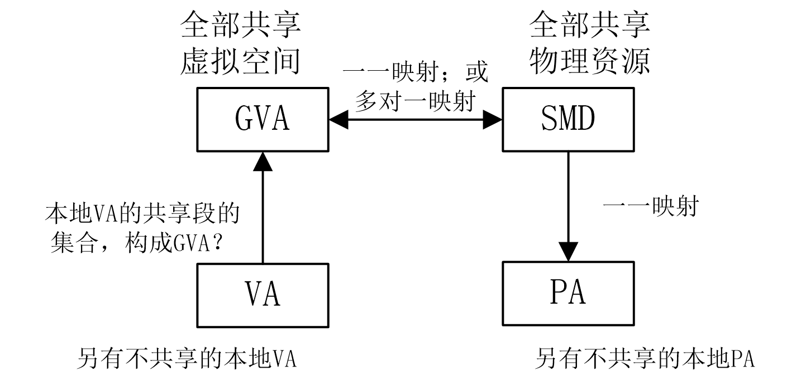

注5：GVA里，不包含未共享的内存段。HBM必须全部共享，才能全被看见、达到互连效果。

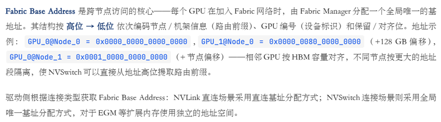

## 异步访问和同步访问

基于SMD，申威576超节点系统支持以同步/异步的方式，访问共享内存段（*TokenID需再考虑*）。

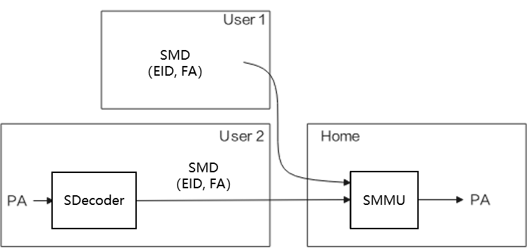

图1：同步/异步访问示意图：User1以URMA异步访问；User2以Load/Store同步访问。

### URMA异步访问

URMA异步访问，如图2所示（*TokenID需再考虑*）。

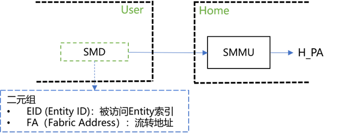

图2：URMA异步访问：通过URMA软件接口，向存储设备发起访问

### Load/Store同步访问

Load/Store同步访问，如图3所示（*TokenID需再考虑*）。

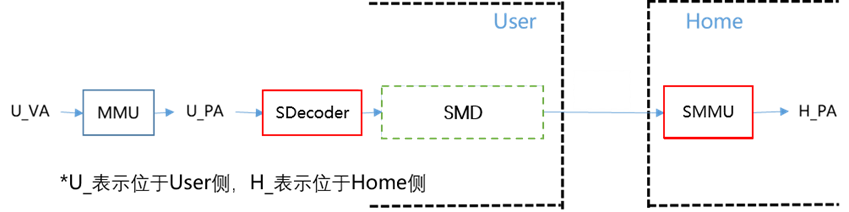

图3：Load/Store同步访问：由硬件直接发起(CPU指令)，向存储设备发起访问

## 内存池化地址代换设计

### 软硬件约定

（1）SMMU的设计，基于华为UMMU简化。FA不包括TokenID（*需再考虑*），且EID只用于路由。Home侧的SMMU只基于FA进行地址代换，且**暂不支持权限检查（或仅支持读写权限检查）**。

（2）SDecoder使用两级代换表结构（段页混合式）。一级条目使用段式映射，最大32GB（必须按照1GB对界）。二级条目使用页式映射，固定1GB。**该1GB空间一定是来自某一个Home，且FA连续。**

（3）export与import的粒度应保持一致（最小粒度为8MB），但可与SDecoder粒度（最小粒度为1GB）不同。

  a. 当用户程序仅export 8MB，Home侧操作系统pin住单个8MB页，按8MB对界地址建立FA→PA映射并填写SMMU页表。User侧操作系统按1GB粒度import远端内存，建立PA→FA映射。**此时对User侧操作系统而言，视为已经得到了1GB的远程内存，但用户程序需要保证访问不会超过实际export的8MB空间（由软件保证）。**
  b. 当用户程序第二次export 8MB时，Home侧操作系统查SMMU表发现对应的1GB空间已经被export。此时Home侧操作系统仅pin住新的8MB页并装填FA→PA的SMMU页表中的单个8MB条目，不执行export的后续操作。当用户程序第二次import 8MB时，User侧操作系统通过查表发现对应的1GB空间已经被import，则直接返回，不执行任何操作。

### SDecoder设计

SDecoder作为576超节点系统中User侧CPU/GPU/xPU（在Load/Store同步访问时）对SMD访问的入口，在User侧按需将本地PA转换为SMD发送给Home侧。具体通过查找SDecoder Table，完成PA→SMD的地址转换。

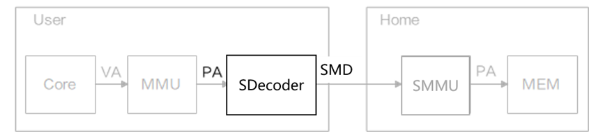

图4：SDecoder功能：User侧的PA到SMD（包含FA）的地址转换

#### 两级代换表结构

SDecoder采用两级代换表结构，通过基地址和访问地址逐级索引，最终获得代换表的表项。

SDecoder一级表（L1 SDecoder Table，SDT_L1）本身的基地址（PA[47:4]）需由软件填写，硬件在代换过程中使用。SDT_L1表共4096个条目（注：[46:35]共12位，对应4K个条目；即128TB/32GB=4K个），每个条目长度设置为16B，因此SDT_L1表的存储开销为64KB。

SDecoder二级表（L2 SDecoder Table，SDT_L2）本身的基地址（L2_BASE[63:3]）可从一级表中获得。每个一级表条目所对应的SDT_L2表共32个条目（注：[34:30]共5位，对应32个条目；即32GB/1GB=32个），每个条目长度设置为8B，因此每个一级表条目所对应的SDT_L2表的存储开销为256B，所有SDT_L2表的存储开销共计为4K\*256B=1MB。

表1：SDecoder一级表（SDT_L1）条目内容

| 域名            | 范围（*共102位*） | 描述                                                                          |
| --------------- | ----------------- | ----------------------------------------------------------------------------- |
| L2_BASE[63:3]   | *61位*            | 二级表基地址                                                                  |
| EID[10:0]       | *11位*            | Entity标识，消息路由使用                                                      |
| S_PFN[47:30]    | *18位*            | 网络地址FA的基址（以1GB对界）                                                 |
| SEG_LEN[34:30]  | [11:7]            | 段长                                                                          |
| SEG_BASE[34:30] | [6:2]             | 段的基地址（以1GB对界）                                                       |
| Type            | [1]               | 类型位：为1表示该32G空间范围内有且仅有1个段表；为0表示该32G空间范围内均为页表 |
| Valid           | [0]               | 有效位                                                                        |

表2：SDecoder二级表（SDT_L2）条目内容

| 域           | 范围（*共30位*） | 描述                          |
| ------------ | ---------------- | ----------------------------- |
| EID[10:0]    | *11位*           | Entity标识，消息路由使用      |
| S_PFN[47:30] | *18位*           | 网络地址FA的基址（以1GB对界） |
| Valid        | [0]              | 有效位                        |

#### 一级代换表SDT_L1查询

进行PA→SMD的地址转换时，首先查询SDecoder一级表SDT_L1，判断是否为段式代换。如果该32G空间范围内存在段式代换、且该PA落在所对应的段地址范围内，则完成代换；否则，需要继续查询SDecoder二级表SDT_L2。

SDT_L1条目中主要存储段基址SEG_Base[34:30]（段必须按照1GB对界）、段长度SEG_LEN[34:30]（以1GB为单位，不超过32GB）、网络地址的基址S_PFN[47:30]，代换过程如下：

a. 以U_PA[47:35]为索引访问SDT_L1代换表，读取对应条目；
b. 读条目内容（SEG_Base[34:30]/SEG_LEN[34:30]）；
c. 判断U_PA是否落入段表范围内。方式如下：
① 计算偏移：U_PA_Offset[34:30] = U_PA[34:30] – SEG_BASE[34:30]；
② 如果U_PA_Offset是正数，且U_PA_Offset小于SEG_LEN，则说明可以按照段式代换，跳至步骤d。否则，按照页式代换，跳转至查询SDecoder第二级代换表SDT_L2。
d. **段式代换得到网络地址FA的基址，为：**

**FA[47:30]={S_PFN[47:30] + {13’h0, U_PA_Offset[34:30]} },**

**拼上页内偏移后，获得最终网络地址FA为：**

**FA[47:0]={ {S_PFN[47:30] + {13’h0, U_PA_Offset[34:30]} }, U_PA[29:0] }**

#### 二级代换表SDT_L2查询

如果该32G空间范围内不存在段式代换，或该PA未落在所对应的段地址范围内，需要继续查询SDecoder二级表SDT_L2，进行页式代换。

采用页式代换时，SDT_L1代换表条目中存储二级表SDT_L2的基址，代换过程如下：

a. 如前所述，以U_PA[47:35]为索引访问一级表SDT_L1条目，得到二级表基地址L2_BASE[63:3]；
b. 以U_PA[34:30]为索引访问二级表SDT_L2条目；
① 从命中条目中读出网络地址FA的基址S_PFN[47:30]；
② 拼上页内偏移后，获得最终网络地址FA为：

**FA[47:0]={ S_PFN[47:30], U_PA[29:0] }**

#### 两级代换流程示意图

SDecoder两级代换流程的示意图如下：

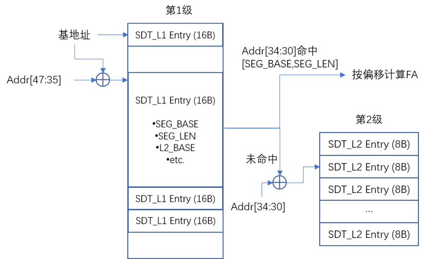

图4：SDecoder两级代换流程示意图

#### SDecoder代换快表（SDTLB）

硬件设置SDecoder的代换快表（SDecoder TLB，SDTLB）缓存结构，存储PA→SMD的映射关系。SDTLB采用全相联的组织结构，共设置128个条目（可覆盖128GB至4TB容量范围）。

表3：SDecoder代换快表（SDTLB）结构

| 域名 |              | 范围（*共49位*） | 含义描述                                  |
| ---- | ------------ | ---------------- | ----------------------------------------- |
| Tag  | U_PA[47:30]  | [18:1]           | 远端内存的本地物理地址（以1GB为单位）     |
|      | Valid        | [0]              | 有效位                                    |
| Data | EID[10:0]    | *11位*           | Entity标识，消息路由使用                  |
|      | S_PFN[47:30] | *18位*           | 网络地址FA的基址（以1GB对界）             |
|      | Grn          | [0]              | 粒度位：为1表示32GB粒度；为0表示1GB粒度。 |

### SMMU设计

SMMU作为576超节点系统中的内存访问控制组件，在Home侧提供内存资源的地址映射（以及访问权限校验）。

SMMU代换的完整流程包含四个步骤：配置查找、上下文查找、地址转换、权限校验。其中，EID用于索引配置查找表（用EID找上下文表的PA），Token ID用于索引上下文查找表（用TokenID找转换表和权限表的基地址；*TokenID需再考虑*），FA用于索引地址转换表和权限校验表（用代换表和权限表，完成代换和检查）。

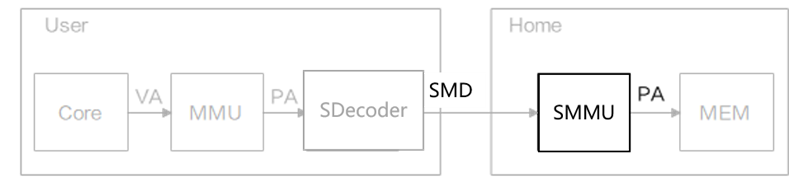

图5：UMMU功能：Home侧的FA到PA的地址转换和权限校验

在完成EID索引和Token ID索引查找后（*TokenID需再考虑*），可通过查找SMMU地址代换表，最终完成FA→PA的地址转换。

#### 三级代换表结构

SMMU地址代换表（SMMU Table，SMMT）采用三级页式管理，类似CoreX核心MMU实现方式，通过逐级索引获得页表项。

SMMU页表分为三级：一级页表目录PGD、二级页表目录PUD、三级页表PTE。PGD/PUD/PTE的页表条目内容结构，与CoreX核心的GPT页表设置基本一致。一级页表目录PGD本身的基地址（PTBR[47:13]）需由软件填写，硬件在代换过程中使用。

表4：SMMU一级页表目录PGD条目内容

| 域名       | 范围（*共102位*） | 描述              |
| ---------- | ----------------- | ----------------- |
| PFN[47:13] | [58:24]           | 物理地址页面号    |
| ……         |                   | ……                |
| ACCESSED   |                   | （软件使用）      |
| ……         |                   | ……                |
| PCD        |                   | 不可Cache访问空间 |
| LastFlag   |                   | 最后一级标志      |
| ContFlag   |                   | 条目连续标志      |
| FOR        |                   | 读故障位          |
| ……         |                   | ……                |
| Valid      | [0]               | 有效位            |

表5：SMMU二级页表目录PUD条目内容（略）

表6：SMMU三级页表目录PTE条目内容（略）

#### 三级代换表查询

从FA[47:0]到PA[47:0]的代换流程如下：

a. 一级页表条目的物理地址PGDIndex[47:0] = { PTBR[47:13], 13b’0} + { 40b’0, FA[47:43], 3b’0};
b. 访问Home侧本地存储空间，读出PGDIndex[47:0]地址中存放的一级页表条目，进行有效位判断后，将其中的PFN作为二级页表起始物理地址PUDBase[47:13]；
c. 二级页表条目的物理地址PUDIndex[47:0] = { PUDBase[47:13], 13b’0} + { 35b’0, FA[42:33], 3b’0};
d. 访问Home侧本地存储空间，读出PUDIndex[47:0]地址中存放的二级页表条目，进行有效位判断后，将其中的PFN作为三级页表起始物理地址PTEBase[47:13]；
e. 三级页表条目的物理地址PTEIndex[47:0] = { PTEDBase[47:13], 13b’0} + { 35b’0, FA[32:23], 3b’0};
f. 访问Home侧本地存储空间，读出PTEIndex[47:0]地址中存放的三级页表条目，进行有效位判断后，再进行权限检查，若无异常产生，则将其中的PFN[47:23]作为FA对应的H_PA[47:23]，得到物理地址**H_PA[47:0] = { PFN[47:23], FA[22:0]}**，结束代换流程。

*注：如有更细粒度的管理需求，可以考虑增加其他粒度（8GB/4GB/2GB等）支持。*

#### 三级代换流程示意图

SMMU三级代换流程的示意图如下（旧图；待修改）：

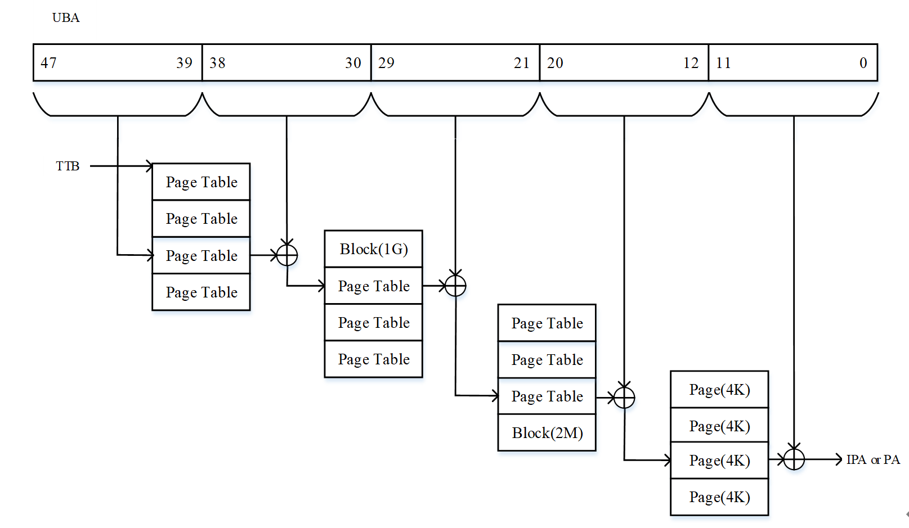

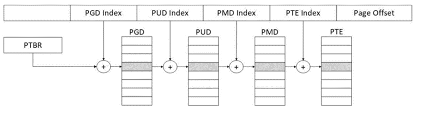

图6：SMMU三级代换流程示意图（旧图；待修改）

#### SMMU代换快表（SMTLB）

硬件设置SMMU的代换快表（SMMU TLB，SMTLB）缓存结构，存储FA→PA的映射关系。SMTLB采用全相联的组织结构，共设置1024个条目（可覆盖8GB至512GB容量范围）。

表7：SMMU代换快表（SMTLB）结构

| 域名 |             | 范围（*共53位*） | 含义描述                                   |
| ---- | ----------- | ---------------- | ------------------------------------------ |
| Tag  | FA[47:23]   | [26:2]           | 网络地址FA（以8MB对界）                    |
|      | Grn         | [1]              | 粒度位：为1表示512MB粒度；为0表示8MB粒度。 |
|      | Valid       | [0]              | 有效位                                     |
| Data | H_PA[47:23] | *25位*           | Home侧导出内存的本地物理地址               |
|      | Grn         | [0]              | 粒度位：为1表示512MB粒度；为0表示8MB粒度。 |

## 附1：内存访问流程示例

假如xPU A借用xPU B的64MB的内存进行读写（xPU A/B均可以为C1或A3），会有以下步骤：

（1）xPU B调用注册接口urma_register_seg，pin住64MB内存防止被OS换出；

（2）xPU B将这64MB内存对应的UBMD发送到xPU A上，xPU A可将该内存段import到本地（URMA），或者将UBMD写入UB Decoder中（LD/ST），并建立起本地物理地址到远端UBMD的映射；

（3）xPU A发起Load操作，本地MMU将VA翻译成PA，UB Decoder根据PA查页表，获取到UBMD，随后组装成一个Read的事务包发送到xPU B；

（4）xPU B的UMMU接收到该报文，根据UBMD中的UBA进行地址转换，并根据PA到指定的内存地址读取相应数据。

## 附2：UB内存管理（UBMM）软件架构

UBMM软件架构，如下图所示（《灵衢®使能操作系统参考设计》第4.2节）：

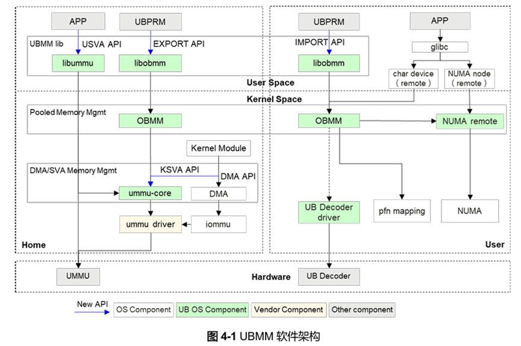

其中：

- ummu driver：和UMMU硬件交互的驱动，实现ummu-core定义的底层能力，保证Home侧的内存通路。
- UB Decoder driver：用来配置UB Decoder硬件，保证User侧的Load/Store通路。

注：ummu driver 和 UB Decoder driver 分别用于配置Home侧和User侧的数据通路，同时Home和User之间的链路需要UBFM配置正确的路由信息才可确保联通。

Home侧有四种接口，可以将内存资源注册到UMMU；User侧有异步/同步两种方式，可以使用已注册的内存资源：

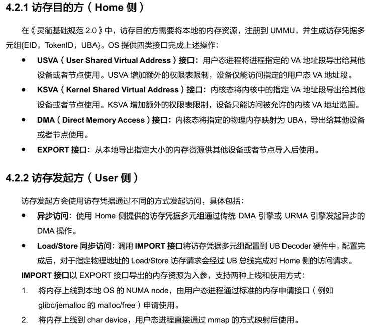

内存借用流程需要由UBPRM进行决策，得到Home侧的EID信息、User侧的EID信息以及需要借用的内存大小。如下流程为决策之后的使用流程：

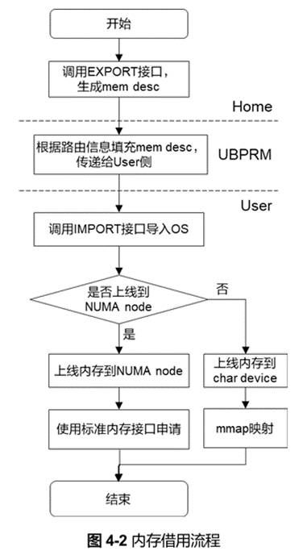

1) Home 侧：调用obmm_export 接口，指定EID和内存大小信息，生成mem desc中的UBA和TokenID 信息，{dest EID，UBA，TokenID}描述 Home侧出借内存信息。
2) UBPRM：填充mem desc中的{src EID，scna，dcna}以及不同vendor实现的私有信息。
3) User 侧：调用obmm_import接口将mem desc导入到OS中。
4) User 侧：如果选择上线到NUMA node，则可使用标准的内存接口申请与使用内存（如malloc，mbind，numa_alloc_onnode，move_pages 等）。
5) User 侧：如果选择上线到char device，则调用mmap接口映射后使用。

## 修订记录

外网略。
