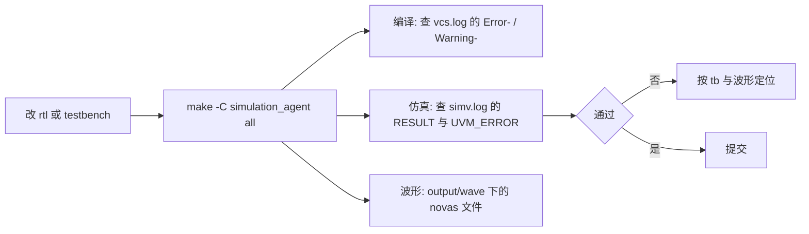

# simulation: 仿真流程

| 项目 | 内容 |
| --- | --- |
| 文档名称 | simulation/README (仿真流程) |
| 日期 | 2026-10-06 |
| 范围 | 仿真入口, 变量与目标, 判定口径, 产物与波形 |

## 入口

仿真入口有两套, 用法完全一样, 区别只在运行目录:

| 入口 | 给谁用 | 说明 |
| --- | --- | --- |
| `simulation/` | 人 | 日常人工仿真 |
| `simulation_agent/` | agent | `Makefile` 与 `base` 是指向 `simulation/` 的软链, 只有 `run_*_testcase/` 独立, 避免与人工仿真互相覆盖日志与波形 |

下文示例统一用 `simulation_agent/`, 换成 `simulation/` 即人工仿真的命令. 改动 `rtl/` 后, 在
**仓库根目录**跑一遍编译与冒烟:

```bash
make -C simulation_agent all
```

## 变量与目标

| 变量 | 默认 | 作用 |
| --- | --- | --- |
| `TB_TOP` | `tb_sdtlb` | 仿真的顶层. 单元自检用 `tb_sdtlb` / `tb_sdecoder` / `tb_sdptw` / `tb_sdior` / `tb_syn_fifo`; UVM 冒烟的 `tb_top` 已挪到 `backup/` |
| `TESTNAME` | `TestBase` | UVM 的 `+UVM_TESTNAME`;单元自检用不到, 只参与运行目录命名 |
| `DUMP_WAVE` | `1` | 1 = 出 FSDB 波形 (目前 tb 体量小, 默认出);0 = 不出 |

常用目标: `all` (编译 + 仿真 + 收尾清软链), `vcs` (只编译 / elaborate), `simv_only` (只跑已编译
好的 `simv`), `verdi` (开波形), `clean` (清软链).

## 判定与产物



- **判定看日志, 不看退出码**: VCS 即使碰到 `$fatal`, 退出码仍是 0. 单元自检看 `log/simv.log` 里的
  `RESULT: PASS|FAIL` 行;UVM 冒烟看 `UVM_ERROR` / `UVM_FATAL` 计数;编译阶段看 `log/vcs.log` 里
  有没有 `Error-[` / `Warning-[`
- **断言结果不在 `RESULT` 里**: 单元自检打印的 `RESULT` 只统计 tb 自己的检查项, 断言失败另打
  `[ERROR] [ASSERT]: Assertion '...' failed` 到同一份日志, 不影响 `RESULT` —— 判日志时两种都要看
- **产物与清理**: 运行目录是 `<入口>/run_single_testcase/<TB_TOP>.<TESTNAME>/` (回归用
  `run_regress_testcase/`), 已 gitignore, 不入库. `all` / `clean` 只删目录里的软链, **日志与波形
  会留着** —— 换 `DUMP_WAVE` 或换测试重跑前先删运行目录, 否则会看到上一轮的旧波形 / 旧日志;
  agent 只清理自己 `simulation_agent/` 下的运行目录, 不动 `simulation/` 的
- **波形**: 落在运行目录的 `output/wave/` 下 (`novas.vf` + `novas_000.fsdb`), 用
  `make -C simulation_agent verdi` 打开. 回归由 [script/regression_run.py](../script/regression_run.py)
  驱动, 那里显式 `DUMP_WAVE=0` (回归不存波形), 排查问题按单测跑并开波形
- **写 tb 的时序口径**: SDecoder 是单时钟域时序模块, tb 内不出现 `#NUM` 延时 —— 时钟与复位由
  [testbench/top/crg.sv](../testbench/top/crg.sv) 生成, 同步等时钟块事件 (如 `@(sdtlb_if.drv)`)
  或时钟沿, 组合量的稳定靠"隔一个事件"而不是延时. 波形 dump 用的 `$fsdbDumpvars(..., "+all")`
  不受此限
